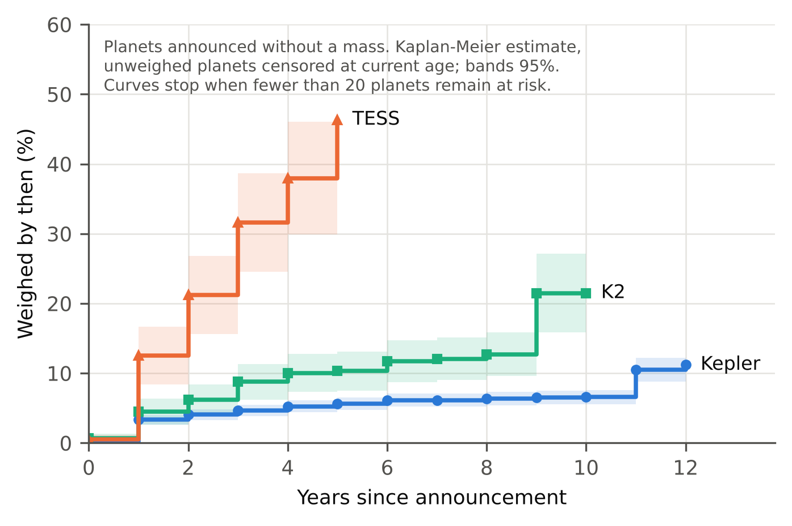
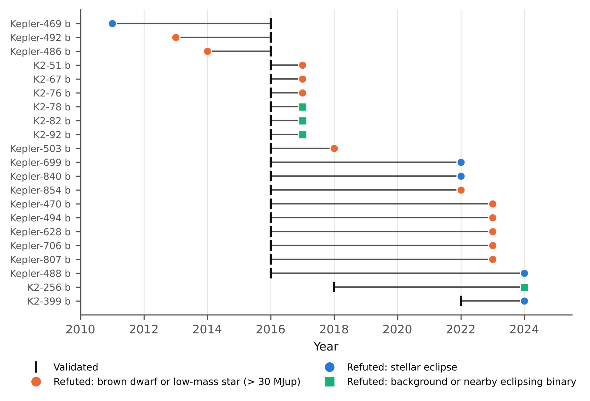

**Peter Kalafatis**\
Independent researcher, x9m8.com, New York, NY, USA\
Correspondence: x9m8x7@gmail.com

**Preprint, not peer reviewed.** Target journal: *Publications of the Astronomical Society of the Pacific*.

**Keywords:** exoplanets; statistical validation; false positives; Kepler; K2; TESS; philosophy of science; confirmation

**Social media summary (≤120 characters):** Of 3,028 exoplanets validated by statistics, 21 were overturned. Most were brown dwarfs or small stars.

## Abstract

Most known transiting exoplanets were never weighed. They entered the catalogue through statistical validation, an argument that every non-planetary explanation of the transit is improbable. Using the NASA Exoplanet Archive and the validation papers' own tables, I follow 3,028 planets credited to 24 validation papers from Kepler, K2 and TESS. Twenty-one were later overturned (0.69%; 95% CI 0.43–1.06%). Against each paper's own false-positive probabilities, overturns run well above expectation: 13 observed against 1.55 expected for the largest batch (Morton et al. 2016; Poisson *p* = 1.1 × 10⁻⁸), and 20 against 2.69 across six papers. The excess is not spread evenly. All 13 Kepler overturns are larger than 6 Earth radii, and 12 of the 21 objects proved to be brown dwarfs or low-mass stars above the archive's 30 Jupiter-mass ceiling. Remove those, along with three refuted before validation, and the largest batch agrees with its stated probabilities (3 against 1.55; *p* = 0.20). Validation therefore looks well calibrated against the alternatives it models and blind to one it does not. Meanwhile 64% of transiting planets have never had a mass measured. I discuss what this means for the difference between validating and confirming a planet.

## 1. Introduction

Kepler changed what it means to discover a planet. Before 2014 a transiting planet was usually announced with a radial-velocity mass, which settled that the transiting body had planetary mass. After 2014 the archive filled with planets that had no mass at all. Their status rested on a probability: the chance that something other than a planet produced the transit signal, given what was known about the star, its neighbours, the light curve and the population of eclipsing binaries in the galaxy. When that probability fell below a threshold, usually 1%, the candidate was called a validated planet and entered the catalogue alongside planets that had been weighed.

The approach has a clear rationale. Most Kepler host stars are too faint for precise radial velocities, and most small planets produce velocity signals too small to measure with existing instruments. Without statistical validation the planet count would have stayed at a few hundred, and population studies of small planets would have had little to work with. Morton and Johnson (2011) showed that most Kepler candidates should have low false-positive probabilities, and Morton (2012) built the framework that, as the public package vespa, was used to validate 1,284 Kepler planets in a single paper (Morton et al. 2016). Later work brought the same logic to K2 and TESS, added new tools such as TRICERATOPS (Giacalone et al. 2021), and replaced the explicit scenario model with machine learning (Armstrong et al. 2021; Valizadegan et al. 2022).

A validated planet is a forecast, and forecasts can be scored. A false-positive probability of 0.003 says that, among many candidates like this one, about three in a thousand are not planets. Sum those probabilities across a paper and you get the number of non-planets the paper expects to have let through. Years later some of those planets have been weighed, some re-observed at higher resolution, and some quietly removed from the archive. Comparing the expected count with what actually happened is a direct test of the method.

That test has not, as far as I can find, been run across validation papers. Specific planets have been challenged: Burke et al. (2019) found that Kepler-452 b and Kepler-186 f no longer reach the 99% confidence that validation requires once the Kepler pipeline's false alarms are modelled, and Mullally et al. (2018) argued that Earth-like Kepler planets near the detection limit should not be confirmed without an independent detection. Collier et al. (2026) asked how many TESS validations would fail without high-resolution imaging. Lehmann and Vanderburg (2024) matched ephemerides across all K2 candidates and identified 43 false positives caused by contamination from nearby stars. None of these counts overturns among validated planets against what the validating papers predicted. I am not aware of a study that does.

This paper does that count. It asks four questions. How much of the current catalogue rests on validation rather than a measured mass? How many validated planets have been overturned, and by which papers? Do the overturns match the probabilities the papers assigned? And where they do not, what went wrong? The answer to the last question turns out to be the most informative, and Section 5 places it in the philosophy-of-science literature on confirmation, unconceived alternatives and inductive risk.

## 2. Validation and confirmation

The archive treats validated and confirmed planets the same way, but the two words name different arguments.

**Confirmation** is direct. A mass measurement from radial velocities or transit-timing variations shows that the transiting object has planetary mass. The inference runs from a measured property of the object to its classification.

**Validation** is eliminative. It enumerates the ways a transit-like signal can arise without a planet around the target star: an eclipsing binary that is the target itself, an eclipsing binary in the background or foreground blended into the photometric aperture, an eclipsing binary bound to the target in a hierarchical triple. It then estimates the probability of each, given the light-curve shape, stellar properties, imaging constraints and Galactic population models, and compares their total with the probability of a planet. If the planet hypothesis dominates by a large enough margin, the candidate is validated.

The two arguments fail in different ways. A confirmation can be wrong if the measurement is wrong. A validation can be wrong for that reason too, but it can also be wrong because the list of alternatives was incomplete. The probability it reports is conditional on that list. An object that mimics a planet and is not represented among the alternatives cannot lower the planet probability, however common it is.

This distinction is old in philosophy of science. Eliminative induction depends on an exhaustive hypothesis space, and Stanford (2006) argued that the history of science is full of alternatives scientists did not conceive at the time. The exoplanet case lets the worry be tested with numbers. If validation fails mainly through bad luck within a complete hypothesis space, overturns should track the stated probabilities. If it fails mainly through gaps in the space, overturns should cluster in some region of parameter space and exceed the stated probabilities there.

## 3. Data and methods

### 3.1 Sources

All data are public. I queried the NASA Exoplanet Archive (Akeson et al. 2013; Christiansen et al. 2025) through its TAP service on 15 October 2026. The query covered the composite planet table (pscomppars; 6,445 planets), the planetary-systems table of all published solutions (ps; 40,336 rows), the Kepler cumulative KOI table, the K2 planets-and-candidates table (k2pandc), the Kepler and K2 name-alias tables and the TESS Objects of Interest table. I took the validation papers' own candidate tables from VizieR: Morton et al. (2016), Crossfield et al. (2016), Montet et al. (2015), Mayo et al. (2018), and Livingston et al. (2018a, 2018b). The queries, the raw files and the code that rebuilds every number in this paper are in the archive listed under Research transparency.

### 3.2 Planets and their status

A planet is *weighed at discovery* if the archive solution from its discovery publication reports a measured mass (archive flag `pl_bmassprov` = "Mass", which excludes minimum masses, *M* sin *i*). It is *weighed later* if a solution from any other publication reports a measured mass. Fifteen of the 4,781 current transiting planets, mostly early ground-based discoveries such as WASP-19 b and HAT-P-7 b, have no archive solution from their discovery paper and are therefore counted as announced without a mass; none belongs to a validation batch. *Overturned* planets are those that once carried a planet name and were later removed. For K2 these are entries whose k2pandc disposition is REFUTED (8 planets). For Kepler they are named KOIs that no longer appear among the archive's planets and that appear in a validation list I could check, which in practice means Morton et al. (2016) (13 planets). One further named KOI absent from the composite table, Kepler-1658 b, is not on that list and, as far as I can find, has not been refuted; I treat its absence as an artefact of naming in the snapshot. Every planet on the six validation lists used below was matched to the archive.

For each overturned planet I recorded what it turned out to be and the publication that showed it (Table 2). I sorted the causes into three classes. *Mass above the archive ceiling* covers brown dwarfs and low-mass stars whose measured mass exceeds the archive's inclusion limit of 30 Jupiter masses (NASA Exoplanet Archive 2024). *Stellar eclipse* covers hierarchical eclipsing systems, self-luminous companions, and objects shown to be too large to be planets, where no measured mass places them above the ceiling. *Background or nearby eclipsing binary* covers signals traced to another star.

### 3.3 Track record by paper

The archive credits each planet's discovery to one publication, identified by its bibcode. I selected 24 publications that the archive credits with Kepler, K2 or TESS planets announced without a mass and whose validation method I could confirm from the paper (Table 1). The list covers the bulk-validation papers of each mission and every paper that validated an overturned planet, but it is not exhaustive. Planets that the credited paper itself weighed are excluded. One credit needs correcting. The archive credits K2-51 b, K2-67 b and K2-76 b, all later overturned, to Vanderburg et al. (2016), a candidate catalogue that validated nothing; Shporer et al. (2017) identify the validating paper as Crossfield et al. (2016), and I credit them there.

For each paper I counted planets credited, overturned and weighed later. A planet is *followed* if it was overturned or weighed later; this is the subset where an error could have been found by a direct measurement. Rates carry two-sided 95% Clopper–Pearson intervals. Batches with no overturns get one-sided 95% upper bounds.

### 3.4 Calibration

A paper's false-positive probabilities (FPPs) imply an expected number of non-planets among the planets it validated: the sum of the FPPs. I compared this with the observed number of overturns using the exact Poisson upper tail, *P*(*X* ≥ observed | mean = expected). Six papers publish per-planet FPPs in machine-readable form. For each I used every planet the paper lists as validated, with its own FPP column (for Livingston et al. 2018b, the FPP of their table 2). FPPs given as upper limits were taken at the limit, which biases the expected count upward and the test toward agreement. These lists include some planets that other teams had already confirmed, which can only add planets that are unlikely to be overturned and so makes the test more conservative. The pooled analysis counts each planet once, under the earliest of the six papers that lists it.

The overturn count is a lower bound on the true number of non-planets, because most validated planets have never been checked. The test is therefore conservative in one direction: an excess of overturns over expectation cannot be explained by planets nobody has looked at.

### 3.5 Sensitivity analyses

Four checks probe the calibration result. S1 removes the three planets refuted before the validation paper appeared. S2 removes overturns that rest only on a mass above the 30 Jupiter-mass ceiling. S3 brackets the non-planet fraction among Morton et al.'s giant-sized planets: a lower bound that treats every unchecked giant as a planet, and an estimate from followed giants alone. S4 gives upper bounds for groups of batches with no overturns.

### 3.6 Follow-up over time

To ask how quickly validated planets are checked, I estimated the cumulative probability that a planet announced without a mass receives one, as a function of years since its announcement. I used the Kaplan–Meier estimator, with planets not yet weighed censored at their current age, and Greenwood 95% intervals. Curves stop when fewer than 20 planets remain at risk.

### 3.7 TESS

TESS validations are recent and few have been overturned anywhere. As a weak check I matched the 405 TESS planets announced without a mass to the TOI table by TIC identifier and, where the TOI period is available, by period (within 1%) and tabulated their current TFOPWG dispositions.

### 3.8 Use of AI

Claude (Anthropic; model claude-opus-5-5) was used in October 2026 to write the data-retrieval and analysis code, draw the figures, draft the text, and run two independent audits, one of every number against the result files and one of every cited claim against its source. I chose the question, reviewed every step and every number, and take full responsibility for the content.

## 4. Results

### 4.1 Most transiting planets have never been weighed

Of 4,781 transiting planets in the archive, 3,434 were announced without a measured mass. Since then, 360 of these have been weighed. That leaves 3,074 transiting planets with no mass from any publication: 64.3% of transiting planets and 47.7% of all 6,445 known planets. Kepler accounts for most of them (2,341 of its 2,762 transiting planets have never been weighed), followed by K2 (401 of 549) and TESS (327 of 1,004). Figure 1 shows how two years, 2014 and 2016, changed the composition of the catalogue.

### 4.2 Track record

Across the 24 batches, 3,028 credited planets have produced 21 overturns, a rate of 0.69% (95% CI 0.43–1.06%). Of the 3,028, 192 have since been weighed, so 213 have been followed. Among followed planets the overturn rate is 9.9% (6.2–14.7%), but this figure mixes the base rate with the choice of which planets to follow up and should not be read as a failure rate.

By mission, Kepler batches account for 2,418 planets and 13 overturns, K2 for 378 and 8, and TESS for 232 and none. Every Kepler overturn comes from one paper, Morton et al. (2016), though this partly reflects how Kepler overturns were identified (Section 3.2). Six of the eight K2 overturns come from Crossfield et al. (2016), and one each from Livingston et al. (2018a) and Christiansen et al. (2022). Table 1 lists every batch.

The 716 planets validated by Rowe et al. (2014) through multiplicity are among the best-followed batches: 119 (17%) have since been weighed, mostly through transit-timing variations in multi-planet systems, and none have been overturned. The one-sided 95% upper bound on the overturn rate among followed planets is 2.5%. The 420 Kepler planets validated by machine learning have been followed so rarely (4 planets) that the corresponding bound is 53%, which says nothing useful.

### 4.3 Calibration

Table 1 and Figure 2 compare observed overturns with the number each paper's FPPs predict. Three of six papers show more overturns than expected.

Morton et al. (2016) list 1,284 validated planets with summed FPP 1.55; 13 were overturned (*p* = 1.1 × 10⁻⁸). Crossfield et al. (2016) list 106 K2 planets as validated, some of them previously confirmed by others, with summed FPP 1.08; 6 were overturned (*p* = 0.0009). Livingston et al. (2018a) list 42 with summed FPP 0.0099; 1 was overturned (*p* = 0.0098), but a single event makes that comparison fragile. The three remaining papers, Livingston et al. (2018b), Mayo et al. (2018) and Montet et al. (2015), expected 0.02–0.05 overturns each and recorded none. Pooled across the 1,563 distinct planets in these six lists, 20 were overturned against 2.69 expected (*p* = 1.3 × 10⁻¹¹). Track-record counts in Table 1 differ slightly from these lists because they follow the archive's credit: for example, the archive credits two of Morton et al.'s 1,284 planets to a later paper.

The excess cannot come from unchecked planets, which can only add overturns. It is also not an artefact of upper-limit FPPs. Morton et al. (2016) and Crossfield et al. (2016), which supply all but one overturn, report no FPPs as upper limits.

### 4.4 Where the failures are

The overturns are not spread across the parameter space. They sit almost entirely among the largest planets. Figure 3 splits Morton et al.'s planets by their published radius. Below 6 Earth radii the paper validated 1,209 planets, expected 1.47 to be false, and none have been overturned. Above 6 Earth radii it validated 75 planets and expected 0.079 to be false; 13 have been overturned. The overturned objects range from 6.27 to 17.9 Earth radii.

Those 13 give a lower bound on the non-planet fraction among Morton et al.'s giants of 17.3% (95% CI 9.6–27.8%). Only 20 of the 75 giants have been followed at all. Among them, 13 were overturned, which suggests a fraction of 65% (41–85%) if the followed giants were representative. They probably are not, because suspicious objects attract follow-up, so the true fraction lies somewhere between these figures. Either way it exceeds the paper's own expectation for its giants, about 0.1%, by two orders of magnitude.

The overturns also share a cause (Table 2; Figure 5). Twelve of the 21 objects had measured masses above the archive's 30 Jupiter-mass ceiling. Seven were stars between about 78 and 103 Jupiter masses, at or above the hydrogen-burning limit, and two were brown dwarfs of about 37 and 40 Jupiter masses. The remaining three were K2-51 b and K2-67 b, stars of about 0.15 and 0.16 solar masses (Shporer et al. 2017), and Kepler-854 b, whose non-planetary mass came from ellipsoidal variation (Niraula et al. 2022). Five more were stellar eclipses: hierarchical triples, a self-luminous companion, and two objects whose inferred radius was too large for a planet at their irradiation (Niraula et al. 2022). Only four were background or nearby eclipsing binaries, the kind of false positive that validation is chiefly designed to exclude. One caveat on classification: Li and Shporer (2024) describe Kepler-488 b as *likely* a red dwarf, and I count it among stellar eclipses on that basis.

The sensitivity analyses show what drives the excess (Table 3). Three overturns were published before the validation paper: KOI-126 (Kepler-469 b), shown to be a hierarchical triple by Carter et al. (2011), and two KOIs weighed by Díaz et al. (2013, 2014). Removing them leaves Morton et al. (2016) with 10 overturns against 1.55 (*p* = 5.5 × 10⁻⁶). Removing overturns that rest only on the mass ceiling leaves 4 (*p* = 0.072). Removing both leaves 3, consistent with expectation (*p* = 0.20). For Crossfield et al. (2016), dropping the ceiling cases leaves the three background binaries, also consistent (3 against 1.08; *p* = 0.096).

Within the scenarios validation models, then, the record matches the stated probabilities. Outside them, it does not. Most of the excess comes from compact objects of planetary size but non-planetary mass: brown dwarfs and the smallest stars, which are about the radius of Jupiter and can produce the same transit.

### 4.5 Who gets checked, and when

Most validated planets are never revisited. Kaplan–Meier estimates (Figure 4) put the probability that a Kepler planet announced without a mass has been weighed within five years at 5.6% (4.7–6.5%), against 10.3% (7.5–13.1%) for K2 and 46.3% (35.9–56.7%) for TESS. TESS's brighter host stars make radial-velocity follow-up feasible in a way it never was for most Kepler stars. Both older missions show a late step in the curve. For Kepler it comes mostly from a single photodynamical catalogue (Ofir et al. 2025), which gave first masses for 43 planets announced without one, 28 of them Rowe et al. (2014) planets about eleven years after announcement. For K2 it comes mostly from a radial-velocity survey (Howard et al. 2025). Follow-up arrives in campaigns rather than as a steady flow.

The time from validation to overturn has a median of 2 years and ranges from −5 to 8 years (Figure 5). The negative values belong to the three objects already refuted when Morton et al. (2016) validated them. Their survival suggests that validation at that scale did not systematically cross-check the literature on individual KOIs. The record does not show when or how this was handled in later work.

### 4.6 TESS

Of the 405 TESS planets announced without a mass, 354 matched a TOI. None carries a false-positive or false-alarm disposition; 264 are confirmed planets, 86 remain planet candidates, 2 are ambiguous and 2 are known planets. This is weak evidence. TOI dispositions are often updated in light of validation papers, so they are not independent of the claim being tested. Among the 23 TESS validations that have been followed, none was overturned, and the one-sided 95% upper bound on the overturn rate among followed planets is 12%.

## 5. Discussion

### 5.1 What the numbers say

Statistical validation has a good record in the regime it was built for. For small planets and for the false-positive scenarios that vespa and its successors model, no overturns have been recorded beyond what the papers predicted. This record is weak, though: so few small validated planets have been checked that a much higher error rate could not yet be ruled out (Section 5.4). In its weakest regime the record is poor. Among giant-sized Kepler planets validated in bulk, at least one in six was not a planet, most of them brown dwarfs or stars, and among those followed up the share was plausibly more than half.

That pattern matches long-standing warnings. Santerne et al. (2012) measured a false-positive rate of 34.8 ± 6.5% among Kepler giant candidates, and Santerne et al. (2016) measured 54.6 ± 6.5% for giant candidates with periods below 400 days. Fressin et al. (2013) estimated the overall Kepler false-positive rate at 9.4%, highest for giants at 17.7%. The new element here is the comparison with the validating papers' own numbers. The giant-planet problem was known at the level of candidates. This study shows it was not absorbed into the per-planet probabilities that put those giants in the catalogue.

### 5.2 Validation, confirmation and unconceived alternatives

An eliminative argument is only as strong as its list of alternatives. The false-positive probability is conditional on the scenario set and on the priors that set uses. When a mimic is missing, or modelled with too little weight, the stated probability can be both precise and wrong, and nothing in the light curve will warn the user.

The overturns fit that description. Brown dwarfs and stars near the hydrogen-burning limit are compact enough to match the radius of a giant planet. A transit by one is a genuine transit by a genuine companion, so it can look like a planet in every respect the photometry measures. Whether a validation framework treats such companions as an alternative, and with what prior frequency, is a modelling choice. It is not decided by the data. The archive's 30 Jupiter-mass ceiling makes the boundary sharper: it sits well above the 13 Jupiter-mass deuterium-burning limit in the IAU working definition of a planet (Lecavelier des Etangs & Lissauer 2022), so some objects that the IAU would call brown dwarfs stay in the archive as planets. The overturned objects in this study fall above both lines.

Stanford (2006) used the history of theory change to argue that scientists routinely fail to conceive of alternatives that later prove correct. The exoplanet record supports a narrower, testable version of the point. Here the alternative was conceived, as the Santerne et al. papers show, but the probabilities attached to individual planets did not reflect it. The failure sits between community knowledge and the hypothesis space written into a pipeline. That is a different problem from Stanford's, and arguably easier to fix.

Mayo's (2018) account of severe testing gives a second way to read the result. A test is severe for a hypothesis if it would probably have failed were the hypothesis false. For small planets against the modelled binary scenarios, validation is a severe test, and the record so far bears that out. For a giant planet against a brown-dwarf alternative, a transit light curve is not severe, because the brown dwarf would produce the same light curve. Calling both cases "validated" erases a difference in severity that the data make visible.

### 5.3 Inductive risk and the database as an epistemic object

The threshold for validation, an FPP below 1% (or 0.1% in Mayo et al. 2018), is a decision about acceptable error, the kind of choice Douglas (2000) called inductive risk. Once a planet enters the archive, though, the threshold disappears from view. The composite table gives a validated planet and a weighed one the same status, and downstream users, from occurrence-rate studies to target lists for atmospheric spectroscopy, inherit the inductive risk without seeing it. Leonelli (2016) argued that databases are not neutral containers but shape what their users take to be known. The exoplanet archive is a clear case. Its own documentation separates discovery methods, yet nothing in the composite table warns users that 64% of transiting planets have never been weighed, or that the 13 overturns in its largest validated batch are giants.

### 5.4 Practical consequences

Three changes would make validated planets easier to use. First, catalogues could carry the validating FPP and the scenario set as fields, so users can filter by severity rather than treat all planets alike. Second, validation of giant-sized candidates could require either a mass constraint or an explicit brown-dwarf and low-mass-star scenario with a prior drawn from measured companion statistics. The data here suggest that the bulk validation of giants without such constraints accounts for most observed overturns. Third, follow-up of validated small planets is too sparse to test their calibration. With 9 of Morton et al.'s 1,209 small planets weighed, the 95% upper bound on their overturn rate is 28%, which tells us very little. A modest random follow-up sample, selected without regard to how suspicious a planet looks, would turn the track record from an anecdote into a measurement.

### 5.5 Limitations

The count of overturns depends on the archive's bookkeeping. A planet that is a false positive but has never been flagged counts as a success, so all rates here are lower bounds. The test of calibration nonetheless runs in the safe direction, because missed overturns can only enlarge the excess. Planets that are not overturned but are disputed (the archive marks Kepler-452 b as controversial) do not count as overturns. Nor does Kepler-747 b, which Niraula et al. (2022) flag as possibly non-planetary but which the archive still lists.

Calibration requires machine-readable per-planet FPPs, which I could obtain for six papers covering 1,563 planets. Batches validated by multiplicity, machine learning and most TESS tools are assessed only by their raw track records. The follow-up subset is not random, so rates among followed planets mix error with selection. Classifying the overturned objects relied on the refuting papers' own conclusions, which for some objects (Kepler-488 b among them) are stated as likely rather than certain. Finally, archive credit does not always name the validating paper, as the Vanderburg et al. (2016) case shows; I corrected for this in the calibration but kept the archive's credit in the track record.

## 6. Conclusions

Statistical validation added thousands of planets to the catalogue, and most of them have never been weighed. Their track record splits cleanly. Within the false-positive scenarios that validation models, overturns match the stated probabilities. Outside those scenarios, among giant-sized planets that turned out to be brown dwarfs and low-mass stars, overturns exceed the stated probabilities by roughly two orders of magnitude. The error is conceptual rather than statistical: the probabilities were computed correctly over a hypothesis space that did not give enough weight to one of the most common planet mimics. A validated planet is a claim conditional on a model of what else it could be. Catalogues, and the people who use them, should keep that condition in view.

## Acknowledgements

This research used the NASA Exoplanet Archive, operated by the California Institute of Technology under contract with NASA under the Exoplanet Exploration Program, and the VizieR catalogue service (CDS, Strasbourg). Claude (Anthropic; model claude-opus-5-5) was used in October 2026 for code, figures, drafting and two independent audits, as described in Section 3.8. I reviewed all output and take full responsibility for the content.

## Author contributions

P.K. conceived the study, directed the analysis, reviewed all results and wrote the paper with AI assistance as declared.

## Financial support

This research received no specific grant from any funding agency, commercial or not-for-profit sectors.

## Conflicts of interest

None.

## Research transparency and reproducibility

All data are public. Archive and VizieR tables were retrieved on 15 October 2026. The raw tables, a record of what was retrieved (with query statements reconstructed from the saved column headers), and code that rebuilds every number, table and figure in this paper are in the code archive: https://x9m8.com/wp-content/uploads/2026/10/kalafatis-2026-validated-exoplanets-code.zip. This is a secondary analysis of existing data and was not preregistered.

## References

Akeson, R. L., Chen, X., Ciardi, D., et al. (2013). The NASA Exoplanet Archive: Data and tools for exoplanet research. *Publications of the Astronomical Society of the Pacific*, 125, 989. https://doi.org/10.1086/672273

Armstrong, D. J., Gamper, J., & Damoulas, T. (2021). Exoplanet validation with machine learning: 50 new validated Kepler planets. *Monthly Notices of the Royal Astronomical Society*, 504, 5327. https://doi.org/10.1093/mnras/staa2498

Burke, C. J., Mullally, F., Thompson, S. E., et al. (2019). Re-evaluating small long-period confirmed planets from Kepler. *The Astronomical Journal*, 157, 143. https://doi.org/10.3847/1538-3881/aafb79

Cabrera, J., Barros, S. C. C., Armstrong, D., et al. (2017). Disproving the validated planets K2-78b, K2-82b, and K2-92b. *Astronomy & Astrophysics*, 606, A75. https://doi.org/10.1051/0004-6361/201731233

Cañas, C. I., Bender, C. F., Mahadevan, S., et al. (2018). Kepler-503b: An object at the hydrogen burning mass limit orbiting a subgiant star. *The Astrophysical Journal Letters*, 861, L4. https://doi.org/10.3847/2041-8213/aacbc5

Cañas, C. I., Bender, C. F., Mahadevan, S., et al. (2023). Characterization of low-mass companions to Kepler Objects of Interest observed with APOGEE-N. *The Astrophysical Journal Supplement Series*, 265, 50. https://doi.org/10.3847/1538-4365/acbcbe

Carter, J. A., Fabrycky, D. C., Ragozzine, D., et al. (2011). KOI-126: A triply eclipsing hierarchical triple with two low-mass stars. *Science*, 331, 562. https://doi.org/10.1126/science.1201274

Christiansen, J. L., Bhure, S., Zink, J. K., et al. (2022). Scaling K2. V. Statistical validation of 60 new exoplanets from K2 Campaigns 2–18. *The Astronomical Journal*, 163, 244. https://doi.org/10.3847/1538-3881/ac5c4c

Christiansen, J. L., McElroy, D. L., Harbut, M., et al. (2025). The NASA Exoplanet Archive and Exoplanet Follow-up Observing Program: Data, tools, and usage. *The Planetary Science Journal*, 6, 186. https://doi.org/10.3847/PSJ/ade3c2

Collier, M., Giacalone, S., Derfer, B., et al. (2026). Assessing the impact of high-resolution imaging on statistical validation of TESS planet candidates. arXiv:2608.21560 (preprint).

Crossfield, I. J. M., Ciardi, D. R., Petigura, E. A., et al. (2016). 197 candidates and 104 validated planets in K2's first five fields. *The Astrophysical Journal Supplement Series*, 226, 7. https://doi.org/10.3847/0067-0049/226/1/7

Díaz, R. F., Damiani, C., Deleuil, M., et al. (2013). SOPHIE velocimetry of Kepler transit candidates. VIII. KOI-205 b: A brown-dwarf companion to a K-type dwarf. *Astronomy & Astrophysics*, 551, L9. https://doi.org/10.1051/0004-6361/201321124

Díaz, R. F., Montagnier, G., Leconte, J., et al. (2014). SOPHIE velocimetry of Kepler transit candidates. XIII. KOI-189 b and KOI-686 b: Two very low-mass stars in long-period orbits. *Astronomy & Astrophysics*, 572, A109. https://doi.org/10.1051/0004-6361/201424406

Douglas, H. (2000). Inductive risk and values in science. *Philosophy of Science*, 67(4), 559–579. https://doi.org/10.1086/392855

Fressin, F., Torres, G., Charbonneau, D., et al. (2013). The false positive rate of Kepler and the occurrence of planets. *The Astrophysical Journal*, 766, 81. https://doi.org/10.1088/0004-637X/766/2/81

Giacalone, S., Dressing, C. D., Jensen, E. L. N., et al. (2021). Vetting of 384 TESS Objects of Interest with TRICERATOPS and statistical validation of 12 planet candidates. *The Astronomical Journal*, 161, 24. https://doi.org/10.3847/1538-3881/abc6af

Howard, A. W., Sinukoff, E., Blunt, S., et al. (2025). Planet masses, radii, and orbits from NASA's K2 mission. *The Astrophysical Journal Supplement Series*, 278, 52. https://doi.org/10.3847/1538-4365/adc5e4

Lafarga, M., Armstrong, D. J., Cui, K., et al. (2026). Automatic search for transiting planets in TESS-SPOC FFIs with RAVEN: Over 100 newly validated planets and over 2000 vetted candidates. arXiv:2603.22597 (preprint).

Lecavelier des Etangs, A., & Lissauer, J. J. (2022). The IAU working definition of an exoplanet. *New Astronomy Reviews*, 94, 101641. https://doi.org/10.1016/j.newar.2022.101641

Lehmann, D. A., & Vanderburg, A. (2024). Ephemeris matching reveals false positive validated and candidate planets from the K2 mission. *The Open Journal of Astrophysics*, 7. https://doi.org/10.33232/001c.117415

Leonelli, S. (2016). *Data-centric biology: A philosophical study*. University of Chicago Press.

Li, C., & Shporer, A. (2024). A search for temporal atmospheric variability of Kepler hot Jupiters. *The Astronomical Journal*, 167, 245. https://doi.org/10.3847/1538-3881/ad3807

Lillo-Box, J., Latham, D. W., Collins, K. A., et al. (2024). K2-399 b is not a planet. *Astronomy & Astrophysics*, 689, L8. https://doi.org/10.1051/0004-6361/202451398

Livingston, J. H., Endl, M., Dai, F., et al. (2018a). 44 validated planets from K2 Campaign 10. *The Astronomical Journal*, 156, 78. https://doi.org/10.3847/1538-3881/aaccde

Livingston, J. H., Crossfield, I. J. M., Petigura, E. A., et al. (2018b). Sixty validated planets from K2 Campaigns 5–8. *The Astronomical Journal*, 156, 277. https://doi.org/10.3847/1538-3881/aae778

Mayo, A. W., Vanderburg, A., Latham, D. W., et al. (2018). 275 candidates and 149 validated planets orbiting bright stars in K2 Campaigns 0–10. *The Astronomical Journal*, 155, 136. https://doi.org/10.3847/1538-3881/aaadff

Mayo, D. G. (2018). *Statistical inference as severe testing: How to get beyond the statistics wars*. Cambridge University Press. https://doi.org/10.1017/9781107286184

Montet, B. T., Morton, T. D., Foreman-Mackey, D., et al. (2015). Stellar and planetary properties of K2 Campaign 1 candidates and validation of 17 planets, including a planet receiving Earth-like insolation. *The Astrophysical Journal*, 809, 25. https://doi.org/10.1088/0004-637X/809/1/25

Morton, T. D. (2012). An efficient automated validation procedure for exoplanet transit candidates. *The Astrophysical Journal*, 761, 6. https://doi.org/10.1088/0004-637X/761/1/6

Morton, T. D., Bryson, S. T., Coughlin, J. L., et al. (2016). False positive probabilities for all Kepler Objects of Interest: 1284 newly validated planets and 428 likely false positives. *The Astrophysical Journal*, 822, 86. https://doi.org/10.3847/0004-637X/822/2/86

Morton, T. D., & Johnson, J. A. (2011). On the low false positive probabilities of Kepler planet candidates. *The Astrophysical Journal*, 738, 170. https://doi.org/10.1088/0004-637X/738/2/170

Mullally, F., Thompson, S. E., Coughlin, J. L., et al. (2018). Kepler's Earth-like planets should not be confirmed without independent detection: The case of Kepler-452b. *The Astronomical Journal*, 155, 210. https://doi.org/10.3847/1538-3881/aabae3

NASA Exoplanet Archive. (2024). Exoplanet criteria for inclusion in the archive. https://exoplanetarchive.ipac.caltech.edu/docs/exoplanet_criteria.html

Niraula, P., Shporer, A., Wong, I., & de Wit, J. (2022). Revisiting Kepler transiting systems: Unvetting planets and constraining relationships among harmonics in phase curves. *The Astronomical Journal*, 163, 172. https://doi.org/10.3847/1538-3881/ac4f64

Ofir, A., Yoffe, G., & Aharonson, O. (2025). Planetary mass determinations from a simplified photodynamical model: Application to the complete Kepler dataset. *The Astronomical Journal*, 169, 90. https://doi.org/10.3847/1538-3881/ad91a7

Rowe, J. F., Bryson, S. T., Marcy, G. W., et al. (2014). Validation of Kepler's multiple planet candidates. III. Light curve analysis and announcement of hundreds of new multi-planet systems. *The Astrophysical Journal*, 784, 45. https://doi.org/10.1088/0004-637X/784/1/45

Santerne, A., Díaz, R. F., Moutou, C., et al. (2012). SOPHIE velocimetry of Kepler transit candidates. VII. A false-positive rate of 35% for Kepler close-in giant candidates. *Astronomy & Astrophysics*, 545, A76. https://doi.org/10.1051/0004-6361/201219608

Santerne, A., Moutou, C., Tsantaki, M., et al. (2016). SOPHIE velocimetry of Kepler transit candidates. XVII. The physical properties of giant exoplanets within 400 days of period. *Astronomy & Astrophysics*, 587, A64. https://doi.org/10.1051/0004-6361/201527329

Shporer, A., Zhou, G., Vanderburg, A., et al. (2017). Three statistically validated K2 transiting warm Jupiter exoplanets confirmed as low-mass stars. *The Astrophysical Journal Letters*, 847, L18. https://doi.org/10.3847/2041-8213/aa8bff

Stanford, P. K. (2006). *Exceeding our grasp: Science, history, and the problem of unconceived alternatives*. Oxford University Press.

Valizadegan, H., Martinho, M. J. S., Wilkens, L. S., et al. (2022). ExoMiner: A highly accurate and explainable deep learning classifier that validates 301 new exoplanets. *The Astrophysical Journal*, 926, 120. https://doi.org/10.3847/1538-4357/ac4399

Valizadegan, H., Martinho, M. J. S., Jenkins, J. M., et al. (2023). Multiplicity boost of transit signal classifiers: Validation of 69 new exoplanets using the multiplicity boost of ExoMiner. *The Astronomical Journal*, 166, 28. https://doi.org/10.3847/1538-3881/acd344

Vanderburg, A., Latham, D. W., Buchhave, L. A., et al. (2016). Planetary candidates from the first year of the K2 mission. *The Astrophysical Journal Supplement Series*, 222, 14. https://doi.org/10.3847/0067-0049/222/1/14

## Tables

**Table 1.** Track record of 24 validation publications (archive discovery credit by bibcode; K2-51 b, K2-67 b and K2-76 b credited to Crossfield et al. 2016, which validated them; planets weighed in the credited paper excluded) and, for the six with machine-readable per-planet FPPs, calibration against each paper's list of validated planets. Followed = overturned or later weighed. Upper bound: one-sided 95% Clopper–Pearson bound on the overturn rate among followed planets when none were overturned.

| Publication | Mission | Method | Planets | Over-turned | Weighed later | Followed | Upper bound |
|:----------------------|:--------|:------------------|---------:|---------:|---------:|---------:|---------:|
| Rowe et al. 2014 | Kepler | multiplicity | 716 | 0 | 119 | 119 | 2.5% |
| Morton et al. 2016 | Kepler | vespa FPP | 1,282 | 13 | 16 | 29 |  |
| Armstrong et al. 2021 | Kepler | machine learning | 50 | 0 | 0 | 0 | – |
| Valizadegan et al. 2022 | Kepler | machine learning (ExoMiner) | 301 | 0 | 3 | 3 | 63.2% |
| Valizadegan et al. 2023 | Kepler | machine learning (ExoMiner) + multiplicity | 69 | 0 | 1 | 1 | 95.0% |
| Montet et al. 2015 | K2 | vespa FPP | 17 | 0 | 3 | 3 | 63.2% |
| Crossfield et al. 2016 | K2 | vespa FPP | 63 | 6 | 7 | 13 |  |
| Sinukoff et al. 2016 | K2 | vespa FPP | 8 | 0 | 3 | 3 | 63.2% |
| Dressing et al. 2017 | K2 | vespa FPP | 15 | 0 | 1 | 1 | 95.0% |
| Mayo et al. 2018 | K2 | vespa FPP | 96 | 0 | 12 | 12 | 22.1% |
| Livingston et al. 2018a | K2 | vespa FPP | 24 | 1 | 0 | 1 |  |
| Livingston et al. 2018b | K2 | vespa FPP | 19 | 0 | 2 | 2 | 77.6% |
| Hirano et al. 2018 | K2 | vespa FPP | 12 | 0 | 1 | 1 | 95.0% |
| Heller et al. 2019 | K2 | vespa FPP | 17 | 0 | 0 | 0 | – |
| Castro Gonzalez et al. 2020 | K2 | vespa FPP | 12 | 0 | 0 | 0 | – |
| de Leon et al. 2021 | K2 | vespa FPP | 35 | 0 | 0 | 0 | – |
| Christiansen et al. 2022 | K2 | vespa FPP | 60 | 1 | 1 | 2 |  |
| Giacalone et al. 2021 | TESS | TRICERATOPS | 10 | 0 | 3 | 3 | 63.2% |
| Giacalone et al. 2022 | TESS | TRICERATOPS | 13 | 0 | 5 | 5 | 45.1% |
| Mistry et al. 2023 | TESS | VaTEST (TRICERATOPS) | 10 | 0 | 2 | 2 | 77.6% |
| Mistry et al. 2024 | TESS | VaTEST (TRICERATOPS) | 7 | 0 | 2 | 2 | 77.6% |
| Hord et al. 2024 | TESS | vespa + TRICERATOPS | 16 | 0 | 7 | 7 | 34.8% |
| Lafarga et al. 2026 | TESS | machine learning (RAVEN) | 113 | 0 | 3 | 3 | 63.2% |
| Collier et al. 2026 | TESS | TRICERATOPS (automated pipeline) | 63 | 0 | 1 | 1 | 95.0% |
| **All** | | | **3,028** | **21** | **192** | **213** | |

*Calibration (each paper's own validated list and FPPs; p = Poisson P(X ≥ observed)).*

| Validation paper | Planets | Median FPP | Expected | Observed | p |
|:--------------------------|-------:|---------:|---------:|-------:|-----------:|
| Morton et al. 2016 | 1,284 | 3.0e-04 | 1.55 | 13 | 1.1 × 10^-8^ |
| Crossfield et al. 2016 | 106 | 2.4e-05 | 1.08 | 6 | 9.0 × 10^-4^ |
| Livingston et al. 2018a | 42 | 2.0e-05 | 0.00988 | 1 | 0.0098 |
| Livingston et al. 2018b | 56 | 6.6e-06 | 0.0206 | 0 | – |
| Mayo et al. 2018 | 149 | 1.0e-04 | 0.0258 | 0 | – |
| Montet et al. 2015 | 21 | 1.1e-03 | 0.047 | 0 | – |
| Pooled, distinct planets | 1,563 | | 2.69 | 20 | 1.3 × 10^-11^ |

**Table 2.** The 21 overturned planets: what they turned out to be and who showed it. *The archive credits discovery to Vanderburg et al. (2016), a candidate catalogue. Before? = refuted before the validation paper appeared.

| Planet | Validated by | What it was | Class | Shown by | Before? |
|:-----------|:-----------------|:------------------------|:--------------|:-------------|:-----|
| Kepler-469 b | Morton et al. 2016 | hierarchical triple: two M dwarfs eclipsing the primary | stellar eclipse | Carter et al. 2011 | yes |
| Kepler-492 b | Morton et al. 2016 | brown dwarf (~40 MJup) | mass above 30 MJup | Díaz et al. 2013 | yes |
| Kepler-486 b | Morton et al. 2016 | very-low-mass star (~78 MJup) | mass above 30 MJup | Díaz et al. 2014 | yes |
| K2-51 b | Crossfield et al. 2016* | low-mass star (0.146 Msun) | mass above 30 MJup | Shporer et al. 2017 | no |
| K2-67 b | Crossfield et al. 2016* | low-mass star (0.161 Msun) | mass above 30 MJup | Shporer et al. 2017 | no |
| K2-76 b | Crossfield et al. 2016* | low-mass star (0.094 Msun) | mass above 30 MJup | Shporer et al. 2017 | no |
| K2-78 b | Crossfield et al. 2016 | background eclipsing binary | background or nearby eclipsing binary | Cabrera et al. 2017 | no |
| K2-82 b | Crossfield et al. 2016 | background eclipsing binary | background or nearby eclipsing binary | Cabrera et al. 2017 | no |
| K2-92 b | Crossfield et al. 2016 | background eclipsing binary | background or nearby eclipsing binary | Cabrera et al. 2017 | no |
| Kepler-503 b | Morton et al. 2016 | object at the hydrogen-burning limit (~79 MJup) | mass above 30 MJup | Cañas et al. 2018 | no |
| Kepler-699 b | Morton et al. 2016 | non-planetary (radius inconsistent with planet given irradiation) | stellar eclipse | Niraula et al. 2022 | no |
| Kepler-840 b | Morton et al. 2016 | non-planetary (radius inconsistent with planet given irradiation) | stellar eclipse | Niraula et al. 2022 | no |
| Kepler-854 b | Morton et al. 2016 | non-planetary mass from ellipsoidal variation | mass above 30 MJup | Niraula et al. 2022 | no |
| Kepler-470 b | Morton et al. 2016 | low-mass star (~103 MJup) | mass above 30 MJup | Cañas et al. 2023 | no |
| Kepler-494 b | Morton et al. 2016 | brown dwarf (~37 MJup) | mass above 30 MJup | Cañas et al. 2023 | no |
| Kepler-628 b | Morton et al. 2016 | low-mass star (~92 MJup) | mass above 30 MJup | Cañas et al. 2023 | no |
| Kepler-706 b | Morton et al. 2016 | low-mass star (~93 MJup) | mass above 30 MJup | Cañas et al. 2023 | no |
| Kepler-807 b | Morton et al. 2016 | star near the hydrogen-burning limit (~78 MJup) | mass above 30 MJup | Cañas et al. 2023 | no |
| K2-256 b | Livingston et al. 2018a | light contamination from a bright eclipsing binary 78 arcsec away | background or nearby eclipsing binary | Lehmann & Vanderburg 2024 | no |
| K2-399 b | Christiansen et al. 2022 | hierarchical eclipsing binary (M-dwarf pair orbiting a G dwarf) | stellar eclipse | Lillo-Box et al. 2024 | no |
| Kepler-488 b | Morton et al. 2016 | self-luminous companion (M dwarf); secondary eclipse too deep for a planet | stellar eclipse | Li & Shporer 2024 | no |

**Table 3.** Sensitivity of the calibration result. S1 drops overturns published before the validation paper; S2 drops overturns resting only on a mass above 30 Jupiter masses.

| Paper | Expected | Observed | S1: observed (p) | S2: observed (p) | S1 + S2: observed (p) |
|:--------------------------|-------:|-------:|------------:|------------:|------------:|
| Morton et al. 2016 | 1.55 | 13 | 10 (5.5 × 10^-6^) | 4 (0.07) | 3 (0.20) |
| Crossfield et al. 2016 | 1.08 | 6 | 6 (9.0 × 10^-4^) | 3 (0.10) | 3 (0.10) |
| Livingston et al. 2018a | 0.00988 | 1 | 1 (0.0098) | 1 (0.0098) | 1 (0.0098) |

Morton et al. (2016) planets larger than 6 Earth radii: 75 validated, 13 overturned, 7 weighed later, 0.079 expected. Lower bound on non-planet fraction 17.3% (95% CI 9.6–27.8%); among followed giants 65.0% (40.8–84.6%).

## Figures

