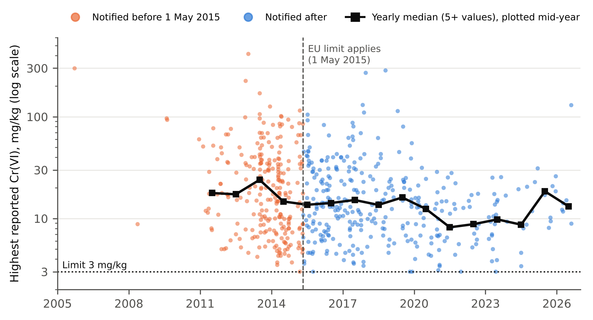
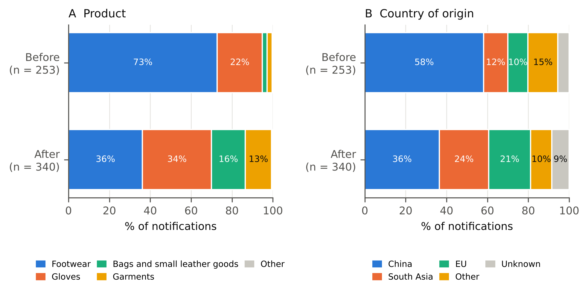

**Peter Kalafatis**\
Independent researcher, x9m8.com, New York, NY, USA\
Correspondence: x9m8x7@gmail.com

**Preprint, not peer reviewed.** Target journal: *Regulatory Toxicology and Pharmacology*.

**Keywords:** chromium(VI); leather; contact allergy; REACH restriction; Safety Gate; RAPEX; market surveillance; footwear

**Social media summary (≤120 characters):** EU alerts for allergenic chromium in leather fell 13-fold, 2013–15 to 2023–25. Allergy rates did not.

## Abstract

Hexavalent chromium, Cr(VI), forms in chrome-tanned leather and is a leading cause of contact allergy. Since 1 May 2015 the EU has barred leather articles that touch the skin from containing 3 mg/kg or more. I assembled every notification for Cr(VI) in leather and leather-type articles in Safety Gate, the EU's rapid alert system for dangerous products (593 notifications, 2005–2026), and compared it with published surveys and patch-test data. Notifications rose from 2011, peaked in 2014, and fell by 26% a year from 2016 to 2025 (95% CI 22–30%): from 40 per 1,000 alerts in 2013–2015 to 3 in 2023–2025, a 13-fold drop. Germany sent 58% of them. Footwear gave way to gloves, bags, belts and garments, and the share made in the EU doubled. Notified articles contained a median of 14 mg/kg; one in four exceeded ten times the limit. Concentrations fell after 2015 in German notifications only. Over the same years, surveys found the share of leather articles above the limit fell only from 23–35% to 11–13%, and chromium allergy among Danish patients stayed at about 2%. The alert record overstates progress: leather goods still fail at a rate the alerts no longer show.

## 1. Introduction

Most leather is tanned with chromium. Chromium(III) salts cross-link collagen and give a soft, durable, heat-stable leather; the EU's reference document on tanning reports that 80–90% of the world's tanneries use them (Black et al., 2013), and one estimate puts chrome-tanned leather at more than 90% of world production (Hedberg et al., 2015). The chromium that tans leather is trivalent. The trouble is that a small part of it can oxidise to the hexavalent form, Cr(VI), during finishing, drying or storage, and Cr(VI) is a potent skin sensitiser. Heat above about 80 °C, ultraviolet light, alkaline contact, certain fatliquors and, above all, dry storage favour its formation; humid storage suppresses it (Hedberg et al., 2015; Mathiason et al., 2015). The same piece of leather can pass or fail a test depending on how it was kept.

Chromium allergy used to be a disease of construction workers, caused by Cr(VI) in wet cement. As chromate in cement was limited, leather took over as the main source. In Copenhagen, the share of chromium-allergic patients with clinically relevant leather exposure rose from 24% in 1989–1994 to 46% in 1995–2007, while the share with relevant cement exposure fell from 13% to 3% (Thyssen et al., 2009). Leather shoes are now the most frequent exposure (Kursawe Larsen et al., 2026), and the allergy is persistent: allergic patients report more foot and hand dermatitis, more sick leave and lower quality of life than controls (Bregnbak et al., 2014; Alinaghi et al., 2021).

Regulators responded in two steps. Germany banned detectable Cr(VI) in leather articles intended for prolonged skin contact in August 2010 (Bedarfsgegenständeverordnung, 2010). Denmark then proposed an EU-wide restriction (Danish EPA, 2012), and Commission Regulation (EU) No 301/2014 added it to Annex XVII of REACH: from 1 May 2015, leather articles and leather parts that contact the skin may not be placed on the market if they contain 3 mg/kg or more of Cr(VI), the quantification limit of the standard test (EN ISO 17075). According to the opinion of ECHA's Risk Assessment Committee (RAC), the limit was expected to be about 80% effective in reducing new leather-related cases (Regulation 301/2014, recital 7), and RAC estimated that it would prevent 5,760–15,840 new cases of chromium allergy a year beyond those already prevented by the German ban (RAC/SEAC, 2012). The Regulation also asked for the restriction to be reviewed if the prevalence of allergy did not fall (recital 8).

Ten years later, has it worked? Two kinds of evidence exist. Patch-test clinics in Denmark have tracked chromium allergy since the 1980s. One analysis found a decline over 2002–2017 that began before the regulation (Alinaghi et al., 2019); the most recent, covering 4,830 patients tested between 2016 and 2024, found a stable prevalence of 2.1%, not significantly different from before the regulation (Kursawe Larsen et al., 2026). Market surveillance projects have tested samples of leather goods, and they still find about one article in eight above the limit (ECHA, 2018; Danish EPA, 2019; Köhler, 2022). A third source has not been used. When an EU or EEA authority acts against a product that it judges a serious risk, it is expected to notify the Commission, which publishes the notification in Safety Gate (formerly RAPEX) (Implementing Decision (EU) 2019/417), although some measures are never notified (Wijnhoven et al., 2013). Cr(VI) is one of the three substance groups most often behind Safety Gate alerts for restricted chemicals harmful to health in 2015–2023 (EEA, 2024). Yet, as far as I can find, no peer-reviewed study has counted or analysed the Cr(VI) leather notifications themselves. Earlier work has used the system to study azo dyes in textiles and leather (Kawakami et al., 2013), skin-lightening cosmetics (Michalek et al., 2019), cosmetics notified by Germany (Elsner & Schliemann, 2017) and notifications in general (Pigłowski, 2023, 2026).

This paper assembles that record and asks four questions. How many notifications have there been, and how has their number changed relative to all alerts? Which products and countries do they involve, and has that changed since 2015? How much Cr(VI) did the notified articles contain? And does the trend in notifications agree with the other two kinds of evidence?

## 2. Materials and methods

### 2.1 Data

Safety Gate publishes each notification with the notifying country, the product and its category, a description, the country of origin, the type of risk, a free-text statement of the risk and the legal requirement breached, and the measures taken (voluntary or ordered by an authority, such as withdrawal, recall or import rejection). A notification follows when an authority has taken or required such a measure for a product judged to pose a serious risk. Under the notification guidelines in force for most of the study period, a product may be judged to pose a serious risk simply because it contains a restricted substance above an EU legal limit, without a detailed risk assessment (Commission Implementing Decision (EU) 2019/417, section 3.4.3.3; these guidelines ceased to apply in March 2025, and notifications from December 2024 fall under the General Product Safety Regulation, (EU) 2023/988). Since 2015, Cr(VI) leather notifications are therefore, in practice, records of limit exceedances that an authority found and acted on; earlier ones relied on national rules, product-safety standards for gloves and footwear, or a national risk assessment.

On 20 October 2026 I queried the public Safety Gate search service for all years available (2005–2026, including archived alerts) with three full-text searches, "chromium", "hexavalent" and "leather", and downloaded the full record of each of the 1,089 distinct notifications returned. The same service gave the total number of alerts, and of alerts for chemical risk, published in each year; these serve as denominators. The code, the snapshot and a record of the queries are archived with the paper (see Research transparency).

### 2.2 Classification

I worked with the English text of each notification: the product name, the product description, the legal provision and the risk description. A notification concerns Cr(VI) if this text names it in any of the forms used ("chromium VI", "chromium (VI)", "Cr(VI)", "hexavalent chromium" and common misspellings); 675 did. It concerns leather if the product text or the statement of the risk mentions leather and does not describe the material only as imitation, synthetic or similar; generic background sentences (such as a reference to clinical studies of leather goods, repeated in a batch of notifications for textile garments) were ignored. Because many notifications for shoes and gloves say only that the insole or lining contains Cr(VI), I also counted articles that do not mention leather at all if the product name is of a kind that is almost always leather when Cr(VI) is the issue: shoes, boots, sandals, slippers, clogs, moccasins, sneakers, trainers, loafers, insoles and other footwear, gloves and mittens, handbags, wallets, purses, belts and watch straps. Notifications in categories covered by other Cr(VI) limits (construction products, toys, cosmetics and chemical products) were excluded, as was jewellery unless the product text named real leather. The study set contains 593 notifications: 518 that name leather and 75 identified by product name alone. The 82 excluded Cr(VI) notifications were 38 textile garments not made of leather, 29 toys, 9 cements and other construction products (one of them filed under "other"), 5 cosmetics and 1 tattoo ink.

I assigned each notification a product type from its name and description (footwear; gloves; garments; bags and small leather goods; other), a flag for children's products, and flags for the component named in the statement of the risk (insole or footbed, lining, upper). Countries of origin were grouped as China, South Asia (India, Pakistan, Bangladesh), the EU, other and unknown.

### 2.3 Concentrations

Most notifications report the measured Cr(VI) content, often for several models or components. I extracted every value in mg/kg (or ppm) that the statement of the risk attributes to Cr(VI) and used the highest value per notification. The extraction drops measurement uncertainties ("30.8 mg/kg ± 7.7 mg/kg" gives 30.8), reads ranges and lists as several values, reads "mg/k" as mg/kg, converts percentages by weight below 1% (1% = 10,000 mg/kg), discards values of 100,000 mg/kg or more, skips numbers that the text gives as a limit ("instead of 3 mg/kg", "less than 1 mg/kg") or as total or extractable chromium, and, where a sentence also names another substance (lead, azo dyes, dimethylfumarate and others), keeps only the values that belong to chromium. If the statement of the risk gave no value, the product text was searched, and if a sentence naming chromium gave no value, the next sentence was tried ("... contain chromium VI. The measured levels were ..."). A value was found for 587 of the 593 notifications. Two reports gave a value in g/kg, which I did not convert because it is almost certainly a typing error for mg/kg; one of these had no other value. In the number audit, a hand check of 60 randomly drawn notifications found one extraction error (since corrected), and a scan of all values found one more (also corrected).

### 2.4 Analysis

The EU limit applied from 1 May 2015, so notifications published before that date form the "before" period and the rest the "after" period. For trends I used full calendar years. The yearly number of notifications was modelled by Poisson regression with log(total alerts that year) as an offset, so that the slope estimates the annual change in notifications per alert; standard errors were scaled by the Pearson dispersion (quasi-Poisson; dispersion 1.43 for the main model). Main estimates cover 2016–2025, the first ten full years after the limit, and 2010–2014 for the period before. Concentrations were summarised by medians with bootstrap 95% intervals (10,000 resamples, seed 20261020), compared between periods with the Mann–Whitney test and the ratio of geometric means, and modelled against year by least squares on log10 concentration (robust standard errors) and by median regression. Shares compared between periods carry exact (Clopper–Pearson) 95% intervals.

Sensitivity analyses (Table 3) used only notifications that name leather; the lowest instead of the highest value per notification; the date the notification was created rather than published; Germany alone and all other countries; raw counts without a denominator; the 2016–2022 period, before total alerts rose steeply in 2023; chemical-risk alerts as denominator; plain Poisson and negative binomial models; and the exclusion of values of exactly 3 mg/kg.

Finally, I set the Safety Gate record beside the two other kinds of evidence (Table 2): published market surveys of the share of leather articles above 3 mg/kg, and patch-test prevalence of chromium allergy in Denmark, the only country for which I found a published series that spans the regulation.

### 2.5 Use of AI

Claude (Anthropic; model claude-opus-5-5) was used in October 2026 to retrieve the data, write the analysis code, draw the figures, draft the text, search the literature, and run two independent checks, one of every number against the result files (including a hand check of the text extraction) and one of every cited claim against its source. I chose the question, reviewed every step and every number, and take full responsibility for the content.

## 3. Results

### 3.1 What was notified

The 593 notifications run from 12 May 2005 to 13 August 2026 (Table 1). Footwear accounted for 307 (51.8%), gloves for 171 (28.8%), bags and small leather goods (bags, wallets, belts, straps, bracelets, dog leads and similar) for 62 (10.5%) and garments for 50 (8.4%). Ninety-five (16.0%) were products for children or babies. When the statement of the risk named the part that failed, it was most often the part in longest contact with skin: the insole or footbed (83 notifications), then the lining (28) and the upper (12).

The products came from 42 known countries or territories of origin. China accounted for 271 (45.7%), India for 62 (10.5%) and Pakistan for 47 (7.9%); 95 (16.0%) were made in the EU, and for 43 (7.3%) the origin was unknown. Nineteen countries sent notifications, but one dominated: Germany sent 345 (58.2%; 95% CI 54.1–62.2%), followed by Spain (89; 15.0%), France (29), Estonia (28) and Finland (27). Measures were voluntary in 320 notifications (54.0%), ordered by an authority in 181 (30.5%), both in 36 (6.1%) and not stated in 56 (9.4%).

### 3.2 Rise and fall

Before 2011 there were six notifications in six years (Figure 1). Numbers rose from 2011, the first full year after Germany's national ban, when German authorities began notifying regularly (11 notifications in 2011, 63 in 2013), and grew by 80% a year relative to all alerts between 2010 and 2014 (95% CI 33–144%). The peak came in 2014, with 97 notifications, or 42.7 per 1,000 Safety Gate alerts.

After the EU limit took effect the number fell in most years. Between 2016 and 2025, notifications per 1,000 alerts fell by 26.1% a year (95% CI 22.1–29.8%). Expressed per 100 chemical-risk alerts, the decline was 32.9% a year (27.5–38.0%), and in raw counts 20.3% a year (16.0–24.4%). Over 2013–2015, 39.9 of every 1,000 Safety Gate alerts concerned Cr(VI) in leather; over 2023–2025 the figure was 3.0, a 13-fold drop. Measured against chemical-risk alerts alone, the share fell from 15.2% to 0.57%. The decline is not an artefact of the large rise in total alerts after 2022: restricted to 2016–2022, the annual decline per 1,000 alerts was 24.2% (18.6–29.5%).

The fall was not confined to one notifier. German notifications fell from an average of 29.6 a year in 2010–2014 to 16.0 a year in 2016–2025, and notifications from all other countries from 14.4 to 12.8 a year; both series declined by about 25–27% a year after 2015 (Table 3). After May 2015 ten countries notified a Cr(VI) leather product for the first time (Cyprus, Greece, Luxembourg, Norway, Poland, Slovakia, Slovenia, Sweden, the Netherlands and the United Kingdom), and Germany's share fell from 64.9% of notifications between December 2010 and April 2015 (95% CI 58.6–70.8%) to 52.9% afterwards (47.5–58.3%). Germany nonetheless remained the largest notifier in both periods.

### 3.3 What changed in the mix

The products notified changed after 2015 (Figure 3). Footwear fell from 72.7% of notifications before the limit (95% CI 66.8–78.1%) to 36.2% after (31.1–41.5%), while gloves rose from 22.1% to 33.8%, bags and small leather goods from 2.4% to 16.5%, and garments from 2.4% to 12.9%. The countries of origin shifted too: China's share fell from 58.1% to 36.5%, South Asia's rose from 11.9% to 24.1%, and the share of products made in the EU doubled, from 9.9% (6.5–14.2%) to 20.6% (16.4–25.3%). Children's products made up 18.6% of notifications before the limit and 14.1% after.

### 3.4 How much Cr(VI)

The highest value reported in every notification was at or above the 3 mg/kg limit; six were exactly 3 mg/kg. The median highest value per notification was 14.3 mg/kg (95% CI 13.0–15.6), almost five times the limit, with an interquartile range of 7.9–30.2 mg/kg and a maximum of 414 mg/kg, in a pair of ladies' gloves (Figure 2). One notification in four (148; 25.2%) reported more than ten times the limit, and about one in six (91; 15.5%) no more than twice the limit.

Notified articles contained less Cr(VI) after the limit than before: the median fell from 17.6 to 13.0 mg/kg (Mann–Whitney p = 0.0003), the geometric mean by 26%, and the share above ten times the limit from 35.1% to 17.9%. Across 2010–2025, concentrations fell by about 5–6% a year (least squares on the log scale, −6.0% a year, 95% CI −7.8 to −4.2; median regression −5.1%, −8.1 to −1.9). The decline holds when the lowest instead of the highest value per notification is used (16.0 to 13.0 mg/kg; p = 0.007), but it rests on German notifications, whose median fell from 21.2 to 13.5 mg/kg; in notifications from other countries there was no decline (10.1 to 12.8 mg/kg; p = 0.93). The decline in the number of notifications, by contrast, held in every sensitivity analysis (Table 3).

### 3.5 Three measures side by side

Table 2 sets the Safety Gate record beside the other evidence. Before the limit, market surveys in Germany and Denmark found Cr(VI) above 3 mg/kg in 23–35% of the leather articles they tested (Danish EPA, 2012). After it, an EU-wide enforcement project that checked 467 leather articles in 2016 found 13.3% above the limit (ECHA, 2018), a Danish survey published in 2019 found 10 of 94 samples from 74 leather products (10.6%) above the limit, though not all were treated as violations once measurement uncertainty was considered (Danish EPA, 2019), and the Stuttgart state laboratory found 12% of 99 articles tested in 2020–2021 (Köhler, 2022). The share of non-compliant articles in surveys fell by roughly a factor of two to three. Safety Gate notifications per alert fell by a factor of 13. Chromium allergy among patients tested in Gentofte, Denmark, did not fall significantly: 2.3% in 2006–2009, 1.9% in 2010–2013 and 2.1% in 2016–2024 (p = 0.65 and 0.41 for the comparisons with the two earlier periods; Kursawe Larsen et al., 2026).

## 4. Discussion

### 4.1 The alert record overstates progress

Read on its own, the Safety Gate record tells a success story. Notifications for Cr(VI) in leather climbed to a peak just as the EU restriction arrived, then fell in most years until, by the mid-2020s, they had almost disappeared from a system now flooded with alerts for other products. The concentrations reported by Germany, the main notifier, also edged down. A regulator could take this as evidence that the 3 mg/kg limit worked.

The other two measures do not support that reading. Surveys designed to estimate compliance found that about one leather article in eight still exceeded the limit one to six years after it took effect. That is an improvement on the one in three or four found before 2015, but a modest one compared with the 13-fold fall in notifications. And the outcome the limit was meant to change, the rate of chromium allergy, has not moved measurably in the most recent Danish data (Kursawe Larsen et al., 2026), and the burden of dermatitis among allergic patients did not improve in the first years after the regulation (Alinaghi et al., 2021); an earlier Danish analysis found a decline in prevalence that started before the regulation (Alinaghi et al., 2019). Taken together, the three measures say that non-compliance fell somewhat, allergy did not fall measurably after 2015, and notifications fell far more than either.

One explanation consistent with these numbers is that much of the decline in notifications reflects fewer checks or fewer notifications rather than fewer non-compliant products. I cannot test this directly, because Safety Gate does not publish how many products were tested. But Safety Gate is not a sample of the market. It records what authorities chose to test, found to fail, judged serious and decided to notify, and each of those steps varies between countries (Wijnhoven et al., 2013). The European Environment Agency notes that the number of alerts is influenced by EU and national market-surveillance initiatives (EEA, 2024), and the pattern here fits that: notifications rose with German enforcement of its national ban from 2011, peaked in the run-up to the EU limit, and declined afterwards, while alerts for other chemical hazards drove a steep rise in the system's total after 2022 (Table 1). Germany alone sent more than half of all Cr(VI) leather notifications, before and after the restriction became EU law. A product that fails in a country that does not test for Cr(VI) in leather leaves no trace in the system.

Part of the gap may also have a chemical cause. Because Cr(VI) forms and disappears with storage humidity, the same leather can pass in one laboratory and fail in another, and a product is more likely to fail in a dry, cold climate or after dry storage (Mathiason et al., 2015). Testing practice therefore shapes notification counts in ways that have nothing to do with how the leather was made. The test itself has limits near 3 mg/kg: one evaluation found that the colorimetric method cannot reliably resolve concentrations at or below that level (Davis et al., 2022). And a leather that passes when tested may still release Cr(VI) later in use (Hedberg, 2020).

### 4.2 What the notifications do show

Although the counts mislead as a measure of compliance, the content of the notifications is informative. The articles that fail are not marginal cases: half contain more than 14 mg/kg, almost five times the limit, and a quarter about 30 mg/kg or more. When a failing part is named, it is most often the insole, the leather in closest and longest contact with sweating skin, which is consistent with the role of leather shoes and foot dermatitis in the Danish patients (Kursawe Larsen et al., 2026; Alinaghi et al., 2021). The shift from shoes toward gloves, bags, belts and garments after 2015 suggests either that footwear supply chains improved or that surveillance moved to other products; the notifications cannot separate the two. The doubling of the share made in the EU, from about 10% to 21%, shows that non-compliant leather is not only an import problem.

### 4.3 Implications

Three practical points follow. First, Safety Gate counts should not be used on their own to judge whether a chemical restriction is working. They record enforcement activity as well as compliance, and they need a denominator, the number of products tested, which the system does not publish (Elsner & Schliemann, 2017). Publishing the number of checks behind each year's notifications, even for a few priority substances, would make the record far more informative. Second, the evidence that matters most for a skin-sensitiser restriction is the rate of new allergy. The Danish series is the only one I found that spans the regulation; similar series elsewhere would show whether the Danish result holds across Europe. Third, the Regulation itself foresees a review if the prevalence of allergy does not fall (recital 8). The persistence of non-compliance and of allergy supports that review, and the evidence that Cr(VI) can form after an article passes its test, and that the standard method is unreliable near the limit, suggests that testing conditions deserve attention alongside the limit (Hedberg, 2020; Davis et al., 2022). Clinicians have argued that the regulation may need revision to protect those already sensitised (Alinaghi et al., 2021).

### 4.4 Limitations

The study set depends on text classification. A notification that described a Cr(VI) leather product without using any of the search terms would be missed, and a few product-type assignments are judgement calls; the main trend is unchanged when only notifications that name leather are used. In the number audit, hand checks of 30 included and 30 excluded notifications each found one misclassification; both, and the batch of 25 textile notifications behind one of them, were corrected before the final analysis. Concentrations come from free text written by many authorities; the extraction rules are documented in the code, and individual values may still be misread. Notifications record the highest values an authority chose to report, not a random sample of products. Safety Gate's annual totals, used as denominators, include all product types and changed in composition over time; using chemical-risk alerts or raw counts instead changes the size of the decline but not its direction. The market surveys in Table 2 used different sampling designs and are not strictly comparable with each other, and the patch-test series comes from one Danish clinic. None of the comparisons in Table 2 is a formal test.

## 5. Conclusions

The EU's rapid alert system records a 13-fold fall in notifications for hexavalent chromium in leather since the EU limit took effect in 2015. Surveys of leather goods on the market and patch tests of patients do not show a comparable improvement: about one leather article in eight still fails, and in the one Danish series that spans the regulation, chromium allergy is as common as it was before the limit. The alert record reflects enforcement as well as compliance, and on its own it would give a misleadingly good picture of a restriction that has yet to show a reduction in the disease it targets.

## Acknowledgements

This research used data published by the European Commission's Safety Gate system. The European Commission is not responsible for the analysis or conclusions. Claude (Anthropic; model claude-opus-5-5) was used in October 2026 for data retrieval, code, figures, drafting, literature search and two independent checks, as described in Section 2.5. I reviewed all output and take full responsibility for the content.

## Author contributions

P.K. conceived the study, directed the analysis, reviewed all results and wrote the paper with AI assistance as declared.

## Financial support

This research received no specific grant from any funding agency, commercial or not-for-profit sectors.

## Conflicts of interest

The author makes leather goods (Marcellino NY, bespoke bridle-leather briefcases). The study received no funding or input from that business or from any leather producer, tanner or retailer.

## Research transparency and reproducibility

All data are public. The Safety Gate snapshot (retrieved 20 October 2026), the yearly totals, the query record and code that rebuilds every number, table and figure in this paper are in the code archive: https://x9m8.com/wp-content/uploads/2026/10/kalafatis-2026-chromium-leather-code.zip. This is a secondary analysis of existing data and was not preregistered.

## References

Alinaghi, F., Thyssen, J. P., Zachariae, C., & Johansen, J. D. (2021). No immediate effect of regulatory reduction of chromium in leather among adult patients with chromium allergy. *Contact Dermatitis*, 85(5), 514–522. https://doi.org/10.1111/cod.13925

Alinaghi, F., Zachariae, C., Thyssen, J. P., & Johansen, J. D. (2019). Temporal changes in chromium allergy in Denmark between 2002 and 2017. *Contact Dermatitis*, 80(3), 156–161. https://doi.org/10.1111/cod.13181

Bedarfsgegenständeverordnung. (2010). *Achtzehnte Verordnung zur Änderung der Bedarfsgegenständeverordnung vom 3. August 2010* [Eighteenth ordinance amending the Consumer Goods Ordinance]. Bundesgesetzblatt I, Nr. 42 (13 August 2010), 1138.

Black, M., Canova, M., Rydin, S., Scalet, B. M., Roudier, S., & Delgado Sancho, L. (2013). *Best available techniques (BAT) reference document for the tanning of hides and skins* (EUR 26130 EN). Publications Office of the European Union. https://doi.org/10.2788/13548

Bregnbak, D., Thyssen, J. P., Zachariae, C., & Johansen, J. D. (2014). Characteristics of chromium-allergic dermatitis patients prior to regulatory intervention for chromium in leather: A questionnaire study. *Contact Dermatitis*, 71(6), 338–347. https://doi.org/10.1111/cod.12291

Commission Implementing Decision (EU) 2019/417 of 8 November 2018 laying down guidelines for the management of the European Union Rapid Information System 'RAPEX'. *Official Journal of the European Union*, L 73, 15.3.2019, 121.

Commission Regulation (EU) No 301/2014 of 25 March 2014 amending Annex XVII to Regulation (EC) No 1907/2006 (REACH) as regards chromium VI compounds. *Official Journal of the European Union*, L 90, 26.3.2014, 1.

Danish EPA. (2012). *Annex XV restriction report: Proposal for a restriction. Chromium (VI) compounds* (Version 1.0, 19 January 2012). Danish Environmental Protection Agency; European Chemicals Agency. https://chesar.echa.europa.eu/documents/10162/477b4727-e5fc-75da-ccd9-b8bcc2d2b7dd

Danish EPA. (2019). *Chromium VI and cobalt in leather goods* (Survey of chemical substances in consumer products No. 177). Danish Environmental Protection Agency. https://mst.dk/publikationer/2019/september/chromium-vi-and-cobalt-in-leather-goods

Davis, S. J., Wise, W. R., Recchia, S., Spinazzè, A., & Masi, M. (2022). The evaluation of the detection of Cr(VI) in leather. *Analytica*, 3(1), 1–13 (published online 29 December 2021). https://doi.org/10.3390/analytica3010001

ECHA. (2018). *Forum REF-4 project report: Harmonised enforcement project on restrictions* (ECHA-18-R-03-EN). European Chemicals Agency. https://chesar.echa.europa.eu/documents/10162/17088/ref_4_report_en.pdf/b53f5cd9-64a4-c120-1953-e9e176b9c282

EEA. (2024, April 16). *Alerts for products posing a risk to human health and the environment* (European zero pollution dashboards indicator). European Environment Agency. Retrieved 20 October 2026, from https://www.eea.europa.eu/en/european-zero-pollution-dashboards/indicators/alerts-reported-for-products-posing-a-risk-to-human-health-and-the-environment

Elsner, P., & Schliemann, S. (2017). Gefährliche Kosmetikprodukte in Deutschland: Analyse der RAPEX-Datenbank der Europäischen Kommission [Dangerous cosmetic products in Germany: Analysis of the European Commission's RAPEX database]. *Der Hautarzt*, 68(11), 885–889. https://doi.org/10.1007/s00105-017-4016-2

Hedberg, Y. S. (2020). Chromium and leather: A review on the chemistry of relevance for allergic contact dermatitis to chromium. *Journal of Leather Science and Engineering* (now *Collagen and Leather*), 2, Article 20. https://doi.org/10.1186/s42825-020-00027-y

Hedberg, Y. S., Lidén, C., & Odnevall Wallinder, I. (2015). Chromium released from leather – I: Exposure conditions that govern the release of chromium(III) and chromium(VI). *Contact Dermatitis*, 72(4), 206–215. https://doi.org/10.1111/cod.12329

Kawakami, T., Isama, K., & Ikarashi, Y. (2013). [Characterization of cases contravening of regulations regarding primary aromatic amines originating from azo dyes in commercial textile products and leather products in European Union]. *Kokuritsu Iyakuhin Shokuhin Eisei Kenkyusho Hokoku*, (131), 66–74.

Köhler, M. (2022, January 13). *Chrom(VI) in Lederprodukten – ein Bericht aus dem Laboralltag* [Chromium(VI) in leather products: A report from laboratory practice]. Chemisches und Veterinäruntersuchungsamt Stuttgart; analytik-news.de. https://www.analytik-news.de/fachartikel/pdf/cvuas36.pdf

Kursawe Larsen, C., Jensen, M. B., Isufi, D., Zachariae, C., Johansen, J. D., & Schwensen, J. F. B. (2026). Trends in contact allergy to chromium following the 2015 European Union leather regulation. *Contact Dermatitis*, 94(1), 67–72. https://doi.org/10.1111/cod.70045

Mathiason, F., Lidén, C., & Hedberg, Y. S. (2015). Chromium released from leather – II: The importance of environmental parameters. *Contact Dermatitis*, 72(5), 275–285. https://doi.org/10.1111/cod.12334

Michalek, I. M., Liu, B., Benn, E. K. T., & Caetano dos Santos, F. L. (2019). Skin lightening products' violations in Europe: An analysis of the rapid alert system for dangerous non-food products 2005–2018. *Regulatory Toxicology and Pharmacology*, 106, 50–54. https://doi.org/10.1016/j.yrtph.2019.04.020

Pigłowski, M. (2023). Notifications in European Rapid Alert system for dangerous products (RAPEX). In *Safety and Reliability of Systems and Processes, Summer Safety and Reliability Seminar 2023* (pp. 187–198). Gdynia Maritime University. https://doi.org/10.26408/srsp-2023-14

Pigłowski, M. (2026). Multidimensional analysis of alerts reported in the Safety Gate system (RAPEX) in 2005–2025. *Sustainability*, 18(13), 6875. https://doi.org/10.3390/su18136875

RAC/SEAC. (2012, December 4). *Compiled RAC opinion and draft SEAC opinion on an Annex XV dossier proposing restrictions on chromium (VI) compounds in leather articles* (ECHA/RAC/RES-O-0000001412-86-09/F). European Chemicals Agency. https://chesar.echa.europa.eu/documents/10162/e55bb713-4100-018b-ac13-ad1070658e75

Thyssen, J. P., Jensen, P., Carlsen, B. C., Engkilde, K., Menné, T., & Johansen, J. D. (2009). The prevalence of chromium allergy in Denmark is currently increasing as a result of leather exposure. *British Journal of Dermatology*, 161(6), 1288–1293. https://doi.org/10.1111/j.1365-2133.2009.09405.x

Wijnhoven, S. W. P., Janssen, P. J. C. M., & Schuur, A. G. (2013). *Definition of serious risk within RAPEX notifications* (RIVM Letter Report 090013001/2013). National Institute for Public Health and the Environment (RIVM). https://www.rivm.nl/bibliotheek/rapporten/090013001.pdf

## Tables

**Table 1.** Safety Gate notifications for hexavalent chromium in leather and leather-type articles, by year of publication. All alerts and chemical-risk alerts are the totals in the Safety Gate search for each year. 2026 runs to the snapshot date (20 October).

| Year | Notifications | By Germany | By other countries | Notifying countries | All alerts | Per 1,000 alerts | Chemical-risk alerts | Per 100 chemical alerts |
|:-----|-----:|-----:|-----:|-----:|-------:|------:|-------:|------:|
| 2005 | 2 | 2 | 0 | 1 | 713 | 2.8 | 83 | 2.41 |
| 2006 | 0 | 0 | 0 | 0 | 960 | 0.0 | 142 | 0.00 |
| 2007 | 0 | 0 | 0 | 0 | 1,378 | 0.0 | 288 | 0.00 |
| 2008 | 1 | 0 | 1 | 1 | 1,556 | 0.6 | 343 | 0.29 |
| 2009 | 2 | 2 | 0 | 1 | 1,693 | 1.2 | 496 | 0.40 |
| 2010 | 1 | 0 | 1 | 1 | 1,972 | 0.5 | 437 | 0.23 |
| 2011 | 19 | 11 | 8 | 3 | 1,544 | 12.3 | 337 | 5.64 |
| 2012 | 27 | 16 | 11 | 6 | 1,932 | 14.0 | 415 | 6.51 |
| 2013 | 76 | 63 | 13 | 4 | 2,038 | 37.3 | 490 | 15.51 |
| 2014 | 97 | 58 | 39 | 5 | 2,271 | 42.7 | 610 | 15.90 |
| 2015 | 74 | 30 | 44 | 9 | 1,889 | 39.2 | 528 | 14.02 |
| 2016 | 64 | 34 | 30 | 10 | 1,919 | 33.4 | 425 | 15.06 |
| 2017 | 61 | 27 | 34 | 12 | 2,048 | 29.8 | 444 | 13.74 |
| 2018 | 34 | 19 | 15 | 8 | 2,102 | 16.2 | 588 | 5.78 |
| 2019 | 29 | 22 | 7 | 5 | 2,198 | 13.2 | 571 | 5.08 |
| 2020 | 29 | 16 | 13 | 6 | 2,218 | 13.1 | 523 | 5.54 |
| 2021 | 23 | 18 | 5 | 3 | 2,132 | 10.8 | 518 | 4.44 |
| 2022 | 11 | 9 | 2 | 3 | 2,244 | 4.9 | 774 | 1.42 |
| 2023 | 20 | 5 | 15 | 6 | 3,410 | 5.9 | 1,737 | 1.15 |
| 2024 | 7 | 5 | 2 | 2 | 4,173 | 1.7 | 2,281 | 0.31 |
| 2025 | 10 | 5 | 5 | 5 | 4,766 | 2.1 | 2,496 | 0.40 |
| 2026 | 6 | 3 | 3 | 3 | 3,131 | 1.9 | 1,107 | 0.54 |
| **2005–2026** | **593** | **345** | **248** | | **48,287** | | **15,633** | |

**Table 2.** Three measures of the same problem before and after the EU limit. Safety Gate rows are computed here; the others are taken from the cited sources.

| Measure | Before the limit | After the limit | Source |
|:------|:------|:------|:------|
| Safety Gate notifications per 1,000 alerts | 39.9 (2013–2015) | 3.0 (2023–2025) | This study |
| Safety Gate notifications per 100 chemical-risk alerts | 15.2 (2013–2015) | 0.57 (2023–2025) | This study |
| Median highest Cr(VI) in a notified article, mg/kg | 17.6 (n = 251) | 13.0 (n = 336) | This study |
| Leather articles above 3 mg/kg in market surveys | 23% of 588 (Germany 2008); 32% of 504 (Germany 2009); 35% of 43 (Denmark 2002) | 13.3% of 467 (EU enforcement project, 2016 checks); 10.6% of 94 samples (Denmark, 2019 report); 12% of 99 (Stuttgart 2020–2021) | Danish EPA (2012); ECHA (2018); Danish EPA (2019); Köhler (2022) |
| Chromium allergy among patch-tested dermatitis patients, Gentofte (Denmark) | 2.3% (2006–2009); 1.9% (2010–2013) | 2.1% (2016–2024, n = 4,830), stable | Kursawe Larsen et al. (2026) |

**Table 3.** Sensitivity of the two main results. Trend: annual change in notifications per 1,000 alerts, 2016–2025 (quasi-Poisson; 95% CI) unless stated. Concentration: median highest value before and after 1 May 2015, ratio of geometric means (after/before) and Mann–Whitney p.

| Analysis | n | Annual change | Median before → after (mg/kg) | Geometric-mean ratio | p |
|:------|-----:|:------|:------|-----:|-----:|
| Main analysis | 593 | -26.1% (-29.8 to -22.1) | 17.6 → 13.0 | 0.74 | 0.00034 |
| Only alerts that name leather | 518 | -26.8% (-30.4 to -23.0) | 17.7 → 13.0 | 0.74 | 0.00078 |
| Lowest instead of highest value per alert | 587 | – | 16.0 → 13.0 | 0.79 | 0.007 |
| Creation date instead of publication date | 593 | -25.9% (-29.8 to -21.7) | 17.5 → 13.0 | 0.78 | 0.0018 |
| Germany excluded | 248 | -27.3% (-35.6 to -17.9) | 10.1 → 12.8 | 0.96 | 0.93 |
| Germany only | 345 | -25.1% (-30.4 to -19.3) | 21.2 → 13.5 | 0.64 | 6.2e-06 |
| Raw counts, no denominator, 2016–2025 | 288 | -20.3% (-24.4 to -16.0) | – | – | – |
| Per 1,000 alerts, 2016–2022 only | 251 | -24.2% (-29.5 to -18.6) | – | – | – |
| Per 100 chemical-risk alerts, 2016–2025 | 288 | -32.9% (-38.0 to -27.5) | – | – | – |
| Plain Poisson instead of quasi-Poisson | 288 | -26.1% (-29.2 to -22.8) | – | – | – |
| Negative binomial (method-of-moments dispersion estimated at zero, so equal to Poisson) | 288 | -26.1% (-29.2 to -22.8) | – | – | – |
| Values of exactly 3 mg/kg excluded | 581 | – | 17.7 → 13.0 | 0.75 | 0.00065 |

## Figures

