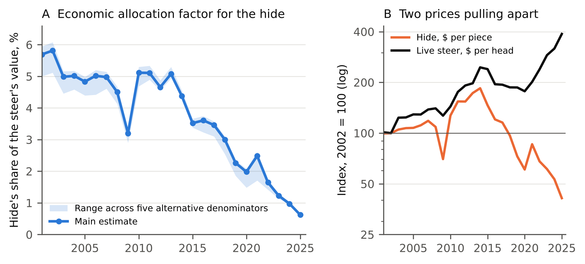

**Peter Kalafatis**

Independent researcher, x9m8.com, New York, NY, USA. Correspondence: x9m8x7@gmail.com

**Preprint, not peer reviewed.** Version 1, October 2026.

## Abstract

Life cycle assessments of leather assign part of a steer's farm emissions to its hide, usually in proportion to the hide's share of the animal's value. That share is a price ratio, and prices move. I built a monthly US series for June 2001 to December 2025. The hide price is the Bureau of Labor Statistics producer price index for hides and skins, converted to dollars per piece with six USDA Agricultural Marketing Service report prices; nine published figures not used in the scaling fall within a median 5.8% of it. Live value is the Nebraska fed-steer price times steer live weight. The hide's share averaged 4.86% in 2002–2013 and 0.94% in 2023–2025, falling to 0.62% in 2025, a fivefold drop that holds across six denominators (5.0–5.2-fold). Since 2013 the hide lost 76% of its dollar value while the live steer gained 96%. Holding farm emissions fixed at 21.3 kg CO~2~e per kg carcass, the farm emissions assigned to 1 m^2^ of leather fell from 113 kg CO~2~e (2002–2013) to 22 (2023–2025); mass allocation would keep them near 112. Published allocation factors from 1% to 3.5% are consistent with readings of this moving ratio at different dates.

**Keywords:** life cycle assessment; allocation; leather; cattle hides; by-products; greenhouse gas emissions; beef

**Social media summary:** On paper, the farm carbon assigned to US leather fell fivefold since the 2000s, mostly because hide prices crashed.

## 1. Introduction

A steer is raised for its meat. The hide comes along with it. Any life cycle assessment (LCA) of leather has to decide how much of the animal's farm emissions, which dominate the footprint of finished leather, belong to that hide. ISO 14044 asks practitioners to avoid allocation where they can, by subdividing processes or expanding the system, and to fall back on physical or economic relationships only when they cannot (ISO, 2006). For slaughter co-products the usual fallback is economic: each output carries burdens in proportion to its share of the total value.

The European Product Environmental Footprint Category Rules (PEFCR) for leather fix that share at a single default. In bovine slaughtering, hides and skins receive 3.5% of the burden, fresh meat and edible offal 92.9%, and "no change of allocation factors is allowed" (De Rosa-Giglio et al., 2018, Table 19). Other studies use other numbers. An Italian analysis using 2023 prices found 2.68% on average (Lunesu et al., 2025). A Leather Working Group LCA has been reported to use 1.8%, an industry-funded US study to test 1%, and the 2026 UNIDO guidance to use 1.5% (Leather and Hide Council of America [LHCA], 2025, 2026). A Canadian beef footprint using 2006 US prices gave hides 6.8% (Desjardins et al., 2012). A recent global reassessment that assigned 8.1% of farm emissions to hides reported a footprint for leather far above earlier estimates and drew an industry rebuttal centred largely on that factor (Roncevich et al., 2026; LHCA, 2026). Physical allocation by mass gives about 5% to 6% in the studies that report it directly (Desjardins et al., 2012; Lunesu et al., 2025; LHCA, 2025), and industry figures reported by LHCA (2026) put the hide's mass fraction at 7% to 7.8%.

These numbers are usually discussed as if they were rival estimates of one quantity. They are not. An economic allocation factor is a ratio of two prices, and in the United States the two have moved in opposite directions. Cattle hide prices fell after 2014 as demand for leather weakened and Chinese demand for US hides declined (Muhammad & Griffith, 2023), and the hide's share of packers' by-product value fell from about two-thirds in 2000 to 15–20% by 2020, according to trade estimates (LHCA, as reported in leatherbiz, 2020a). Over the same years fed-cattle prices reached records. Brester and Swanser (2021) quantified how much the hide collapse depressed cattle prices. Others have noticed the drift without measuring it. Desjardins et al. (2012) observed that hide values almost halved between 2006 and 2009; Lunesu et al. (2025) reported that the economic allocation to hides tends to fall over 2015–2023 Italian prices, without tabulating it; and Roncevich et al. (2026) recommended that allocation "accurately reflect changes in this allocation across time" while applying a single fixed factor themselves.

I am not aware of a published time series of the hide's economic allocation factor for US cattle. This paper builds one, monthly from June 2001 to December 2025, from open government data. It asks three questions. How far has the factor moved? Is the movement robust to the choices needed to compute it? And what does it do to the farm emissions carried by a square metre of leather?

## 2. Methods

### 2.1 Hide price

The USDA Agricultural Marketing Service (AMS) publishes a daily By-Product Drop Value (Steer) report, in which the hide line is the price of a butt-branded steer hide per piece (USDA AMS, 2015). Its archive is not available as an open machine-readable series for the whole period. I therefore used the Bureau of Labor Statistics producer price index for hides and skins, including cattle (series WPU0419, June 2001 = 100, monthly, not seasonally adjusted; retrieved from FRED on 20 October 2026), and converted it to dollars with a single scale factor *k*. The study starts in June 2001, the base month of this index.

*k* is the geometric mean of the ratio between an AMS report price and the index for the same month, over six reports read in full: 28 April 2015 ($95.75), 27 October 2017 ($56.00), 8 November 2019 ($36.00–36.50; midpoint used), 23 May 2025 ($15.25), 26 August 2025 ($19.25) and 30 September 2025 ($19.00) (USDA AMS, 2015, 2017, 2019, 2025a, 2025b, 2025c). Two of these (8 November 2019 and 23 May 2025) come from AMS's weekly hide report and refer to specified weight classes (62–66 lb and 60–62 lb) rather than the drop-value report. No report price earlier than 2015 was available, so the level before 2015 rests on the index tracking the hide price. Fit was checked by leave-one-out refitting and against nine published figures that were not used, four of them multi-month averages: Peel's averages for 2013–2017, 2018, the first half of 2019 and June 2019 (Peel, 2019); Brester and Swanser's start-of-2020 and April 2020 values; and three trade quotes for 2020 and 2025 that cite USDA (Kay, 2020; leatherbiz, 2020b; Peck, 2025). The butt-branded steer hide is a mid-grade hide; heavy native steer hides sell for more and branded cow hides for much less.

### 2.2 Live value and the allocation factor

The allocation factor for month *t* is

*s*~t~ = *H*~t~ / (*P*~t~ × *W*~t~ / 100),

where *H* is the hide price ($/piece), *P* the Nebraska price for 65–80% Choice steers ($/cwt live) and *W* the steer live weight (lb). *W* is the federally inspected average steer dressed weight divided by 0.63, the dressing percentage used in the AMS drop-value report. Prices and weights come from the USDA Economic Research Service (ERS) Livestock and Meat Domestic Data machine-readable files, downloaded on 20 October 2026 (USDA ERS, 2026). Annual values are means of monthly values.

The live animal's value stands in for the total value of the slaughter outputs. The PEFCR allocates at the slaughterhouse among meat, hide, fat, bones and other outputs (De Rosa-Giglio et al., 2018), so I also computed an output-value denominator: the Choice boxed-beef cutout value (Choice 1–3, 600–900 lb carcasses; $/cwt carcass) times carcass weight, plus the hide. This omits offal, fat and meals, and so slightly overstates the hide's share.

### 2.3 Sensitivity analyses

I recomputed the factor with (a) the commercial average live weight of all cattle instead of steers, (b) the Texas/Oklahoma/New Mexico price for 35–65% Choice steers, (c) dressing percentages of 62% and 64%, (d) the output-value denominator, (e) the scale factor *k* set to the lowest and highest single-report ratios, and (f) prices averaged over three- and five-year windows (hide value and live value each averaged, then divided). FAO's LEAP guidelines for large ruminants recommend economic allocation among slaughter products that serve different markets, and define economic value as the average market value "possibly over a 5-year time frame" (FAO, 2016). I also compared the modelled share with values computed in other ways: the hide's value in $/cwt live printed in the two 2025 AMS reports divided by that month's steer price (these two reports are also scaling anchors, so this check tests the denominator, not the hide price); Peel's (2024) by-product and hide shares for 1 March 2024; and the LHCA statement that the hide was "closer to 1%" of the animal's value in late April 2020 (leatherbiz, 2020a).

The change between 2013 and 2025 was split into its hide-price and live-value parts by taking logs: Δln *s* = Δln *H* − Δln *P* − Δln *W*.

### 2.4 Emissions carried by the hide

To isolate the effect of prices, farm emissions per animal were held constant per kilogram of carcass at 21.3 kg CO~2~e per kg carcass weight, the cradle-to-farm-gate footprint of US beef estimated by Rotz et al. (2019). Emissions per steer are 21.3 × carcass weight; the hide carries *s*~t~ times that. Hide weight is 4.80 lb per 100 lb live (cured and fleshed; USDA AMS, 2015), and leather area is 0.12 m^2^ per kg of raw hide, the average reported for tanneries in the Vicenza district (Lunesu et al., 2025); applying a raw-hide yield to cured-and-fleshed weight is an approximation. The resulting 3.3 to 4.0 m^2^ per hide is of the same order as UNIDO's mass balance, in which a lighter, 25.6 kg salted hide yields about 3.5 m^2^ of grain leather plus split (Buljan et al., 2000). Because carcass weight and hide weight are both fixed fractions of live weight here, the farm emissions per m^2^ reduce to the allocation factor times a constant, about 2,330 kg CO~2~e per m^2^. The result is the farm-stage emissions carried by 1 m^2^ of finished leather; tanning and finishing are excluded. For comparison I computed the same quantity under the PEFCR's fixed 3.5% and under a 4.8% mass allocation, the hide mass fraction tested in an LHCA-funded US LCA (LHCA, 2025).

These per-square-metre figures illustrate scale; they are not a new footprint of US leather. Rotz et al.'s estimate covers the whole US beef herd, including cull cows and dairy animals, and is applied here to a fed-steer carcass.

### 2.5 Software, data and AI use

Analyses used Python 3.13 with pandas and NumPy; figures used matplotlib. Code, the anchor-price table and parameter file are in the reproducibility package; raw government files are linked rather than redistributed. The study was carried out with the assistance of Claude (Anthropic; model claude-opus-5-5) in October 2026, which retrieved data, wrote and ran the analysis code, searched the literature and drafted the text under the author's direction. Independent AI agents checked every number against the result files and every citation against its source. The author reviewed all of it and takes full responsibility for the content.

## 3. Results

### 3.1 Hide prices

The scale factor was 0.627 dollars per index point; the six single-report ratios ranged from 0.487 to 0.704. Fitted prices were within 11% of five of the six AMS prices (Figure 1). The exception was 23 May 2025, when AMS reported $15.25 and the scaled index gave $19.65 (29% high); leaving that report out of the fit made the miss 36%. Against the nine figures not used in the fit, the median absolute error was 5.8% (mean 11.5%). The largest misses were April 2020, when the scaled index gave $26.83 against Brester and Swanser's figure of a little over $18 during the pandemic plant closures (49% high), and June 2019 (21% high). A monthly index smooths short collapses that a daily price records.

The scaled series shows a butt-branded steer hide at about $51 in 2002, a peak annual mean of $93.71 in 2014, and $20.85 in 2025 (Table 1).

### 3.2 The allocation factor

The hide's share of the live steer's value was 5.81% in 2002 and averaged 4.86% over 2002–2013, with a one-year dip to 3.20% in 2009 (Figure 2A; Table 1). It fell from 2014 onwards, to 3.52% in 2015, 1.98% in 2020 and 0.62% in 2025. The 2023–2025 mean was 0.94%, one-fifth of the 2002–2013 mean (5.2-fold). The monthly maximum was 6.77% in June 2001 and the minimum 0.51% in September 2025.

Between 2013 and 2025 the annual mean hide price fell 76% and the live steer's value rose 96%, mostly through price (78%) and partly through weight (11%). In logs, the hide's fall accounted for 68% of the decline in the share and the live value's rise for 32% (Figure 2B).

### 3.3 Sensitivity and cross-checks

The fivefold decline held in every variant (Table 2). Across the six denominators the 2002–2013 mean ranged from 4.47% to 5.05% and the 2023–2025 mean from 0.89% to 0.99%, a 5.0- to 5.2-fold fall. The dollar scaling moves the level but not the ratio: at the lowest and highest single-report ratios the early mean was 3.77% or 5.46% and the late mean 0.73% or 1.06%. Averaging prices over 2023–2025 or 2021–2025 gave 0.91% or 1.25% for 2025.

The cross-checks were mixed. The AMS reports for 26 August and 30 September 2025 value the hide at $1.38 and $1.36 per cwt live, which against those months' steer prices is 0.56% and 0.57%; the model gives 0.51% for both. The difference comes mainly from live weight: the reports assume a 1,400 lb steer, while the model uses 1,503 lb and 1,529 lb from slaughter data. Peel's (2024) figures for 1 March 2024 imply 1.18% (6.4% by-products × 18.4% hide); the model gives 1.01% for March 2024. For April 2020 the model gives 1.81%, 81% above the LHCA's "closer to 1%", in the same month in which the index missed the daily price collapse.

### 3.4 Published factors in context

Placed against the US series (Figure 3A), the published factors line up with the prices of their time. The 5% value fraction in Mekonnen and Hoekstra's (2010) worked example matches the US share of the 2000s. Desjardins et al.'s (2012) 6.8%, computed from 2006 US prices per kilogram of hide, meat, offal and rendering products, is higher than the US 2006 value here (5.02%); the two use different denominators, so their levels are not strictly comparable. The PEFCR's 3.5% matches US prices around 2015–2017. The Italian 2.68% for 2023 is about twice the US 2023 value of 1.23%. The LWG's 1.8%, UNIDO's 1.5% and the US 1% bracket US values for 2022–2024. Mass-based factors of 4.8% and 5.88% sit near the US economic share of the 2000s and far above it today.

### 3.5 Emissions carried by a square metre of leather

At 21.3 kg CO~2~e per kg carcass, a 2025 fed steer carries about 9,230 kg CO~2~e to the farm gate and yields a hide of about 33 kg, or 4.0 m^2^ of leather. Under the economic factor of each year, the farm emissions assigned to 1 m^2^ were 135 kg CO~2~e in 2002, averaged 113 over 2002–2013, 22 over 2023–2025 and 14.5 in 2025 (Figure 3B; Table 1). The emission factor per kilogram of carcass was held fixed, so the decline comes entirely from the allocation factor. Under the PEFCR's fixed 3.5% the figure is 82 kg CO~2~e per m^2^, and under 4.8% mass allocation 112, in every year by construction. In 2025 mass allocation gave 7.7 times the economic figure.

## 4. Discussion

### 4.1 What moved

The hide's economic share of a US steer fell about fivefold between 2002–2013 and 2023–2025, most of it after 2013. The fall came from both sides of the ratio. Hides lost three-quarters of their dollar value while the live animal's value doubled. The first reflects a weak market for leather and a decade of declining Chinese demand for US hides, sharpened by the 2018 trade dispute (Muhammad & Griffith, 2023); the second reflects record fed-cattle prices and, to a smaller degree, heavier cattle (Table 1). Neither has anything to do with how the hide was produced.

That is the core problem with economic allocation for a falling co-product. As a hide approaches worthlessness its allocated emissions approach zero, and a material that by 2025 was partly landfilled in the United States (LHCA estimated about 15% of US hides were wasted in 2024; leatherbiz, 2024) looks increasingly carbon-free on paper. The PEFCR already gives 0% to hides that are legally waste (De Rosa-Giglio et al., 2018). Under year-specific economic allocation, sold hides have been converging on that treatment.

### 4.2 The argument over allocation factors

The dispute that followed Roncevich et al. (2026) has been framed as a disagreement over a number: 8.1% against the PEFCR's 3.5% or the industry's 1% to 1.8% (LHCA, 2026). The US series suggests that each of these numbers is a reading of a ratio that has moved about fivefold between the 2002–2013 and 2023–2025 averages, and by a factor of 2.3 within the five years from 2019 to 2024. A footprint for "leather" that does not state the price year of its allocation factor is incompletely specified. Two studies of identical hides, one using 2005 prices and one using 2025 prices, would differ about eightfold in farm-stage emissions per square metre through allocation alone.

Roncevich et al. (2026) built their 8.1% by weighting values of 6.8%, 8% and 14% for Italy, India and North America by each region's share of 2022 raw hide exports, with the stated assumption that the United States would show the same ratio as Canada. The paper does not give the prices or price year behind the North American 14%. The only North American source it cites for the factor, Desjardins et al. (2012), reports 6.8%, at 2006 prices. On US data the 14% is above every monthly value since mid-2001 (maximum 6.77%), and around 2022, the export year used for the weights, the US share was 1.65%. The weighting is also internally inconsistent. Using the stated export shares (18.4%, 2.7% and 10.6%) as relative weights gives 9.3%; the 8.1% is reproduced by a later sentence in the paper that applies weights of 0.34, 0.58 and 0.08 to Italy, India and North America, which appears to pair the weights with the wrong regions. I could not read the study's supporting information, so I cannot say how the 14% was obtained; that is a question the authors could answer.

There are three defensible responses. One is to fix the factor, as the PEFCR does, which buys comparability and stability at the cost of describing no particular market. A second is to smooth it with multi-year average prices, as FAO's (2016) definition of economic value allows; on US data prices averaged over 2021–2025 give 1.25%, about one-quarter of the 2002–2013 level. A third is to use a physical basis, which gives the hide roughly 5% to 8% of the burden whatever the market does, and, at the US mass fraction of 4.8%, about eight times the 2025 economic value. The choice between them is a normative one about what a footprint is for. The data show only that the choice now matters more than it did when most leather LCAs were done.

### 4.3 Limitations

The hide price is an index scaled to six report prices, three of them from 2025 and none from before 2015. A monthly index misses short collapses such as April 2020. Using the lowest or highest single-report ratio moves the level by −22% or +12% (Table 2) without changing the ratio between periods, but the size of the decline depends on the index tracking butt-branded steer hide prices before 2015, which could not be checked against a report price. The series covers a mid-grade steer hide; branded cow hides, which fell to $1 a piece in May 2025 (leatherbiz, 2025), would show a steeper collapse, and heavy native steer hides a shallower one. Live value approximates the value of all slaughter outputs; the output-value variant, which drops offal, gave a share about 8% lower in 2002–2013 and 5% lower in 2023–2025. The emissions per square metre rest on one US farm footprint, one hide yield and one leather yield from Italian tanneries, and are meant to show the effect of the allocation factor, not to estimate the footprint of US leather. The LWG, UNIDO and US-study factors were read only through the LHCA's own pages, an interested party; the Rotz et al. (2019) footprint was read in its abstract and data record, not the full paper.

## 5. Conclusion

The economic allocation factor for US cattle hides fell from about 5% in the 2000s to about 0.6% in 2025, under every denominator tested. Most of the drop came from hide prices, and the rest from higher cattle prices and, to a lesser extent, heavier cattle. A leather footprint computed with economic allocation should state its price year, and comparisons between leather and its alternatives should report how sensitive the conclusion is to that choice.

## Acknowledgements

The author thanks the USDA Agricultural Marketing Service, the USDA Economic Research Service and the Bureau of Labor Statistics for open data. Claude (Anthropic; model claude-opus-5-5) assisted with data retrieval, analysis code, literature search and drafting in October 2026, as described in §2.5. The author reviewed all outputs and is responsible for the content.

## Author contributions

P.K. conceived the study, directed the analysis, and reviewed and approved the manuscript.

## Financial support

This research received no specific grant from any funding agency, commercial or not-for-profit sector.

## Conflicts of interest

The author owns Marcellino NY, a small business that makes and sells leather briefcases and buys finished leather. The author has no financial interest in hide trading, tanning, meatpacking or alternative materials.

## Research transparency and reproducibility

All data are public. Hide price index: https://fred.stlouisfed.org/series/WPU0419. Cattle prices and weights: USDA ERS Livestock and Meat Domestic Data. AMS reports: https://mymarketnews.ams.usda.gov/viewReport/2829. Code, the anchor-price table, the parameter file and all result files are in the reproducibility package linked from the article page.

## References

Brester, G. W., & Swanser, K. (2021). *The impact of cattle hide and byproduct values on cattle price declines in 2020* [Staff paper]. Department of Agricultural Economics and Economics, Montana State University. https://doi.org/10.22004/ag.econ.309621

Buljan, J., Reich, G., & Ludvik, J. (2000, August 9). *Mass balance in leather processing* (Regional Programme for Pollution Control in the Tanning Industry in South-East Asia, US/RAS/92/120). United Nations Industrial Development Organization. https://downloads.unido.org/ot/48/13/4813527/20001-_22423.PDF

De Rosa-Giglio, P., Fontanella, A., Gonzalez-Quijano, G., Ioannidis, I., Nucci, B., & Brugnoli, F. (2018). *Product Environmental Footprint Category Rules (PEFCR): Leather* (Final version, 25 April 2018). European Commission Environmental Footprint pilot. https://web.archive.org/web/20220205045047/https://ec.europa.eu/environment/eussd/smgp/pdf/PEFCR_leather.pdf

Desjardins, R. L., Worth, D. E., Vergé, X. P. C., Maxime, D., Dyer, J., & Cerkowniak, D. (2012). Carbon footprint of beef cattle. *Sustainability*, *4*(12), 3279–3301. https://doi.org/10.3390/su4123279

FAO. (2016). *Environmental performance of large ruminant supply chains: Guidelines for assessment* (Version 1). Livestock Environmental Assessment and Performance (LEAP) Partnership, Food and Agriculture Organization of the United Nations. https://openknowledge.fao.org/handle/20.500.14283/i6494en

ISO. (2006). *ISO 14044:2006 Environmental management — Life cycle assessment — Requirements and guidelines*. International Organization for Standardization.

Kay, S. (2020, October 2). Kay's Korner: Hides take a tanning. *Western Livestock Journal*. https://www.wlj.net/kays-korner-hides-take-a-tanning

Leather and Hide Council of America. (2025, October 8). *LCA is leather reporting gamechanger*. https://usleather.org/news-events/example-2-lhca-funded-independent-life-cycle-assessment

Leather and Hide Council of America. (2026, August 27). *The carbon footprint of leather: A critical review of Roncevich et al. (2026)* [K. Flowers]. https://usleather.org/news-events/the-carbon-footprint-of-leather-a-critical-review-of-roncevich-et-al.-2026

leatherbiz. (2020a, May 6). 'Staggering decline' in the hide's share of cattle value. https://leatherbiz.com/News/154398

leatherbiz. (2020b, November 24). US perspective—24.11.20. https://leatherbiz.com/Intelligence/156430

leatherbiz. (2024). A startling revelation. https://leatherbiz.com/Features/170285

leatherbiz. (2025, May 14). US cow hides for $1. https://leatherbiz.com/News/171829

Lunesu, M. F., Correddu, F., Carta, S., Sechi, S., Farina, M., & Pulina, G. (2025). Attributing farm-to-slaughter emissions to hides: Evidence from beef supply chains. *Animals*, *15*(24), 3546. https://doi.org/10.3390/ani15243546

Mekonnen, M. M., & Hoekstra, A. Y. (2010). *The green, blue and grey water footprint of farm animals and animal products: Vol. 1. Main report* (Value of Water Research Report Series No. 48). UNESCO-IHE Institute for Water Education. https://ayhoekstra.nl/pubs/Report48-WaterFootprintAnimalProducts-Vol1.pdf

Muhammad, A., & Griffith, A. (2023, October 19). Can Chinese demand for U.S. hides and skins recover? *Southern Ag Today*, *3*(42.4). https://sat-wp.afpc.tamu.edu/2023/10/19/can-chinese-demand-for-u-s-hides-and-skins-recover

Peck, C. (2025, February 17). Cowhides count. *Beef Magazine*. https://www.beefmagazine.com/market-news/cowhides-count

Peel, D. (2019, July 29). Weak hide values. *Cow-Calf Corner*, Oklahoma State University Extension. Reprinted in *Drovers* (2020, November 19) as "Weak hide values impacting cattle prices." https://www.drovers.com/news/weak-hide-values-impacting-cattle-prices

Peel, D. (2024, March 5). Understanding beef by-product values. *Farm Progress*. https://www.farmprogress.com/cattle-news/understanding-beef-by-product-values

Roncevich, M. K., Hayek, M. N., & Hinestroza, J. P. (2026). The carbon footprint of leather: A comprehensive reassessment using global livestock data and meta-analysis. *ACS Sustainable Chemistry & Engineering*, *14*(27), 12580–12589. https://doi.org/10.1021/acssuschemeng.5c12631

Rotz, C. A., Asem-Hiablie, S., Place, S., & Thoma, G. (2019). Environmental footprints of beef cattle production in the United States. *Agricultural Systems*, *169*, 1–13. https://doi.org/10.1016/j.agsy.2018.11.005

U.S. Bureau of Labor Statistics. (2026). *Producer Price Index by commodity: Hides, skins, leather, and related products: Hides and skins, including cattle* [WPU0419], retrieved from FRED, Federal Reserve Bank of St. Louis, 20 October 2026. https://fred.stlouisfed.org/series/WPU0419

USDA Agricultural Marketing Service. (2015). *USDA by-product drop value (steer): An overview* [NW_LS441; includes report of 28 April 2015]. https://www.ams.usda.gov/sites/default/files/media/ByProduct%20DropValue%28Steer%29Overview.pdf

USDA Agricultural Marketing Service. (2017, October 27). *USDA by-product drop value (steer), FOB Central U.S.* [NW_LS441]. https://mymarketnews.ams.usda.gov/filerepo/sites/default/files/2829/2017-10-27/785671/NW_LS44120171027.TXT

USDA Agricultural Marketing Service. (2019, November 8). *USDA major packer hide report, FOB Central U.S.* [NW_LS448]. https://esmis.nal.usda.gov/sites/default/release-files/kw52j805z/bg257v377/v405sq61v/NW_LS448.TXT

USDA Agricultural Marketing Service. (2025a, May 23). *Major packer hide report* [NW_LS448; AMS_2830]. https://esmis.nal.usda.gov/sites/default/release-files/kw52j805z/v118tc775/h702s430s/AMS_2830.PDF

USDA Agricultural Marketing Service. (2025b, August 26). *By-product drop value (steers) (cattle)* [NW_LS441/447; AMS_2829]. https://esmis.nal.usda.gov/sites/default/release-files/p5547r46g/1257cs964/z316s222h/AMS_2829.PDF

USDA Agricultural Marketing Service. (2025c, September 30). *By-product drop value (steers) (cattle)* [NW_LS441/447; AMS_2829]. https://esmis.nal.usda.gov/sites/default/release-files/p5547r46g/cr56q013x/1r66m2528/AMS_2829.PDF

USDA Economic Research Service. (2026). *Livestock and meat domestic data* [Machine-readable files: livestock prices, wholesale prices, meat statistics]. Retrieved 20 October 2026. https://www.ers.usda.gov/data-products/livestock-and-meat-domestic-data

## Tables

**Table 1.** Hide value, live steer value and the hide's economic allocation factor, United States, annual means of monthly values. Hide: butt-branded steer hide, $ per piece (PPI scaled to AMS prices). Live value: Nebraska fed-steer price times steer live weight. Emissions carried by the hide use 21.3 kg CO~2~e per kg carcass weight (Rotz et al., 2019) for every year, so only prices move them. 2001 covers June to December.

| Year | Hide, $/piece | Steer price, $/cwt live | Live weight, lb | Live value, $/head | Hide share, % | Hide share, output-value basis, % | kg CO~2~e per hide | kg CO~2~e per m^2^ |
|:--|--:|--:|--:|--:|--:|--:|--:|--:|
| 2001 | 50.49 | 68.68 | 1,290 | 885 | 5.69 | 5.00 | 447 | 132.6 |
| 2002 | 50.75 | 67.04 | 1,307 | 876 | 5.81 | 5.11 | 462 | 135.4 |
| 2003 | 53.28 | 84.69 | 1,276 | 1,081 | 4.99 | 4.46 | 387 | 116.1 |
| 2004 | 54.32 | 84.75 | 1,280 | 1,085 | 5.01 | 4.58 | 391 | 116.8 |
| 2005 | 54.50 | 87.28 | 1,296 | 1,131 | 4.83 | 4.40 | 381 | 112.6 |
| 2006 | 56.46 | 85.41 | 1,322 | 1,129 | 5.02 | 4.42 | 404 | 116.9 |
| 2007 | 60.02 | 91.82 | 1,318 | 1,209 | 4.98 | 4.61 | 399 | 115.9 |
| 2008 | 55.22 | 92.27 | 1,331 | 1,228 | 4.50 | 4.13 | 365 | 104.9 |
| 2009 | 35.57 | 82.68 | 1,345 | 1,112 | 3.20 | 2.90 | 262 | 74.5 |
| 2010 | 64.53 | 95.03 | 1,326 | 1,260 | 5.11 | 4.69 | 413 | 119.2 |
| 2011 | 78.24 | 115.22 | 1,335 | 1,538 | 5.11 | 4.89 | 415 | 119.0 |
| 2012 | 78.11 | 123.14 | 1,363 | 1,679 | 4.66 | 4.55 | 387 | 108.5 |
| 2013 | 87.73 | 126.19 | 1,371 | 1,730 | 5.08 | 4.94 | 424 | 118.3 |
| 2014 | 93.71 | 155.11 | 1,385 | 2,150 | 4.38 | 4.31 | 369 | 102.0 |
| 2015 | 74.24 | 148.58 | 1,416 | 2,100 | 3.52 | 3.38 | 303 | 82.0 |
| 2016 | 61.19 | 120.89 | 1,414 | 1,708 | 3.61 | 3.23 | 311 | 84.0 |
| 2017 | 58.63 | 121.90 | 1,394 | 1,697 | 3.46 | 3.10 | 293 | 80.6 |
| 2018 | 49.08 | 117.07 | 1,398 | 1,636 | 3.00 | 2.54 | 255 | 69.9 |
| 2019 | 36.94 | 117.15 | 1,395 | 1,634 | 2.26 | 1.85 | 192 | 52.7 |
| 2020 | 30.85 | 107.73 | 1,440 | 1,551 | 1.98 | 1.48 | 174 | 46.1 |
| 2021 | 43.59 | 122.56 | 1,438 | 1,763 | 2.49 | 1.71 | 218 | 57.9 |
| 2022 | 34.49 | 145.11 | 1,445 | 2,094 | 1.65 | 1.42 | 145 | 38.3 |
| 2023 | 31.06 | 176.31 | 1,441 | 2,541 | 1.23 | 1.13 | 108 | 28.6 |
| 2024 | 27.01 | 188.20 | 1,478 | 2,781 | 0.97 | 0.94 | 88 | 22.7 |
| 2025 | 20.85 | 224.05 | 1,516 | 3,396 | 0.62 | 0.61 | 57 | 14.5 |

**Table 2.** Sensitivity of the hide's economic allocation factor to the denominator, the dollar scaling and the price-averaging rule. Early: mean of 2002–2013; late: mean of 2023–2025.

| Analysis | Early, % | Late, % | 2025, % | Early ÷ late |
|:--|--:|--:|--:|--:|
| Main: Nebraska price, steer dressed weight / 0.63 | 4.86 | 0.94 | 0.62 | 5.2 |
| All-cattle commercial live weight | 5.05 | 0.99 | 0.66 | 5.1 |
| Texas/Oklahoma/New Mexico steer price | 4.84 | 0.96 | 0.63 | 5.1 |
| Dressing percentage 62% | 4.78 | 0.93 | 0.61 | 5.2 |
| Dressing percentage 64% | 4.94 | 0.96 | 0.63 | 5.2 |
| Output value: Choice cutout × carcass weight + hide | 4.47 | 0.89 | 0.61 | 5.0 |
| Dollar scaling at the lowest single-report ratio | 3.77 | 0.73 | 0.48 | 5.2 |
| Dollar scaling at the highest single-report ratio | 5.46 | 1.06 | 0.70 | 5.2 |
| Prices averaged over 2023–2025 (three-year window) | – | – | 0.91 | – |
| Prices averaged over 2021–2025 (five-year window) | – | – | 1.25 | – |

## Figures

