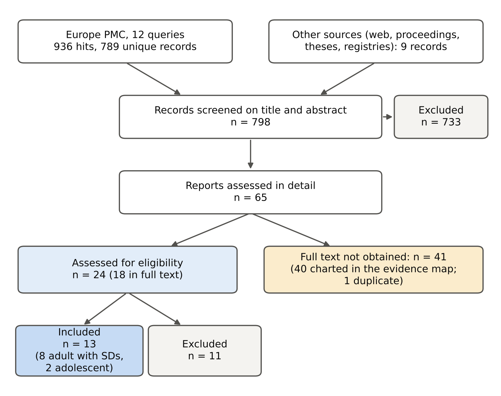

**Peter Kalafatis**

Independent researcher, x9m8.com, New York, NY, USA. Correspondence: x9m8x7@gmail.com

**Preprint, not peer reviewed.** Version 1, October 2026.

## Abstract

Most adults who carry a bag to work carry it on one shoulder, across the body or in one hand, yet advice on bag carriage rests mostly on studies of children's backpacks. I mapped the experimental evidence on asymmetric bag carriage in adults. Twelve Europe PMC queries and a grey-literature search gave 798 records. Sixty-five reports were assessed in detail; for 41 the full text could not be obtained. Thirteen studies were included after full-text reading, and 60 records were charted in an evidence map. The evidence is small and narrow: a median of 15.5 participants per study, mostly young students, mostly loads of 5% to 15% of body mass, laboratory walking of a few minutes, and no study measuring pain. Two electromyography studies agree that a one-shoulder bag raises activity in the strap-side upper trapezius (standardised differences 0.94 to 1.25) and in the opposite-side erector spinae (0.59 to 0.95); in one, a cross-body bag produced a smaller trapezius rise, though the two styles were not compared directly. One study showed gait changes growing with load from 10% to 30% of body mass, while women's own bags at everyday weights changed gait little. Whether any of this causes symptoms has not been tested experimentally.

**Keywords:** load carriage; shoulder bag; handbag; briefcase; gait; electromyography; posture; scoping review; ergonomics

**Social media summary:** One-shoulder bags work the strap-side trapezius harder; whether that causes pain has not been tested.

## 1. Introduction

Bags are carried every day by most working adults, and most of those bags are not backpacks. A briefcase hangs from one hand, a messenger bag crosses the chest, a tote or handbag sits on one shoulder. Each of these puts the load to one side of the body, and the body has to answer that with muscle, posture or a change in the way it walks.

The research literature on load carriage has grown up around two other populations. Military studies examine heavy symmetric loads, and paediatric studies examine school backpacks, where concern about back pain in children drove decades of work and several reviews (for example Ellapen et al., 2021; Guleria et al., 2023). Asymmetric carriage by adults appears in that literature mostly as a comparison condition. Practical advice to adults, to switch shoulders, to wear the strap across the body, to keep the bag light, is therefore drawn largely by analogy.

Existing syntheses cover parts of this ground. Badawy et al. (2018) systematically reviewed one-handed carrying, mainly to identify research gaps for older and obese adults, and Gai et al. (2025) reviewed load carriage, symmetric and asymmetric, in adults aged 60 and over. I am not aware of a review that maps one-shoulder, cross-body and hand-carried bags together in adults of working age. This scoping review asks what has been studied, in whom, with what loads and outcomes, and what the full-text evidence shows about the direction and size of effects. It was originally planned as a meta-analysis; too few studies reported comparable outcomes with usable dispersion, so the effects are reported study by study and not pooled.

## 2. Methods

### 2.1 Design

This is a scoping review with an evidence map, reported with reference to the PRISMA extension for scoping reviews (Tricco et al., 2018). No protocol was registered.

### 2.2 Eligibility

Included studies were experimental or within-subject comparisons in adults (18 years or older) in which a load was carried asymmetrically, on one shoulder, across the body, or in one hand, and compared with carrying nothing or with a symmetric backpack. Outcomes were gait, posture or joint angles, muscle activity, physiological effort, strap pressure, comfort or pain. Studies in adolescents that met all other criteria were kept as a flagged subgroup. Side loads that were not bags (a dumbbell or barbell held at one side) were kept and flagged, since they load the body the same way. Single-case studies, models and reviews were excluded.

### 2.3 Search and screening

Twelve queries were run in Europe PMC, which indexes MEDLINE/PubMed and PubMed Central, on 20 October 2026; the query strings are in the search log in the reproducibility package. They returned 936 hits and 789 unique records. A web search for grey literature, conference proceedings, theses and trial registries added 9 records. Titles and abstracts were screened by a single reviewer working with an AI assistant (§2.6), and 65 reports were taken forward. Full texts were sought from PubMed Central, publisher and repository sites, and Unpaywall. Twenty-four reports were assessed for eligibility: 18 in full text, and six (two reviews, a model, a single-case study, a duplicate and a conference paper) from the abstract or a partial text. For the other 41 the full text could not be obtained in this session, because of a paywall, a bot check that was not bypassed, or no locatable copy; four of them are listed as open access but were not retrieved. These were assessed from the abstract only.

### 2.4 Extraction and evidence map

From full texts, sample, design, task, bag type, load, comparison condition, outcomes and their means and dispersion were extracted from tables or text; nothing was read off figures. Standard errors were converted to standard deviations. The Corrigan (2012) thesis was used for gait values; its journal version (Corrigan & Li, 2014) reports the muscle-activity results. For the evidence map, every record assessed in detail, whether from full text or abstract, was coded by population, bag type and outcome domain. Reviews, the one computational model, and duplicate reports of the same data were removed, leaving 60 records.

### 2.5 Effect sizes

For adult studies that reported a mean and standard deviation for both the carrying and the no-load condition, I computed a within-study standardised difference, *d* = (mean~carry~ − mean~no load~) / √((SD~carry~^2^ + SD~no load~^2^)/2), with Hedges' small-sample correction *J* = 1 − 3/(4(*n* − 1) − 1). Approximate 95% confidence intervals for the within-subject designs use the variance (1/*n* + *d*^2^/2*n*) × 2(1 − *r*) (Borenstein et al., 2009) with a correlation *r* of 0.5 between conditions, since no study reported one; intervals for 0.2 and 0.8 are in the result files. Effects were not pooled across studies. Outcomes reported as change scores, as normalised ratios without a comparison SD, as means without dispersion, or with SDs pooled across other conditions, are described but not converted.

### 2.6 AI use

Searches, screening, full-text extraction, coding, analysis and drafting were carried out with the assistance of Claude (Anthropic; model claude-opus-5-5) in October 2026, under the author's direction. Screening and extraction were therefore not duplicated by a second human reviewer. Independent AI agents checked every number in the manuscript against the extraction file and every citation against its source. The author reviewed the work and takes full responsibility for it.

## 3. Results

### 3.1 What has been studied

Of the 60 records charted (Figure 2), 13 were included after full-text reading, 7 were excluded after eligibility assessment, and 40 were assessed from the abstract only. Forty-five studied adults, five older adults, and ten children or adolescents. One-shoulder bags were the most studied (30 records), followed by hand-carried bags (17), other or unspecified side loads such as dumbbells (16) and cross-body bags (8). Gait was the most common outcome (21 records), followed by posture (11), forces (9), muscle activity (9), balance (8), joint angles (7), physiological effort (6) and coordination (2). One study measured comfort and one strap pressure. None, as far as the full texts and abstracts show, measured pain or musculoskeletal symptoms.

Where sample size was reported (32 records), the median was 15.5 participants (range 1 to 258). Seven records involved occupational groups or participants' own bags (mail and postal carriers, firefighters, manual workers, and women with their own bags), most of them tested in a laboratory. Briefcases appeared in one abstract-only record, whose outcome was standing sway.

The 13 included studies are described in Table 1. Eight studied young adults, mostly students, and one young men with and without chronic low back pain; one studied women aged 18 to 59 carrying their own bags, one women with a mean age of 81, and two adolescents. Loads were mostly 5% to 15% of body mass; two studies went to about 28% to 30%. Walking trials lasted from a few strides to 10 minutes.

### 3.2 Muscle activity

Two studies measured trunk and shoulder muscle activity during treadmill walking with a 10% body-mass bag and reported means and SDs (Table 2; Figure 3). In both, a one-shoulder bag raised activity in the upper trapezius on the strap side: from 3.57 to 8.31 %MVC in Hardie et al. (2015; *g* = 1.25), and by *g* = 0.94 to 1.22 across three strap lengths in Yoon (2014), whose own analysis found no significant effect of strap length. Both also found higher activity in the erector spinae on the side opposite the bag (*g* = 0.95 and 0.59 to 0.70), the muscle that resists the trunk being pulled toward the load. In Hardie et al., the same load in a cross-body bag was associated with a smaller rise in strap-side trapezius activity (4.69 %MVC; *g* = 0.51), although the study did not test the two styles against each other and the intervals overlap; with the cross-body bag, activity rose more in some other muscles. Cho et al. (2013) compared one-shoulder and cross-body carriage directly in 30 women standing still but had no no-load condition and was not included. Strap-side erector spinae activity changed little in either included study.

Two further studies could not be converted. Corrigan (2012) reported peak erector spinae activity normalised to walking without a bag, with means of 1.07 to 1.32 times the unloaded value at 10% to 30% of body mass, but the thesis abstract reports no significant erector spinae increase; and Tajik et al. (2026) reported higher lumbar muscle activity with a dumbbell of 10% and 20% of body mass in one hand, in men with and without chronic low back pain, as means without SDs.

### 3.3 Gait

In the one study that varied load over a wide range, gait changes grew with it. In Corrigan (2012), a shoulder-carried bag widened the stride, lengthened double support and shortened the stride, and each effect grew with load: double support rose from 26.2% of the gait cycle without a bag to 27.7%, 29.5% and 31.1% at 10%, 20% and 30% of body mass (*g* = 0.36, 0.95 and 1.40). In 143 and 61 women walking with and without their own shoulder bags, mostly weighing 5% of body mass or less, Rodrigues et al. (2020) found standardised differences in speed and step and stride length between −0.17 and 0.38. Shin and Yoo (2016) found that very old women turned faster when holding a light bag. Suzuki et al. (2025) reported gait differences by luggage type over 10 minutes of walking, in figures only.

### 3.4 Posture and pelvis

Hyung et al. (2016) measured pelvic tilt and rotation with hand-carried, one-shoulder and cross-body bags at 5%, 10% and 15% of body mass. Of 36 comparisons with walking unloaded, the standardised differences ranged from −0.87 to 1.38 with no consistent pattern by bag type or load (Figure 3). Sussman et al. (2001) reported changes in lateral and forward trunk lean and head tilt with a one-strap bag. In adolescents, a one-shoulder load of about 17% of body mass increased shoulder asymmetry and trunk rotation in standing (Negrini & Negrini, 2007), and a one-shoulder backpack of 15% changed pelvic motion during walking (Ozgul et al., 2012).

### 3.5 Effort

One study measured effort. Walking up and down stairs with a hand-held bag of 10% of body mass, nine men had higher heart rate (149 vs 141 beats per minute) and higher perceived exertion (15.5 vs 11.2 on the Borg scale) than with no load, and slightly higher values than with the same load in a backpack (Tseng & Liu, 2011). These means were averaged over ascent and descent and nine combinations of stair slope and speed, so their SDs are not comparable with the others.

## 4. Discussion

### 4.1 What the evidence shows

The most consistent finding is also the most intuitive. Hang a bag from one shoulder and the upper trapezius on that side works harder to keep the shoulder up and the strap on, while the erector spinae on the other side works harder to stop the trunk leaning toward the load. Two independent studies agree on both at a load of 10% of body mass, with effects of about one standard deviation in the trapezius and 0.6 to 0.95 in the back muscle. Wearing the strap across the body may reduce the shoulder effect, though that rests on one study of 12 women that did not compare the two styles directly. Gait changes are small at everyday loads and grow steadily with heavier ones.

### 4.2 What it does not show

The evidence does not show that any of this matters for health. No record in this map measured pain or musculoskeletal symptoms as an outcome, although 40 of the 60 records were coded from abstracts only; none followed people for longer than a single session; and most tested students for a few minutes in a laboratory. A rise of a few percent of maximal voluntary contraction in the trapezius is a mechanical response, not an injury, and whether it accumulates into neck and shoulder pain in people who carry a bag on the same shoulder every day is an untested hypothesis. Common advice to switch shoulders or use a cross-body strap is plausible on these data, but it has not been tested against an outcome that people would notice.

The loads tested also differ from those people carry. Ten per cent of body mass is 7 kg for a 70 kg adult; the one study of women's own bags found most weighing 5% of body mass or less, and gait differences close to zero.

### 4.3 Gaps worth filling

Three studies would move this field. The first is a field study of people who carry the same bag on the same side every day, with neck and shoulder symptoms as the outcome. The second is a laboratory comparison of one-shoulder, cross-body and hand-carried bags at the same realistic load over a walk long enough to produce fatigue, 20 to 30 minutes, with muscle activity and discomfort measured together. The third is any study of the briefcase, the classic hand-carried work bag, which appeared in only one record and was not studied on its own.

### 4.4 Limitations

Forty-seven of 65 reports could not be read in full (41 with no full text available and six assessed from the abstract or a partial text), which is the largest weakness of this review; they were charted from abstracts, and their results are not reported. Screening and extraction were done by one reviewer with AI assistance, not by two independent reviewers. Effect sizes assume a within-subject correlation that no study reported, and one study's EMG units were ambiguously labelled. Outcome definitions, normalisation methods and loads differed enough that pooling would have been misleading. The search used one database, though it indexes MEDLINE and PubMed Central, plus a grey-literature search, and it missed at least one relevant review (Badawy et al., 2018) and one possibly eligible study of a cross-body bag and standing weight distribution (Qureshi & Shamus, 2012), found later during citation checking. In one study the lateral trunk-lean values differ between the abstract and the table; the table values were used. No protocol was registered.

## 5. Conclusion

Carrying a bag on one shoulder at a tenth of body weight raises activity in the strap-side shoulder muscle and the opposite-side back muscle, and in one study heavier loads changed gait in proportion. That is the extent of the evidence. Whether everyday bag carriage causes pain has not been tested experimentally, and the briefcase has barely been studied at all.

## Acknowledgements

The author thanks the authors of the included studies who published their work open access. Claude (Anthropic; model claude-opus-5-5) assisted with searching, screening, extraction, analysis and drafting in October 2026, as described in §2.6. The author reviewed all outputs and is responsible for the content.

## Author contributions

P.K. conceived the study, directed the review, and reviewed and approved the manuscript.

## Financial support

This research received no specific grant from any funding agency, commercial or not-for-profit sector.

## Conflicts of interest

The author owns Marcellino NY, a small business that makes and sells leather briefcases, including models carried by hand and on one shoulder. This review did not evaluate any product, and the author's business could be seen as having an interest in its subject.

## Research transparency and reproducibility

The search log with all query strings, the screening record for all 65 reports, the extraction file, the evidence-map coding, the analysis code and all result files are in the reproducibility package linked from the article page. All included studies are cited below.

## References

Badawy, M., Schall, M. C., Jr., Sesek, R. F., Gallagher, S., Davis, G. A., & Capanoglu, M. F. (2018). One-handed carrying among elderly and obese individuals: A systematic review to identify research gaps. *Ergonomics*, *61*(10), 1345–1354. https://doi.org/10.1080/00140139.2018.1470680

Borenstein, M., Hedges, L. V., Higgins, J. P. T., & Rothstein, H. R. (2009). *Introduction to meta-analysis*. Wiley. https://doi.org/10.1002/9780470743386

Cho, S.-H., Lee, J.-H., & Kim, C.-Y. (2013). The changes of electromyography in the upper trapezius and supraspinatus of women college students according to the method of bag-carrying and weight. *Journal of Physical Therapy Science*, *25*(9), 1129–1131. https://doi.org/10.1589/jpts.25.1129

Corrigan, L. (2012). *The effect of unilateral load carriage on the muscle activities of the trunk and lower limbs of young healthy males during gait* [Master's thesis, University of Ottawa]. uO Research. https://doi.org/10.20381/ruor-6220

Corrigan, L. P., & Li, J. X. (2014). The effect of unilateral hockey bag carriage on the muscle activities of the trunk and lower limb of young healthy males during gait. *Research in Sports Medicine*, *22*(1), 23–35. https://doi.org/10.1080/15438627.2013.852094

Ellapen, T. J., Paul, Y., Hammill, H. V., & Swanepoel, M. (2021). Altered cervical posture kinematics imposed by heavy school backpack loading: A literature synopsis (2009–2019). *African Journal of Disability*, *10*, Article 687. https://doi.org/10.4102/ajod.v10i0.687

Gai, Z., Meng, Z., & Liu, H. (2025). A systematic review of the biomechanical impact of load carriage on gait in older adults. *Trends in Physical Education and Sport*, *1*(2), 4–14. https://doi.org/10.31489/3081-0531/2025-1-2/4-14

Guleria, M., Sharma, S. P., & Kumar, A. (2023). Analytical parameters to check association between load carriage system and bag packs-influenced musculoskeletal complications among school going students: A scoping review. *Physical Activity and Nutrition*, *27*(3), 20–26. https://doi.org/10.20463/pan.2023.0025

Hardie, R., Haskew, R., Harris, J., & Hughes, G. (2015). The effects of bag style on muscle activity of the trapezius, erector spinae and latissimus dorsi during walking in female university students. *Journal of Human Kinetics*, *45*(1), 39–47. https://doi.org/10.1515/hukin-2015-0005

Hyun, S.-H., & Ryew, C.-C. (2018). Effect of wearing positions of load on the dynamic balance during gait. *Journal of Exercise Rehabilitation*, *14*(1), 152–155. https://doi.org/10.12965/jer.1835120.560

Hyung, E.-J., Lee, H.-O., & Kwon, Y.-J. (2016). Influence of load and carrying method on gait, specifically pelvic movement. *Journal of Physical Therapy Science*, *28*(7), 2059–2062. https://doi.org/10.1589/jpts.28.2059

Negrini, S., & Negrini, A. (2007). Postural effects of symmetrical and asymmetrical loads on the spines of schoolchildren. *Scoliosis*, *2*, Article 8. https://doi.org/10.1186/1748-7161-2-8

Ozgul, B., Akalan, N. E., Kuchimov, S., Uygur, F., Temelli, Y., & Polat, M. G. (2012). Effects of unilateral backpack carriage on biomechanics of gait in adolescents: A kinematic analysis. *Acta Orthopaedica et Traumatologica Turcica*, *46*(4), 269–274. https://doi.org/10.3944/AOTT.2012.2678

Qureshi, Y., & Shamus, E. (2012). Unilateral shoulder bags: Can they be worn in a way to reduce postural asymmetry? *Internet Journal of Allied Health Sciences and Practice*, *10*(4), Article 5. https://doi.org/10.46743/1540-580X/2012.1415

Rodrigues, B. K. M. M., Maciel, M. A. M., Parente, B. L., Lima, P. O. de P., & Abdon, A. P. V. (2020). Use and weight of shoulder bag in female gait and associated factors. *Motricidade*, *16*(2), 144–155. https://doi.org/10.6063/motricidade.16954

Shin, S.-S., & Yoo, W.-G. (2016). Differences in gait velocity and trunk acceleration during semicircular turning gait with and without bag in females of very advanced age. *Journal of Physical Therapy Science*, *28*(8), 2330–2331. https://doi.org/10.1589/jpts.28.2330

Sussman, D. H., Walker, M., Tamburello, M., VanLunen, B., Dowling, E. A., Campbell, K. R., Flores, J. D., Ibrahim, R. A., & Larson, E. A. (2001). Loaded backpack positions affects trunk position during walking. *ISBS Conference Proceedings Archive* (Biomechanics Symposia 2001, University of San Francisco), 150–153. https://ojs.ub.uni-konstanz.de/cpa/article/view/3799

Suzuki, S., Watanabe, D., Shimizu, H., Tanigawa, K., Kashiyama, S., Kawamoto, S., Nagai-Tanima, M., & Aoyama, T. (2025). Effect of luggage type on gait parameters using in-shoe motion sensors. *Scientific Reports*, *15*, Article 27074. https://doi.org/10.1038/s41598-025-12569-4

Tajik, R., Dhahbi, W., Mimar, R., Khaleghi Tazji, M., Ceylan, H. İ., Bayrakdaroğlu, S., Stefanica, V., & Hammami, N. (2026). Neuromuscular and kinetic adaptations to symmetric and asymmetric load carriage during walking in individuals with chronic low back pain. *Bioengineering*, *13*(1), Article 82. https://doi.org/10.3390/bioengineering13010082

Tricco, A. C., Lillie, E., Zarin, W., O'Brien, K. K., Colquhoun, H., Levac, D., Moher, D., Peters, M. D. J., Horsley, T., Weeks, L., Hempel, S., Akl, E. A., Chang, C., McGowan, J., Stewart, L., Hartling, L., Aldcroft, A., Wilson, M. G., Garritty, C., … Straus, S. E. (2018). PRISMA extension for scoping reviews (PRISMA-ScR): Checklist and explanation. *Annals of Internal Medicine*, *169*(7), 467–473. https://doi.org/10.7326/M18-0850

Tseng, H.-Y., & Liu, B.-S. (2011). Effects of load carrying methods and stair slopes on physiological response and postures during stairs ascending and descending. *Industrial Health*, *49*(1), 30–36. https://doi.org/10.2486/indhealth.MS1100

Yoon, J.-G. (2014). Correlations between muscle activities and strap length and types of school bag during walking. *Journal of Physical Therapy Science*, *26*(12), 1937–1939. https://doi.org/10.1589/jpts.26.1937

## Tables

**Table 1.** Studies included after full-text reading (n = 13). BM, body mass; EMG, electromyography; F, female; M, male. Ages are means.

| Study | Country | Participants | Load carried | Task | Outcomes |
|:--|:--|:--|:--|:--|:--|
| Hardie et al. (2015) | UK | 12 F, 21 y | One-shoulder and cross-body bag, 10% BM | Treadmill, 5 min | Trunk and shoulder EMG |
| Yoon (2014) | South Korea | 20, 23 y | One-shoulder bag, 10% BM, three strap lengths | Treadmill, 5 min | Trapezius and erector spinae EMG |
| Hyung et al. (2016) | South Korea | 16, 21 y | Hand, one-shoulder and cross-body bag, 5/10/15% BM | Overground | Pelvic tilt and rotation |
| Corrigan (2012) | Canada | 15 M, 23 y | Shoulder-carried hockey bag, 10/20/30% BM | Overground | Gait; erector spinae EMG |
| Rodrigues et al. (2020) | Brazil | 258 F (143 and 61 analysed by side), 18–59 y | Participant's own shoulder bag (right or left), mostly ≤5% BM | Overground, 2 m plate | Gait |
| Sussman et al. (2001) | USA | 10, students | One-strap bag on one shoulder, 5.9 kg | Treadmill | Trunk and head angles |
| Shin & Yoo (2016) | South Korea | 10 F, 81 y | Hand-held bag, ~0.2 kg | Turning gait | Gait speed; trunk acceleration |
| Tseng & Liu (2011) | Taiwan | 9 M, 22 y | Hand-held bag of books, 10% BM | Stairs | Heart rate; perceived exertion; trunk flexion |
| Hyun & Ryew (2018) | South Korea | 9 M, 23 y | 20 kg barbell at one side (not a bag) | Overground | Gait; balance; ground force |
| Tajik et al. (2026) | Iran | 30 M (15 with chronic low back pain), 23–28 y | Dumbbell in one hand, 10/20% BM (not a bag) | Overground | Lumbar EMG (means only) |
| Suzuki et al. (2025) | Japan | 26 young adults | One-shoulder and cross-body bag | Walking 10 min, in-shoe sensors | Gait (figures only) |
| Negrini & Negrini (2007) | Italy | 43, 12–13 y (adolescents) | One-strap 8 kg load | Standing | Spinal posture |
| Ozgul et al. (2012) | Turkey | 20 M, 13 y (adolescents) | Backpack on one shoulder, 15% BM | Overground | Pelvic kinematics |

**Table 2.** The most consistent findings, adult studies versus carrying nothing. g: within-study standardised difference (Hedges); 95% CI assumes a between-condition correlation of 0.5. EMG in %MVC (Hardie) or as reported (Yoon; unit labelling ambiguous). Strap or bag side as reported by the authors.

| Finding | Study | Carrying vs not carrying | g (95% CI) |
|:--|:--|:--|:--|
| Strap-side upper trapezius, one-shoulder bag | Hardie et al. (2015) | 8.31 vs 3.57 | 1.25 (0.49 to 2.00) |
| Strap-side upper trapezius, cross-body bag | Hardie et al. (2015) | 4.69 vs 3.57 | 0.51 (-0.09 to 1.11) |
| Bag-side upper trapezius, one-shoulder bag, strap iliac crest | Yoon (2014) | 0.31 vs 0.168 | 0.94 (0.41 to 1.46) |
| Bag-side upper trapezius, one-shoulder bag, strap 10 cm below iliac crest | Yoon (2014) | 0.357 vs 0.168 | 1.20 (0.63 to 1.78) |
| Bag-side upper trapezius, one-shoulder bag, strap 20 cm below iliac crest | Yoon (2014) | 0.421 vs 0.168 | 1.22 (0.64 to 1.80) |
| Opposite-side erector spinae, one-shoulder bag | Hardie et al. (2015) | 3.61 vs 2.51 | 0.95 (0.27 to 1.64) |
| Opposite-side erector spinae, strap iliac crest | Yoon (2014) | 0.251 vs 0.196 | 0.59 (0.11 to 1.06) |
| Opposite-side erector spinae, strap 10 cm below iliac crest | Yoon (2014) | 0.248 vs 0.196 | 0.62 (0.14 to 1.10) |
| Opposite-side erector spinae, strap 20 cm below iliac crest | Yoon (2014) | 0.252 vs 0.196 | 0.70 (0.21 to 1.19) |
| Double support, shoulder bag 10% BM | Corrigan (2012) | 27.7 vs 26.2 | 0.36 (-0.16 to 0.89) |
| Double support, shoulder bag 20% BM | Corrigan (2012) | 29.5 vs 26.2 | 0.95 (0.34 to 1.55) |
| Double support, shoulder bag 30% BM | Corrigan (2012) | 31.1 vs 26.2 | 1.40 (0.69 to 2.12) |
| Stride length, shoulder bag 10% BM | Corrigan (2012) | 1.46 vs 1.51 | -0.41 (-0.93 to 0.12) |
| Stride length, shoulder bag 20% BM | Corrigan (2012) | 1.45 vs 1.51 | -0.49 (-1.02 to 0.05) |
| Stride length, shoulder bag 30% BM | Corrigan (2012) | 1.39 vs 1.51 | -0.98 (-1.59 to -0.36) |
| Stride width, shoulder bag 10% BM | Corrigan (2012) | 11.2 vs 10.6 | 0.24 (-0.27 to 0.75) |
| Stride width, shoulder bag 20% BM | Corrigan (2012) | 13.1 vs 10.6 | 0.84 (0.25 to 1.43) |
| Stride width, shoulder bag 30% BM | Corrigan (2012) | 16.3 vs 10.6 | 1.63 (0.86 to 2.40) |

## Figures

![**Figure 3.** Standardised differences between carrying and not carrying, adult studies with means and SDs for both conditions (8 studies, 89 outcomes). Each dot is one outcome in one study; grey bars are approximate 95% confidence intervals assuming a within-subject correlation of 0.5. Outlined dots are muscle-activity measurements on the side of the strap (one-shoulder bag) or strap shoulder (cross-body bag); side-specific gait and pelvis outcomes are not outlined. One value beyond the axis (peak vertical ground reaction force with a 20 kg barbell, *g* = 4.6) is marked with an arrow. Effects are not pooled.](../figures/fig3_effects.png)
