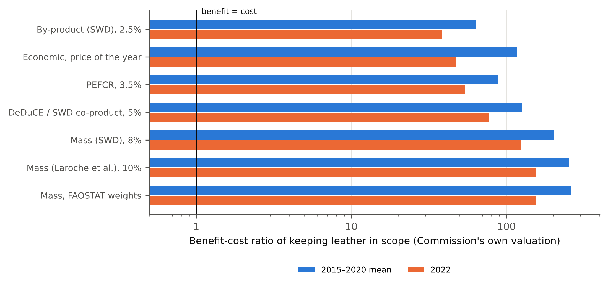

**Peter Kalafatis**

Independent researcher, x9m8.com, New York, NY, USA. Correspondence: x9m8x7@gmail.com

**Preprint, not peer reviewed.** Version 1, October 2026.

## Abstract

In July 2026 the European Commission adopted a delegated act removing cattle hides, skins and leather from the EU Deforestation Regulation, citing, among other grounds, their "relatively low economic value" compared with meat. The Commission's own assessment had attributed 2.5% to 8% of cattle-driven deforestation to hides, depending on the method. I recomputed the deforestation embodied in EU27 imports of raw hides, wet-blue and finished leather for 2005–2022 from Eurostat, FAOSTAT and DeDuCE data. The 5% value share DeDuCE gives leather, adopted in the Commission's assessment, is a constant in the model's code. The EU import price of raw hides fell from 51% of the beef price in 2005 to 15% in 2025, and an economic allocation factor built on those prices fell from 7.2% to 2.9% between 2005 and 2022. Under the seven allocation rules tested, imports embodied 21,000 to 87,000 hectares of deforestation a year in 2015–2020, two-thirds of it in Brazil. Taking the Commission's own per-hectare valuation, which assumes the rule is fully effective, the benefit of keeping leather in scope exceeded its compliance cost by a factor of 39 to 262 under every rule and period. Lower value moves the hectares assigned to leather, not the forest cleared for cattle.

**Keywords:** EU Deforestation Regulation; leather; cattle hides; embodied deforestation; allocation; Brazil; Paraguay; trade

**Social media summary:** The EU exempted leather from its deforestation law for its low value. On the Commission's own numbers, benefits still beat costs by at least 39 to 1.

## 1. Introduction

The EU Deforestation Regulation (Regulation (EU) 2023/1115) requires operators who place certain commodities on the EU market to show that they were not produced on land deforested after 2020. Cattle is one of the seven commodities, and the original Annex I covered cattle hides and skins (HS 4101), tanned or crust hides (4104) and finished leather (4107) alongside beef. After two delays, the regulation applies to large and medium operators from 30 December 2026 (Regulation (EU) 2025/2650).

On 13 July 2026 the Commission adopted a delegated act, in force since 18 September 2026, deleting the cattle lines of headings 4101, 4104 and 4107 from Annex I (Commission Delegated Regulation (EU) 2026/2102). Recital (5) cites, among other grounds, "the relatively low economic value of cattle skins and hides compared to meat within the overall cattle production." The accompanying staff working document (SWD) is franker about the trade-off. It reports that, when hides are treated as a by-product of cattle production, they account for 2.5% of cattle-related deforestation; as a value-based co-product, 5%; and by mass, 8%. It puts the environmental benefit of keeping leather in scope at €979 million to €1,957 million a year against recurring compliance costs of €16.7 million, and still proposes the exclusion, citing the hide's lower economic value, the separate leather value chain, and the imbalance of covering leather but not imported leather goods, while ruling out the alternative of adding derived leather products partly because of the load on the EUDR IT system (European Commission, 2026).

The decision therefore turns on two quantities: how much of the forest cleared for cattle should be charged to the hide, and how many hectares that puts behind European leather imports. Both depend on an allocation rule. The most detailed peer-reviewed estimate of EU leather's deforestation footprint rests mainly on mass: Laroche et al. (2024) attributed 10% of pasture-driven deforestation to hides, based on an 11% hide-to-beef mass ratio checked against market-value estimates of 5% to 15%, and found that EU demand for hides was linked to about 1,200 to 31,000 hectares of forest loss a year in 2018–2020, the upper figure including derived consumer goods. The 5% the Commission describes as value-based comes from the DeDuCE model (Singh & Persson, 2026).

Value-based allocation has a property that matters here. A companion paper showed that the US hide's share of a steer's value fell about fivefold between 2002–2013 and 2023–2025, as hide prices fell and cattle prices rose (Kalafatis, 2026), and Lunesu et al. (2025) reported Italian hide-to-meat price ratios for dairy cows falling from 0.70 in 2015 to 0.19 in 2023. If the value of hides is falling, a value-based allocation shrinks the deforestation charged to leather even when the same forest is being cleared for the same cattle.

This paper asks three questions. What allocation factor do actual hide and beef prices imply for the countries that supply the EU? How much deforestation do EU hide and leather imports embody under each rule? And does the benefit-cost case for keeping leather in the regulation survive the lowest of these factors?

## 2. Methods

### 2.1 Data

Trade data are EU27 annual imports from every extra-EU partner of HS 4101, 4104 and 4107 for 2005–2025, in euros and in 100 kg, from Eurostat Comext (dataset DS-045409, reporter EU27_2020; Eurostat, 2026), retrieved on 21 October 2026. These headings also cover equine hides (and, for 4101, buffalo hides), which the trade data do not separate; all imports under them were treated as cattle. Imports were converted to raw-hide equivalent with the factors used in the SWD's Annex II: 1.00 for 4101, 2.33 for 4104 and 4.20 for 4107 (European Commission, 2026). Unit values for raw hides (4101) and for fresh and frozen beef (0201 and 0202) came from the same source.

Deforestation is the DeDuCE estimate of deforestation driven by cattle pasture expansion, by producer country and year, 2001–2022, in version 2.0 of the data distributed with the trade data of Singh et al. (2024), using the five-year amortised "deforestation risk" (Singh & Persson, 2026). DeDuCE splits pasture deforestation between "Cattle meat" and "Leather"; I summed the two to recover total cattle-driven deforestation. Hide production (tonnes of raw hides and skins of cattle), beef production, and hide and carcass weights per animal are from FAOSTAT (FAO, 2026), retrieved on 21 October 2026.

### 2.2 Embodied deforestation

For origin country *c* and year *t*, the deforestation carried by one tonne of raw hide is

*h*~ct~ = α~ct~ × *D*~ct~ / *H*~ct~,

where *D* is cattle-driven deforestation, *H* is national hide production and α is the hide's allocation factor. EU embodied deforestation is the sum over origins of raw-hide-equivalent imports times *h*. Finished leather made in third countries is attributed to the country that exported it to the EU, not to the country where the cattle were raised, as in the SWD's Annex II, which uses direct EU imports; this understates the role of origins such as Brazil whose hides are tanned in Asia.

### 2.3 Allocation rules

I tested seven rules: the SWD's by-product (2.5%), co-product (5%) and mass (8%) factors; the PEFCR leather default of 3.5% (De Rosa-Giglio et al., 2018); Laroche et al.'s (2024) 10% mass share; and a mass share computed from FAOSTAT hide and carcass weights for each country and year. The economic rule uses the price of each year:

α~ct~ = *P*~hide,t~ *w*~hide,ct~ / (*P*~hide,t~ *w*~hide,ct~ + *P*~beef,ct~ *k* *w*~carcass,ct~),

where *P*~hide~ is the EU import unit value of raw hides from all extra-EU origins, *P*~beef~ the EU import unit value of beef from origin *c*, where beef import data were retrieved for that origin (the 15 largest hide and beef suppliers) and the EU imported at least 100 tonnes of beef from it that year, and otherwise the unit value for all extra-EU origins, *w* the FAOSTAT hide and carcass weights per animal, and *k* = 0.70 the share of carcass weight sold as boneless beef. Because the all-origin beef price also moves when the EU changes where it buys beef, a fixed-mix beef price was computed by weighting origin prices by their 2005–2007 shares of EU beef imports. Sensitivity analyses used *k* = 0.60 and 0.80, the all-origin beef price, the fixed-mix beef price, and unamortised deforestation. The rule leaves out offal, fat and other by-products, which would lower α further.

### 2.4 Benefit and cost

The SWD's Annex II implies an environmental benefit of €50,170 per hectare of avoided deforestation (its summed benefits divided by its summed hectares) and a recurring compliance cost of €16.7 million a year. I applied both unchanged to each allocation rule to compute a benefit-cost ratio, and the allocation factor at which benefit would equal cost. The Commission's figure is a gross benefit: it assumes that every hectare attributed to EU imports would be avoided, with no leakage to other markets. The ratios therefore test the internal consistency of the Commission's assessment rather than estimate the regulation's real-world effect.

### 2.5 Software, data and AI use

DeDuCE code was read at commit 48e4b5a (24 April 2026). Analyses used Python 3.13 with pandas, NumPy and pycountry; figures used matplotlib. All code and processed data are in the reproducibility package. The study was carried out with the assistance of Claude (Anthropic; model claude-opus-5-5) in October 2026, which retrieved data, wrote and ran the analysis code, searched the literature and drafted the text under the author's direction. Independent AI agents checked every number against the result files and every citation against its source. The author reviewed the work and takes full responsibility for it.

## 3. Results

### 3.1 The 5% is a constant

In the DeDuCE data, leather's share of pasture deforestation is 5.0% in every one of the 2,620 country-years with cattle deforestation. The model's code assigns 95% of pasture deforestation, emissions and peat drainage to cattle meat and 5% to leather as fixed multipliers (Singh, 2024, file "4. Deforestation attribution (Python)-Statistical.py", commit 48e4b5a). Whatever its original derivation, which I did not trace in the model's supplementary material, the factor the Commission calls a value-based co-product share is applied identically to every country and year, and so cannot reflect changes in what hides are worth.

### 3.2 What prices imply

The EU import price of raw cattle hides was €1.75 per kg in 2005 and €1.41 in 2025, while the import price of beef rose from €3.43 to €9.69 (Table 2; Figure 1A). The ratio of the two fell from 0.51 to 0.15. The economic allocation factor built on these prices, weighted by EU imports from countries with cattle-driven deforestation, was 7.2% in 2005 and peaked at 8.7% in 2006, ranged from 4.3% to 6.1% in 2008–2018, and was 2.8% to 3.0% in 2020–2022 (Figure 1B). For Brazil it fell from 8.3% in 2005 to 2.8% in 2022 and was 3.0% in 2024. Part of the early fall in the all-origin beef price reflects a change in where the EU bought beef: imports from Brazil fell from 159,010 tonnes in 2007 to 36,399 tonnes in 2008. Holding the 2005–2007 origin mix fixed gives almost the same path, from 7.8% in 2005 to 2.9% in 2022 (Table 2), and a hide-to-beef price ratio falling from 0.52 to 0.16 over 2005–2025. Import-weighted mass shares from FAOSTAT weights were 10.0% to 10.6% in every year, ranging from about 9% for Brazil to about 13.5% for Paraguay.

### 3.3 Deforestation embodied in EU imports

EU27 imports of cattle hides and leather from outside the EU fell from 1.39 million tonnes of raw-hide equivalent in 2005 to 0.98 million in 2022 and 0.76 million in 2025. Countries covered by both DeDuCE and FAOSTAT accounted for 94% to 96% of these imports in every year. The largest excluded supplier was India, for which FAOSTAT reports no cattle hide production; DeDuCE attributes about 15,550 hectares a year of cattle-driven deforestation to India, so its exclusion leaves out an unknown but likely modest amount.

At the 5% factor, imports embodied 42,216 hectares of deforestation a year on average in 2015–2020 (Table 1), about 8% above the Commission's upper estimate of 39,005 hectares, which used average 2015–2020 trade, so the comparison is like for like. Brazil accounted for 66.5% of that total, Paraguay for 21.3% and Bolivia for 5.3%. Across the seven rules the 2015–2020 average ranged from 21,108 hectares (2.5%) to 87,445 hectares (FAOSTAT mass weights), a fourfold spread produced by the rule alone (Figure 2).

The economic rule ran well above the 5% line in 2005–2007, at 1.6 to 2.0 times it (139,259 hectares in 2006, above even the 10% line), and again in 2013–2017, though only narrowly from 2015. From 2018 it was below the 5% line every year. In 2022 it gave 15,779 hectares, against 25,703 at 5% and 51,719 under FAOSTAT mass weights. Part of the 2021–2022 decline in every series reflects lower DeDuCE estimates for those years, which its authors caution are less reliable.

### 3.4 Benefit and cost

Under every rule and in every period the Commission's own valuation put the benefit of keeping leather in the regulation far above its cost (Table 1; Figure 3). For 2015–2020 the benefit-cost ratio ranged from 63 (2.5%) to 262 (mass weights), and 117 under the economic rule. For 2022 it ranged from 39 to 155, and 47 under the economic rule. Benefit would equal cost at an allocation factor of 0.04%, about one-sixtieth of the lowest factor the Commission itself considered.

## 4. Discussion

### 4.1 What "lower economic value" does

The Commission is right that hides are worth less than they were. EU import prices show raw hides losing more than two-thirds of their value relative to beef over twenty years, and the economic allocation factor falling by more than half. But a falling value share does not change how much forest is cleared for cattle. It changes how much of that clearing is charged to the hide. Under a value rule, the less a hide is worth, the less deforestation its buyers are held to carry; under a mass rule, nothing changes. The choice between them is a choice about who should answer for the clearing, not a finding about the forest.

Even taking the value rule at its lowest, the case the Commission's own assessment made for keeping leather in scope does not weaken enough to change sign. At the economic factor of 2022, about 2.9%, the benefit on the Commission's valuation was still about 47 times the cost. That valuation is a gross figure that assumes full effectiveness; real-world leakage would lower every ratio, but it would have to remove more than 97% of the benefit to close the gap at the economic rule.

### 4.2 The fixed 5%

DeDuCE is a careful global dataset and its authors designed it to attribute deforestation to commodities, not to settle allocation between co-products. Its fixed 5% is a reasonable modelling convention, and its documentation may give a derivation that this paper has not examined. It becomes a problem when it is presented in a policy assessment as a "co-product" value share and set beside the argument that leather's value has fallen. On the prices in this study, 5% understated the value share in 2005–2008, 2011 and 2013–2014 and overstated it in every year from 2015. A value-based allocation used to justify a decision about value should be computed from prices, and its year stated.

### 4.3 Limitations

Hide prices are EU import unit values for raw hides from all origins, not farm-gate prices in Brazil or Paraguay; beef prices are import unit values of mostly boneless cuts, converted to a carcass basis with an assumed boneless yield. The economic rule ignores offal and other by-products. FAOSTAT hide production is imputed in most records (4,588 of 5,493), and in every year for Brazil, Paraguay, Bolivia, Colombia and Venezuela, as a fixed ratio to beef output; the "FAOSTAT weights" mass rule therefore reflects FAO's imputation ratios. Brazil's series shows a level break around 2020, which does not affect the results because only the hide-to-carcass ratio enters. Origin beef prices were retrieved for 15 origins only; the all-origin price is used elsewhere, and it is affected by shifts in the EU's beef sourcing, which the fixed-mix sensitivity addresses. HS 4101, 4104 and 4107 include equine and buffalo hides. India, Sudan and Serbia are excluded for lack of FAOSTAT hide data. Embodied deforestation is attributed to the exporting country, not the country of cattle origin, so leather tanned in third countries from South American hides is assigned to the tanning country. DeDuCE estimates for 2021–2022 are flagged by their authors as less reliable, and the version used (v2.0) ends in 2022, so imports for 2023–2025 are described but not converted to hectares; a newer release (v2.1) extends to 2023. The benefit-cost ratios reuse the Commission's per-hectare valuation and compliance cost without re-estimating either. The valuation assumes full effectiveness and no leakage; the ratios show the internal consistency of the Commission's own assessment, not an independent estimate of what the regulation would achieve. The SWD figures were read from a draft-labelled copy published by the Commission before the final SWD(2026) 194.

## 5. Conclusion

The leather exemption rests on a value argument, and value-based allocation does shrink leather's share of cattle deforestation as hides cheapen: from about 7% to about 3% over 2005–2022 on EU prices. It does not shrink the forest. Under every allocation rule tested, including the lowest, the Commission's own numbers show the gross benefit of keeping leather in scope exceeding its cost many times over. The 2030 review of the regulation should state which allocation rule it uses and in which year's prices.

## Acknowledgements

The author thanks Eurostat, FAO, and the DeDuCE authors for open data and open code. Claude (Anthropic; model claude-opus-5-5) assisted with data retrieval, analysis code, literature search and drafting in October 2026, as described in §2.5. The author reviewed all outputs and is responsible for the content.

## Author contributions

P.K. conceived the study, directed the analysis, and reviewed and approved the manuscript.

## Financial support

This research received no specific grant from any funding agency, commercial or not-for-profit sector.

## Conflicts of interest

The author owns Marcellino NY, a small business that makes and sells leather briefcases and buys finished leather. The exemption studied here affects the supply chains of such businesses. The author has no financial interest in hide trading, tanning, meatpacking or alternative materials.

## Research transparency and reproducibility

All inputs are public: Eurostat Comext DS-045409; FAOSTAT production; DeDuCE trade and attribution data (Zenodo, CC BY 4.0) and DeDuCE code (GitHub). Code, the processed panel and all result files are in the reproducibility package linked from the article page.

## References

De Rosa-Giglio, P., Fontanella, A., Gonzalez-Quijano, G., Ioannidis, I., Nucci, B., & Brugnoli, F. (2018). *Product environmental footprint category rules (PEFCR): Leather* (Final version, 25 April 2018). Leather Pilot Technical Secretariat. https://web.archive.org/web/20220205045047/https://ec.europa.eu/environment/eussd/smgp/pdf/PEFCR_leather.pdf

European Commission. (2026). *Commission staff working document accompanying the document Commission Delegated Regulation (EU) …/... amending Regulation (EU) 2023/1115 of the European Parliament and of the Council as regards the list of relevant commodities and relevant products* [Draft-labelled copy of SWD(2026) 194 final]. https://environment.ec.europa.eu/document/download/9b5c8907-8651-440f-be8f-bb2d3d549763_en?filename=Commission%20Staff%20Working%20Document%20on%20Delegated%20Regulation%20on%20EUDR%20list%20of%20relevant%20commodities%20and%20products.pdf

Commission Delegated Regulation (EU) 2026/2102 of 13 July 2026 amending Regulation (EU) 2023/1115 of the European Parliament and of the Council as regards the list of relevant commodities and relevant products. *Official Journal of the European Union*, L, 2026/2102, 17 September 2026. https://eur-lex.europa.eu/eli/reg_del/2026/2102/oj/eng

Eurostat. (2026). *EU trade since 1988 by HS2-4-6 and CN8* (DS-045409) [Data set]. Retrieved October 21, 2026, from https://ec.europa.eu/eurostat/api/comext/dissemination/statistics/1.0/data/DS-045409

FAO. (2026). *FAOSTAT: Crops and livestock products* (QCL) [Data set]. Food and Agriculture Organization of the United Nations. Retrieved October 21, 2026, from https://bulks-faostat.fao.org/production/Production_Crops_Livestock_E_All_Data_(Normalized).zip

Kalafatis, P. (2026). *Leather's carbon bill follows the hide price, not the cow: Economic allocation of US cattle emissions to hides, 2001–2025* [Preprint]. x9m8.com. https://x9m8.com/leather-carbon-footprint-hide-price-allocation/

Laroche, P. C. S. J., Gómez-Suárez, M., Persson, U. M., Pendrill, F., Schwarzmueller, F., Schulp, C. J. E., & Kastner, T. (2024). Accounting for trade in derived products when estimating European Union's role in driving deforestation. *Ecological Economics*, *224*, Article 108288. https://doi.org/10.1016/j.ecolecon.2024.108288

Lunesu, M. F., Correddu, F., Carta, S., Sechi, S., Farina, M., & Pulina, G. (2025). Attributing farm-to-slaughter emissions to hides: Evidence from beef supply chains. *Animals*, *15*(24), Article 3546. https://doi.org/10.3390/ani15243546

Regulation (EU) 2023/1115 of the European Parliament and of the Council of 31 May 2023 on the making available on the Union market and the export from the Union of certain commodities and products associated with deforestation and forest degradation and repealing Regulation (EU) No 995/2010. *Official Journal of the European Union*, L 150, 206–247. https://eur-lex.europa.eu/eli/reg/2023/1115/oj/eng

Regulation (EU) 2025/2650 of the European Parliament and of the Council of 19 December 2025 amending Regulation (EU) 2023/1115 as regards certain obligations of operators and traders. *Official Journal of the European Union*, L, 2025/2650, 23 December 2025. https://eur-lex.europa.eu/legal-content/EN/TXT/HTML/?uri=CELEX:32025R2650

Singh, C. (2024). *DeDuCE: Deforestation Driver and Carbon Emission model* (Version 1.0.1) [Computer software]. GitHub. https://github.com/chandrakant6492/DeDuCE

Singh, C., & Persson, U. M. (2026). Global patterns of commodity-driven deforestation and associated carbon emissions. *Nature Food*, *7*(2), 138–151. https://doi.org/10.1038/s43016-026-01305-4

Singh, C., Persson, U. M., Croft, S., Kastner, T., & West, C. D. (2024). *Commodity-driven deforestation, associated carbon emissions and trade 2001–2022* (Version 2.0) [Data set]. Zenodo. https://doi.org/10.5281/zenodo.10633818

## Tables

**Table 1.** Deforestation embodied in EU27 imports of cattle hides and leather (HS 4101, 4104, 4107, raw-hide equivalent) under each allocation rule, and the benefit-cost ratio of keeping leather in the regulation computed with the Commission's own valuation (EUR 50,170 per hectare, implied by SWD Annex II) and compliance cost (EUR 16.7 million per year).

| Allocation rule | Hectares per year, 2015–2020 mean | Hectares, 2022 | Benefit-cost, 2015–2020 | Benefit-cost, 2022 |
|:--|--:|--:|--:|--:|
| By-product (SWD), 2.5% | 21,108 | 12,851 | 63 | 39 |
| PEFCR, 3.5% | 29,551 | 17,992 | 89 | 54 |
| DeDuCE / SWD co-product, 5% | 42,216 | 25,703 | 127 | 77 |
| Mass (SWD), 8% | 67,546 | 41,124 | 202 | 123 |
| Mass (Laroche et al.), 10% | 84,432 | 51,405 | 253 | 154 |
| Mass, FAOSTAT weights | 87,445 | 51,719 | 262 | 155 |
| Economic, price of the year | 39,167 | 15,779 | 117 | 47 |
| Economic, k = 0.60 | 45,326 | 18,312 | 136 | 55 |
| Economic, k = 0.80 | 34,482 | 13,862 | 103 | 42 |
| Economic, world beef price | 36,228 | 14,823 | 109 | 44 |
| Economic, fixed-mix beef price | 35,727 | 14,572 | 107 | 44 |
| DeDuCE 5%, unamortized | 42,878 | 14,450 | 128 | 43 |

**Table 2.** EU import unit values of raw cattle hides (HS 4101, all extra-EU origins) and beef (HS 0201 + 0202, all extra-EU origins), their ratio, and the economic allocation factor for hides (EU import-weighted across deforestation origins; the same with a fixed-mix beef price holding 2005–2007 origin shares constant; and Brazil).

| Year | Raw hides, EUR/kg | Beef, EUR/kg | Ratio | Economic factor, import-weighted, % | Same, fixed-mix beef price, % | Economic factor, Brazil, % |
|:--|--:|--:|--:|--:|--:|--:|
| 2005 | 1.75 | 3.43 | 0.51 | 7.2 | 7.8 | 8.3 |
| 2008 | 2.46 | 6.36 | 0.39 | 5.8 | 5.9 | 5.8 |
| 2010 | 1.79 | 5.65 | 0.32 | 4.5 | 4.3 | 4.1 |
| 2013 | 2.62 | 6.66 | 0.39 | 6.1 | 5.8 | 5.9 |
| 2015 | 2.44 | 7.98 | 0.31 | 4.8 | 4.8 | 4.6 |
| 2018 | 1.98 | 7.00 | 0.28 | 4.3 | 4.4 | 4.4 |
| 2020 | 1.24 | 6.88 | 0.18 | 2.8 | 2.9 | 2.9 |
| 2022 | 1.68 | 9.09 | 0.19 | 2.9 | 2.9 | 2.8 |
| 2023 | 1.73 | 8.83 | 0.20 | – | – | 3.3 |
| 2024 | 1.58 | 8.88 | 0.18 | – | – | 3.0 |
| 2025 | 1.41 | 9.69 | 0.15 | – | – | – |

## Figures

