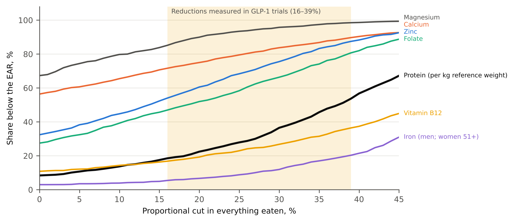

**Peter Kalafatis**

Independent researcher, x9m8.com, New York, NY, USA. Correspondence: x9m8x7@gmail.com

**Preprint, not peer reviewed.** Version 1, October 2026.

## Abstract

GLP-1 receptor agonists cut food intake by 16% to 39% in trials, and the little evidence on what users eat suggests they eat less of the same diet rather than a different one. I modelled the consequences for nutrient adequacy in eligible US adults. Using two 24-hour recalls from NHANES August 2021–August 2023 (n = 2,134 adults with BMI ≥30, or ≥27 with diabetes or hypertension; about 115 million people), I estimated usual intake, cut every food proportionally by the reductions measured in trials, and compared the result with the Estimated Average Requirement. On their current diets, 8.4% of eligible adults ate less protein than the requirement for their height, 32.4% less zinc, 27.5% less folate and 56.4% less calcium. At a 24% cut those shares rose to 26.9%, 67.2%, 56.8% and 78.6%; at 35%, to 45.7%, 83.3%, 74.1% and 86.8%. On average, eligible adults fell below the requirement for 3.1 of 8 nutrients at baseline and 4.9 at a 24% cut. At a 24% cut only 6.5% would reach 1.2 g of protein per kg of reference weight. Supplements, available in the 2017–2020 data, narrowed but did not close the gaps. In this model, eating less without eating differently leaves most eligible adults short of several nutrients.

**Keywords:** GLP-1 receptor agonists; semaglutide; tirzepatide; nutrient adequacy; protein; micronutrients; NHANES; usual intake; obesity

**Social media summary:** Modelled for GLP-1 drugs: eating a third less of the same diet would leave most eligible US adults short of zinc, folate and calcium.

## 1. Introduction

GLP-1 receptor agonists and the dual GIP/GLP-1 agonist tirzepatide work largely by making people eat less. In laboratory studies, liraglutide (1.8 or 3.0 mg) reduced energy intake at an ad libitum lunch by about 16% (van Can et al., 2014), semaglutide 1.0 mg by 24% across a day of ad libitum meals (Blundell et al., 2017), and semaglutide 2.4 mg by 35% at a test lunch (Friedrichsen et al., 2021); with oral semaglutide 50 mg, the relative reduction in lunch intake from baseline was 39 percentage points greater than with placebo (Gabe et al., 2024). A joint advisory from four US medical and nutrition societies summarised the evidence as "observed caloric reductions of 16%–39%" and named iron, calcium, magnesium, zinc and vitamins A, D, E, K, B1, B12 and C as nutrients of concern, with protein a priority to protect lean mass (Mozaffarian et al., 2025).

What users actually eat has barely been measured. A cross-sectional study of 69 users recruited online found mean intakes of fibre, calcium, magnesium, potassium, iron, choline and vitamins A, C, D and E below reference values (Johnson et al., 2025). An app-based study of 116 users, presented at the 2026 European Congress on Obesity, found them eating less energy and protein than non-users with almost the same macronutrient proportions, "eating less of everything rather than changing the composition of their diet" (Vinelli et al., European Congress on Obesity 2026, abstract 1823, as reported by Monostra, 2026). An analysis of NHANES 2007–2020 identified 127 users with type 2 diabetes, too few, in my judgement, for precise estimates (Frankenfeld et al., 2026). The national survey cannot identify users in its most recent cycle, because drug names were not collected (National Center for Health Statistics [NCHS], 2024b).

What can be estimated is the starting point. If eligible adults eat what they eat now, only less of it, how many would fall short? Fulgoni et al. (2024) showed, using NHANES 2015–2018, that prorating usual intake in adults with overweight or obesity by 20% to 50% sharply raises the share below the EAR. I am not aware of a study that applies the intake reductions measured in GLP-1 trials to the population eligible for GLP-1 obesity treatment in post-pandemic NHANES data. This paper uses the two most recent NHANES cycles to estimate usual intake in US adults who meet the clinical criteria for GLP-1 obesity treatment, applies the intake reductions measured in trials, and estimates the share below the Estimated Average Requirement (EAR) for protein and ten micronutrients.

## 2. Methods

### 2.1 Data and sample

NHANES is a nationally representative survey of the US civilian non-institutionalised population (NCHS, 2024c). The main analysis used the August 2021–August 2023 cycle, in which both 24-hour dietary recalls were collected by telephone and no 24-hour supplement recall was taken (NCHS, 2024a); a sensitivity analysis used the 2017–March 2020 pre-pandemic cycle, in which the first recall was taken in person and 24-hour supplement use was recorded (NCHS, n.d.). Files were downloaded from the NCHS website on 21 October 2026.

Eligible adults were aged 20 or older, not pregnant, and had a measured body mass index (BMI) of 30 or more, or 27 or more with self-reported diagnosed diabetes or hypertension, the BMI thresholds of the pivotal trials described in the prescribing information for semaglutide (Wegovy) and tirzepatide (Zepbound) for weight management (Novo Nordisk, 2026; Eli Lilly and Company, 2026). The labels define the population as adults with obesity, or with overweight and at least one weight-related condition; diabetes and hypertension are a subset of those conditions. The analysis included those with two reliable recalls and a positive two-day dietary weight.

### 2.2 Usual intake

Two recalls per person do not give a person's usual intake: day-to-day variation inflates the spread of the distribution and so the share in the tails. I used the variance-adjustment method of the National Research Council (1986), separately by sex. Day-2 intakes were first rescaled to the weighted mean of day 1, which the NCI method treats as the reference day. Intakes were then log-transformed, the within-person variance was estimated from the differences between each person's two days, and each person's two-day mean was shrunk towards the group mean by the square root of the ratio of between-person variance to the variance of two-day means. Values were back-transformed and rescaled so that the weighted mean of usual intake equalled the weighted mean of observed two-day means. This is a simpler relative of the National Cancer Institute (NCI) method used for official estimates (Tooze et al., 2006; Dodd et al., 2006). In the supplement analysis, each person's mean supplement intake over the two days was added after estimating usual intake from food, as in the official tables. To check the method, I applied it to non-Hispanic White adults aged 19 and over in 2017–March 2020 and compared the share below the EAR from food and supplements with the official NCI-method estimates for the same group (US Department of Agriculture, Agricultural Research Service [USDA ARS], n.d.).

### 2.3 Scenarios

Usual intake of every nutrient, including energy, was multiplied by (1 − *r*) for *r* = 16%, 24%, 35% and 39%, the reductions reported for liraglutide (1.8 and 3.0 mg pooled), semaglutide 1.0 mg, semaglutide 2.4 mg and oral semaglutide 50 mg (van Can et al., 2014; Blundell et al., 2017; Friedrichsen et al., 2021; Gabe et al., 2024). Proportional scaling encodes the assumption that people eat less of the same foods. I also computed a continuous curve from 0% to 45%.

### 2.4 Requirements

Prevalence of inadequacy was estimated as the survey-weighted share of usual intakes below the EAR (the cut-point method; Institute of Medicine [IOM], 2000) for vitamins A, C, D, E and B12, folate, calcium, magnesium, zinc and iron, using the adult EARs by sex and age (National Academies of Sciences, Engineering, and Medicine [NASEM], 2019, Appendix J). Iron was assessed only in men and in women aged 51 and over, because the cut-point method is invalid where requirements are skewed, as in menstruating women (IOM, 2000). For potassium, fibre, choline and vitamin K, which have Adequate Intakes (AIs; NASEM, 2019, Appendix J) rather than EARs, I report the share at or above the AI. IOM (2000) frames the AI as a test of the group mean: a group whose mean intake is at or above the AI is likely to have a low prevalence of inadequacy, but nothing can be concluded about inadequacy when it is below. The share at or above the AI is therefore descriptive, not a prevalence of inadequacy.

The protein EAR of 0.66 g/kg/day is defined for reference body weights (NASEM, 2019, Appendix J). Applying it to actual weight in obesity inflates the requirement, so the main analysis used weight at a BMI of 25 for each person's measured height; adjusted body weight (ideal weight at BMI 22 plus 40% of the excess) and actual weight are sensitivity analyses. I also report the share below 1.2 g/kg of reference weight and below 80 g/day, the lower ends of the higher targets proposed during GLP-1 therapy (Mozaffarian et al., 2025). The advisory notes that the body-weight basis for these targets is unclear in obesity; applying 1.2 g/kg to reference weight is my choice.

### 2.5 Statistics

All estimates use the two-day dietary weights and account for the NHANES design; standard errors were computed by Taylor linearisation with primary sampling units treated as sampled with replacement within strata. Error bars in the figures use the *t* distribution with 15 degrees of freedom (30 primary sampling units in 15 strata). The standard errors do not reflect uncertainty in the estimated variance components, so they are somewhat too small. The number of nutrients below the EAR was counted per person for protein, vitamins A, C and B12, folate, calcium, magnesium and zinc; vitamins D and E were left out because nearly everyone is below the EAR from food alone, and iron because it was not assessed in younger women.

### 2.6 Software, data and AI use

Analyses used Python 3.13 with pandas and NumPy; figures used matplotlib. The study was carried out with the assistance of Claude (Anthropic; model claude-opus-5-5) in October 2026, which retrieved data, wrote and ran the analysis code, searched the literature and drafted the text under the author's direction. Independent AI agents checked every number against the result files and every citation against its source. The author reviewed the work and takes full responsibility for it.

## 3. Results

### 3.1 Sample

The main sample comprised 2,134 adults representing an estimated 115 million eligible US adults; 87% had a BMI of 30 or more, 51% were women, and the weighted mean age was 51 years and mean BMI 35.6. Their estimated usual intake averaged 1,996 kcal and 76.1 g of protein per day (Table 1). In the validation sample, the method reproduced the official NCI-method estimates closely: across 13 comparisons for seven nutrients, the share below the EAR differed by 1.4 percentage points on average and by at most 6.0 points (vitamin C in men, 45.0% against 39%; reproducibility package, validation_ars.csv).

### 3.2 The starting point

On their current diets, many eligible adults already fell short (Table 1; Figure 2). Almost all were below the EAR for vitamin D (95.9%) from food, and most for vitamin E (83.4%). Two-thirds were below it for magnesium (67.3%), more than half for calcium (56.4%), vitamin C (57.2%) and vitamin A (54.3%), and about a third for zinc (32.4%). Protein was the exception: 8.4% ate less than the EAR for their reference weight, although 67.2% ate less than 1.2 g/kg of reference weight. Only 17.4% reached the AI for potassium and 3.0% for fibre.

### 3.3 Eating less of the same

Each cut widened every gap (Figure 1). At the 24% reduction measured for semaglutide 1.0 mg, the share below the EAR rose to 26.9% for protein, 67.2% for zinc, 56.8% for folate, 78.6% for calcium, 92.9% for magnesium and 78.2% for vitamin A. At 35%, it reached 45.7% for protein, 83.3% for zinc, 74.1% for folate and 86.8% for calcium, and 31.5% for vitamin B12 and 17.0% for iron in men and older women. Mean intake fell to 1,517 kcal and 57.8 g of protein at 24%, and 1,298 kcal and 49.5 g at 35%.

Shortfalls accumulated in the same people. Across eight nutrients, eligible adults were below the EAR for an average of 3.1 on their current diet, 4.9 at a 24% cut and 5.9 at 35%. The share below the EAR for five or more of the eight rose from 28% to 60% and 78%.

The protein yardstick mattered (Figure 3A). At a 24% cut, 26.9% fell below 0.66 g/kg of reference weight, 36.8% below that amount per kg of adjusted weight, and 67.4% per kg of actual weight. Against the higher targets proposed for GLP-1 therapy, 93.5% would fall below 1.2 g/kg of reference weight and 86.7% below 80 g a day.

### 3.4 Sensitivity

The earlier 2017–2020 cycle gave lower baseline shortfalls from food for most nutrients (for example zinc 20.8% against 32.4%, calcium 44.7% against 56.4%), similar ones for vitamins C, D and E, and the same pattern under each cut (Table 2). Adding 24-hour supplement intake, which was not reduced, narrowed the gaps: at a 35% cut the share below the EAR fell from 71.2% to 53.8% for zinc, from 82.1% to 68.3% for calcium, from 61.7% to 43.7% for folate, from 22.7% to 15.3% for vitamin B12 and from 96.4% to 86.2% for magnesium. The NHANES supplement totals do not include vitamin A or vitamin E, so those results are unchanged.

## 4. Discussion

### 4.1 What the model shows

The arithmetic is simple, and the result is not. A diet that already leaves half of eligible adults short of calcium, and a third short of zinc, cannot be eaten in smaller portions without leaving most of them short. At the intake reductions seen with current obesity doses, eligible adults eating less of the same foods would on average fall below the average requirement for five or six of eight key nutrients, and almost none would reach the protein intakes recommended to protect muscle during weight loss.

The results agree with the one earlier simulation of this kind. Prorating the usual intake of US adults with overweight or obesity in NHANES 2015–2018 by 30%, Fulgoni et al. (2024) found 25% to 40% below the EAR for protein, vitamin B6 and zinc, and 75% to 91% for vitamin A, calcium and magnesium; these figures sit between the 24% and 35% scenarios here. This study adds reductions anchored to GLP-1 trials, the treatment-eligible population, protein per kg of reference weight, the count of shortfalls per person, and the 2021–2023 cycle.

This is not a prediction of deficiency disease. The EAR is the intake at which half of healthy people meet their need; falling below it raises the probability of inadequacy, and the consequences depend on how long the shortfall lasts, on body stores and on the nutrient. The scenarios also apply laboratory reductions, many measured at a single meal, to a whole day, which is likely to overstate sustained free-living reductions; the one app-based comparison found users eating about 14% less than non-users (Vinelli et al., European Congress on Obesity 2026, abstract 1823, as reported by Monostra, 2026). At that level, the 16% curve is closer to the mark, and the shortfalls are still substantial.

### 4.2 What would close the gaps

Because the cuts are proportional, keeping a nutrient at its usual level requires raising its density per calorie by 1/(1 − *r*): about a third more at a 24% cut and about half again at 35%. That is a change in what is eaten, not just how much, and it is the change the joint advisory recommends: protein-dense foods, vegetables, legumes, dairy and whole grains, with supplements where diet cannot meet the need (Mozaffarian et al., 2025). The supplement analysis shows that the multivitamins and minerals already taken by some adults narrow the gaps but leave most shortfalls in place. A companion analysis estimates what a nutritionally complete diet at these energy levels would cost.

### 4.3 Limitations

The 2021–2023 cycle cannot identify GLP-1 users, so this is a simulation of the eligible population, not a study of users. Proportional scaling is an assumption supported by limited observational evidence; users may shift toward or away from nutrient-dense foods. The usual-intake method is the NRC variance adjustment with a mean correction, not the NCI method used in official tables; it reproduced the official estimates within a few percentage points in a validation subgroup, but it does not adjust for weekend recalls or covariates. Both recalls in 2021–2023 were taken by telephone, and under-reporting of energy is common in adults with obesity, which would overstate shortfalls at baseline; the scenarios inherit any such bias. The 2021–2023 cycle has no 24-hour supplement data. Requirements were held fixed, although they change as weight falls, and the protein requirement in obesity has no settled reference weight. The cut-point method assumes that intakes and requirements are uncorrelated, that requirements are roughly symmetric, and that intakes vary more than requirements. Vitamins D and E are near-universally below the EAR from food in the US population, so their results say little about GLP-1 therapy in particular.

## 5. Conclusion

Most US adults who qualify for GLP-1 obesity treatment already eat too little of several nutrients. If they eat less of the same diet, as early evidence suggests users do, the share falling short would rise steeply for protein, zinc, folate, calcium and magnesium. Prescribing appetite suppression without changing what people eat is likely to leave most of them short. Studies that measure what users actually eat, over months rather than meals, are the obvious next step.

## Acknowledgements

The author thanks the National Center for Health Statistics and the NHANES participants. Claude (Anthropic; model claude-opus-5-5) assisted with data retrieval, analysis code, literature search and drafting in October 2026, as described in §2.6. The author reviewed all outputs and is responsible for the content.

## Author contributions

P.K. conceived the study, directed the analysis, and reviewed and approved the manuscript.

## Financial support

This research received no specific grant from any funding agency, commercial or not-for-profit sector.

## Conflicts of interest

The author operates a restaurant (The Heritage Diner) and declares no financial interest in pharmaceuticals, supplements or the food industry beyond it.

## Research transparency and reproducibility

All data are public NHANES files from the NCHS. Code and result files are in the reproducibility package linked from the article page; raw NHANES files are not redistributed and can be downloaded from the URLs listed in the package.

## References

Blundell, J., Finlayson, G., Axelsen, M., Flint, A., Gibbons, C., Kvist, T., & Hjerpsted, J. B. (2017). Effects of once-weekly semaglutide on appetite, energy intake, control of eating, food preference and body weight in subjects with obesity. *Diabetes, Obesity and Metabolism*, *19*(9), 1242–1251. https://doi.org/10.1111/dom.12932

Dodd, K. W., Guenther, P. M., Freedman, L. S., Subar, A. F., Kipnis, V., Midthune, D., Tooze, J. A., & Krebs-Smith, S. M. (2006). Statistical methods for estimating usual intake of nutrients and foods: A review of the theory. *Journal of the American Dietetic Association*, *106*(10), 1640–1650. https://doi.org/10.1016/j.jada.2006.07.011

Eli Lilly and Company. (2026). *Zepbound (tirzepatide) injection, for subcutaneous use* [Prescribing information, revised August 2026]. DailyMed, U.S. National Library of Medicine. https://dailymed.nlm.nih.gov/dailymed/drugInfo.cfm?setid=487cd7e7-434c-4925-99fa-aa80b1cc776b

Frankenfeld, C. L., Movva, N., Hooda, N., Gauthier, J., Reichert, H., & Doepker, C. (2026). Analysis of NHANES: Nutrient, food, and beverage intake of glucagon-like peptide-1 receptor agonist users with type 2 diabetes, 2007–2020. *The Journal of Nutrition*, *156*(8), Article 101685. https://doi.org/10.1016/j.tjnut.2026.101685

Friedrichsen, M., Breitschaft, A., Tadayon, S., Wizert, A., & Skovgaard, D. (2021). The effect of semaglutide 2.4 mg once weekly on energy intake, appetite, control of eating, and gastric emptying in adults with obesity. *Diabetes, Obesity and Metabolism*, *23*(3), 754–762. https://doi.org/10.1111/dom.14280

Fulgoni, V. L., Agler, A., Ricciuto, L., DiFrancesco, L., Williams, D., & Hertzler, S. R. (2024). Impact of simulated caloric reduction on nutrient adequacy among U.S. adults with overweight or obesity (National Health and Nutrition Examination Survey [NHANES] 2015–2018). *The Journal of Nutrition*, *154*(9), 2732–2742. https://doi.org/10.1016/j.tjnut.2024.07.022

Gabe, M. B. N., Breitschaft, A., Knop, F. K., Hansen, M. R., Kirkeby, K., Rathor, N., & Adrian, C. L. (2024). Effect of oral semaglutide on energy intake, appetite, control of eating and gastric emptying in adults living with obesity: A randomized controlled trial. *Diabetes, Obesity and Metabolism*, *26*(10), 4480–4489. https://doi.org/10.1111/dom.15802

Monostra, M. (2026, April 22). GLP-1 users eat less, but do not change macronutrient composition of diet. *Healio*. https://www.healio.com/news/endocrinology/20260422/glp1-users-eat-less-but-do-not-change-macronutrient-composition-of-diet

Institute of Medicine. (2000). *Dietary Reference Intakes: Applications in dietary assessment*. National Academy Press. https://doi.org/10.17226/9956

Johnson, B., Milstead, M., Thomas, O., McGlasson, T., Green, L., Kreider, R., & Jones, R. (2025). Investigating nutrient intake during use of glucagon-like peptide-1 receptor agonist: A cross-sectional study. *Frontiers in Nutrition*, *12*, Article 1566498. https://doi.org/10.3389/fnut.2025.1566498

Mozaffarian, D., Agarwal, M., Aggarwal, M., Alexander, L., Apovian, C. M., Bindlish, S., Bonnet, J., Butsch, W. S., Christensen, S., Gianos, E., Gulati, M., Gupta, A., Horn, D., Kane, R. M., Saluja, J., Sannidhi, D., Stanford, F. C., & Callahan, E. A. (2025). Nutritional priorities to support GLP-1 therapy for obesity: A joint Advisory from the American College of Lifestyle Medicine, the American Society for Nutrition, the Obesity Medicine Association, and The Obesity Society. *The American Journal of Clinical Nutrition*, *122*(1), 344–367. https://doi.org/10.1016/j.ajcnut.2025.04.023

National Academies of Sciences, Engineering, and Medicine. (2019). *Dietary Reference Intakes for sodium and potassium* (Appendix J: Dietary Reference Intakes summary tables). The National Academies Press. https://doi.org/10.17226/25353

National Center for Health Statistics. (2024a). *National Health and Nutrition Examination Survey, August 2021–August 2023 data documentation, codebook, and frequencies: Dietary interview – Total nutrient intakes, first day (DR1TOT_L)*. Centers for Disease Control and Prevention. https://wwwn.cdc.gov/Nchs/Data/Nhanes/Public/2021/DataFiles/DR1TOT_L.htm

National Center for Health Statistics. (2024b). *National Health and Nutrition Examination Survey, August 2021–August 2023 data documentation, codebook, and frequencies: Prescription medications (RXQ_RX_L)*. Centers for Disease Control and Prevention. https://wwwn.cdc.gov/Nchs/Data/Nhanes/Public/2021/DataFiles/RXQ_RX_L.htm

National Center for Health Statistics. (2024c). *National Health and Nutrition Examination Survey, August 2021–August 2023* [Data files and documentation]. Centers for Disease Control and Prevention. https://wwwn.cdc.gov/nchs/nhanes/continuousnhanes/default.aspx?Cycle=2021-2023

National Center for Health Statistics. (n.d.). *National Health and Nutrition Examination Survey 2017–March 2020 pre-pandemic data documentation, codebook, and frequencies: Dietary interview – Total nutrient intakes, first day (P_DR1TOT)*. Centers for Disease Control and Prevention. Retrieved October 21, 2026, from https://wwwn.cdc.gov/Nchs/Data/Nhanes/Public/2017/DataFiles/P_DR1TOT.htm

National Research Council. (1986). *Nutrient adequacy: Assessment using food consumption surveys*. National Academy Press. https://doi.org/10.17226/618

Novo Nordisk. (2026). *Wegovy (semaglutide) injection, for subcutaneous use; Wegovy (semaglutide) tablets, for oral use* [Prescribing information, revised June 2026]. DailyMed, U.S. National Library of Medicine. https://dailymed.nlm.nih.gov/dailymed/drugInfo.cfm?setid=ee06186f-2aa3-4990-a760-757579d8f77b

Tooze, J. A., Midthune, D., Dodd, K. W., Freedman, L. S., Krebs-Smith, S. M., Subar, A. F., Guenther, P. M., Carroll, R. J., & Kipnis, V. (2006). A new statistical method for estimating the usual intake of episodically consumed foods with application to their distribution. *Journal of the American Dietetic Association*, *106*(10), 1575–1587. https://doi.org/10.1016/j.jada.2006.07.003

U.S. Department of Agriculture, Agricultural Research Service. (n.d.). *Total usual nutrient intake from food, beverages, and dietary supplements, among non-Hispanic White individuals: What We Eat in America, NHANES 2017–March 2020 prepandemic* (Tables TB 1–21). https://www.ars.usda.gov/ARSUserFiles/80400530/pdf/usual/gender%20revision/Usual_Intake_Non_Hispanic_White_WWEIA_2017_March%202020_Table_TB.pdf

van Can, J., Sloth, B., Jensen, C. B., Flint, A., Blaak, E. E., & Saris, W. H. M. (2014). Effects of the once-daily GLP-1 analog liraglutide on gastric emptying, glycemic parameters, appetite and energy metabolism in obese, non-diabetic adults. *International Journal of Obesity*, *38*(6), 784–793. https://doi.org/10.1038/ijo.2013.162

## Tables

**Table 1.** Estimated share of US adults eligible for GLP-1 obesity treatment whose usual intake from food would fall below the EAR, at their current diet and after proportional cuts in everything eaten. NHANES August 2021–August 2023, adults 20 and over with BMI ≥30, or ≥27 with diabetes or hypertension, not pregnant, two reliable 24-hour recalls (n = 2,134). Survey-weighted percentages (standard errors).

| Nutrient | Usual diet | Liraglutide, −16% | Semaglutide 1 mg, −24% | Semaglutide 2.4 mg, −35% | Oral semaglutide 50 mg, −39% |
|:--|--:|--:|--:|--:|--:|
| Protein < EAR (0.66 g/kg reference weight) | 8.4 (0.8) | 18.5 (1.7) | 26.9 (1.7) | 45.7 (1.7) | 53.7 (2.1) |
| Zinc | 32.4 (1.9) | 54.0 (2.0) | 67.2 (1.6) | 83.3 (1.2) | 87.5 (0.8) |
| Folate (DFE) | 27.5 (1.5) | 46.9 (1.3) | 56.8 (1.3) | 74.1 (1.2) | 80.7 (1.1) |
| Calcium | 56.4 (1.2) | 71.6 (1.4) | 78.6 (1.3) | 86.8 (0.9) | 89.7 (0.6) |
| Magnesium | 67.3 (1.1) | 85.1 (0.8) | 92.9 (0.6) | 97.4 (0.4) | 98.5 (0.3) |
| Vitamin A (RAE) | 54.3 (1.4) | 70.4 (1.1) | 78.2 (0.8) | 87.9 (0.7) | 90.9 (0.6) |
| Vitamin C | 57.2 (1.7) | 66.7 (1.4) | 72.0 (1.6) | 79.7 (1.7) | 82.7 (1.5) |
| Vitamin D | 95.9 (0.6) | 98.4 (0.3) | 99.0 (0.2) | 99.5 (0.2) | 99.7 (0.1) |
| Vitamin E | 83.4 (1.2) | 93.1 (0.9) | 95.2 (0.9) | 97.0 (0.7) | 98.3 (0.5) |
| Vitamin B12 | 10.8 (1.1) | 16.8 (1.6) | 22.0 (1.5) | 31.5 (1.6) | 36.4 (1.6) |
| Iron (men; women 51+) | 3.0 (0.5) | 5.4 (0.8) | 8.2 (1.0) | 17.0 (1.6) | 20.3 (1.5) |
| *Below other protein yardsticks* | | | | | |
| Protein < 0.66 g/kg adjusted weight | 14.0 (1.0) | 26.1 (1.9) | 36.8 (1.8) | 57.1 (1.4) | 65.2 (1.7) |
| Protein < 0.66 g/kg actual weight | 35.5 (1.4) | 55.4 (1.4) | 67.4 (1.3) | 82.5 (1.4) | 88.5 (1.1) |
| Protein < 1.2 g/kg reference weight | 67.2 (1.5) | 86.4 (1.2) | 93.5 (0.9) | 98.3 (0.4) | 99.3 (0.3) |
| Protein < 80 g/day | 60.7 (1.4) | 78.9 (1.4) | 86.7 (1.3) | 95.1 (0.5) | 96.9 (0.5) |
| *At or above the Adequate Intake* | | | | | |
| Potassium | 17.4 (1.2) | 4.8 (0.4) | 2.0 (0.3) | 0.3 (0.1) | 0.3 (0.1) |
| Fibre | 3.0 (0.4) | 1.1 (0.2) | 0.6 (0.2) | 0.2 (0.1) | 0.1 (0.1) |
| Choline | 9.1 (0.9) | 1.8 (0.3) | 0.8 (0.1) | 0.1 (0.1) | 0.0 |
| Vitamin K | 41.1 (1.1) | 27.4 (1.4) | 21.3 (1.3) | 13.2 (1.0) | 10.7 (0.8) |
| Mean energy, kcal/day | 1,996 | 1,677 | 1,517 | 1,298 | 1,218 |
| Mean protein, g/day | 76.1 | 63.9 | 57.8 | 49.5 | 46.4 |

**Table 2.** Sensitivity: share below the EAR on the usual diet and at a 35% proportional cut in food, by survey cycle and with dietary supplements. NHANES 2017–March 2020 includes 24-hour supplement recalls; supplement intake was added after estimating usual food intake and was not reduced. Percentages (standard errors).

| Nutrient | Usual diet: 2021–2023, food | Usual diet: 2017–2020, food | Usual diet: 2017–2020, food + supplements | −35%: 2021–2023, food | −35%: 2017–2020, food | −35%: 2017–2020, food + supplements |
|:--|--:|--:|--:|--:|--:|--:|
| Protein < EAR (0.66 g/kg reference weight) | 8.4 (0.8) | 5.7 (0.6) | 5.7 (0.6) | 45.7 (1.7) | 35.1 (1.3) | 35.1 (1.3) |
| Zinc | 32.4 (1.9) | 20.8 (1.0) | 16.5 (1.2) | 83.3 (1.2) | 71.2 (1.5) | 53.8 (1.5) |
| Folate (DFE) | 27.5 (1.5) | 21.0 (0.9) | 15.6 (1.0) | 74.1 (1.2) | 61.7 (1.1) | 43.7 (1.6) |
| Calcium | 56.4 (1.2) | 44.7 (1.5) | 34.0 (1.9) | 86.8 (0.9) | 82.1 (1.3) | 68.3 (1.7) |
| Magnesium | 67.3 (1.1) | 57.0 (1.5) | 50.6 (1.6) | 97.4 (0.4) | 96.4 (0.5) | 86.2 (1.2) |
| Vitamin A (RAE) | 54.3 (1.4) | 49.0 (1.7) | 49.0 (1.7) | 87.9 (0.7) | 82.7 (1.3) | 82.7 (1.3) |
| Vitamin C | 57.2 (1.7) | 57.2 (1.1) | 42.2 (1.5) | 79.7 (1.7) | 78.4 (1.2) | 56.5 (1.8) |
| Vitamin D | 95.9 (0.6) | 97.5 (0.4) | 60.0 (1.4) | 99.5 (0.2) | 99.8 (0.0) | 62.0 (1.4) |
| Vitamin E | 83.4 (1.2) | 83.7 (1.1) | 83.7 (1.1) | 97.0 (0.7) | 98.1 (0.6) | 98.1 (0.6) |
| Vitamin B12 | 10.8 (1.1) | 6.0 (0.7) | 4.5 (0.7) | 31.5 (1.6) | 22.7 (1.1) | 15.3 (1.2) |
| Iron (men; women 51+) | 3.0 (0.5) | 0.5 (0.1) | 0.5 (0.1) | 17.0 (1.6) | 7.4 (0.8) | 6.5 (0.7) |

## Figures

