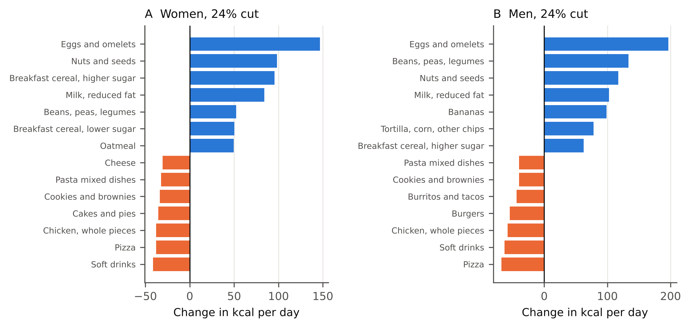

**Peter Kalafatis**

Independent researcher, x9m8.com, New York, NY, USA. Correspondence: x9m8x7@gmail.com

**Preprint, not peer reviewed.** Version 1, October 2026.

## Abstract

GLP-1 receptor agonists cut food intake by 16% to 39% in trials, and eating less of the same diet would leave most eligible adults short of several nutrients. This paper asks what it costs to eat less and still meet requirements. I built the current diet of 3,448 US adults eligible for GLP-1 obesity treatment from NHANES 2017–March 2020 food records, priced it with USDA national average prices inflated to 2026, and used optimisation to find the diet closest to it that meets every Recommended Dietary Allowance or Adequate Intake with a value in the food database except vitamins D and E, within upper limits, the sodium limit and macronutrient ranges, keeping the mix of foods within each food category and limiting each category to the 95th percentile of current intake. Eating less of the same cut cost in proportion, from $9.12 to $6.93 a day for women and from $11.69 to $8.89 for men at a 24% cut. An adequate diet at that cut cost $7.77 and $9.84, a saving of 15% to 16% rather than 24%, and moved 66% to 72% of calories between food categories. Under these limits no adequate diet existed beyond cuts of 32% for women and 28% for men; with limits at the 99th percentile, one existed up to 47%, at $7.87 and $9.58 a day at a 35% cut, and choosing freely among foods within categories removed the limit. The cheapest adequate diets cost $4.54 to $7.59 a day, below the Thrifty Food Plan. Staying well nourished on these drugs takes a different diet more than a larger budget.

**Keywords:** GLP-1 receptor agonists; semaglutide; diet cost; linear programming; diet optimisation; nutrient adequacy; Thrifty Food Plan; NHANES

**Social media summary:** On GLP-1 drugs, eating a quarter less of the same food cuts the grocery bill by a quarter. Eating a quarter less and meeting nutrient needs cuts it by about a sixth.

## 1. Introduction

GLP-1 receptor agonists reduce what people eat. In laboratory studies, liraglutide reduced energy intake at an ad libitum lunch by about 16% (van Can et al., 2014), semaglutide 1.0 mg by 24% across a day of ad libitum meals (Blundell et al., 2017) and semaglutide 2.4 mg by 35% at a test lunch (Friedrichsen et al., 2021); with oral semaglutide 50 mg, the relative reduction at lunch was 39 percentage points greater than with placebo (Gabe et al., 2024). A joint advisory from four US medical and nutrition societies summarised these as "observed caloric reductions of 16%–39%" and recommended managing diet quality to protect nutrient intake at lower energy (Mozaffarian et al., 2025). Guidance on nutrition with anti-obesity medications describes energy intakes of 1,200 to 1,500 kcal a day for women and 1,500 to 1,800 kcal for men as safe during weight reduction (Almandoz et al., 2024).

Simulations show why diet quality matters. Prorating the usual intake of US adults with overweight or obesity by 20% to 50% sharply raises the share below the Estimated Average Requirement (Fulgoni et al., 2024), and a companion paper applied the reductions measured in GLP-1 trials to adults eligible for treatment in NHANES 2021–2023, finding that at a 35% cut most would fall short of zinc, folate, calcium and magnesium (Kalafatis, 2026). Neither asked what eating differently would cost.

Cost is a practical question. Grocery prices rose by about 31% between 2017–2018 and 2025, on my calculation from the food-at-home price index (US Department of Agriculture, Economic Research Service [USDA ERS], 2026a), and the benefits of the Supplemental Nutrition Assistance Program are set by the cost of the Thrifty Food Plan, USDA's estimate of the cost of a healthy, practical diet on a limited budget (USDA Food and Nutrition Service [USDA FNS], 2021). The least-cost diet problem is as old as linear programming (Stigler, 1945), and diet optimisation has been used to show how cost constraints change food choices (Darmon et al., 2006), to translate recommendations into realistic diets close to what people already eat (Maillot et al., 2010), and to set the Thrifty Food Plan itself, which selects "a dietary pattern as close to current consumption patterns as possible" subject to cost and nutrient constraints (USDA FNS, 2021, p. 18). In searches of Europe PMC (including preprints) and the web in October 2026, I found no study that used diet optimisation to estimate the cost or feasibility of a nutritionally adequate diet at the energy reductions measured in GLP-1 trials.

This paper asks three questions. What does the current diet of adults eligible for GLP-1 treatment cost, and how much does eating less of it save? What would a nutritionally adequate diet cost at the energy intakes measured in trials, if it stays as close as possible to what people now eat? And how far can energy fall before an adequate diet requires eating outside the range of current habits?

## 2. Methods

### 2.1 Diet data and sample

I used the NHANES 2017–March 2020 pre-pandemic cycle, which recorded every food and beverage reported in two 24-hour recalls with its USDA food code and weight in grams (National Center for Health Statistics [NCHS], 2022a, 2022b). This cycle was used because its food codes match the latest public food prices (§2.2). The sample was the one defined in the companion paper: adults aged 20 or older, not pregnant, with a measured BMI of 30 or more, or 27 or more with self-reported diabetes or hypertension, and two reliable recalls (Kalafatis, 2026). It comprised 3,448 adults (1,853 women and 1,595 men; mean age about 50), representing about 117 million people with the two-day dietary weights.

Each person's intake of each food was the mean of the two days. The current diet of each sex was the survey-weighted mean intake of every food, in grams a day, covering 3,833 food codes for women and 3,653 for men. Nutrient values came from the Food and Nutrient Database for Dietary Studies (FNDDS) 2017–2018, with FNDDS 2021–2023 used for the few codes not in it (USDA Agricultural Research Service [ARS], n.d.). Alcoholic beverages and plain tap and bottled water were excluded from all diets and costs.

### 2.2 Prices

Prices are the ERS Purchase to Plate National Average Prices (PP-NAP) for 2017–2018: the national average retail price per 100 edible grams of each food as eaten, built from retail scanner data and linked to the same NHANES food codes (USDA ERS, 2023). Foods without a PP-NAP price, 3% of grams eaten, were given the median price of their food category. Prices were inflated to 2026 with the ERS food-at-home consumer price index: the annual changes from 2017–2018 to 2025 give a factor of 1.312, and the ERS September 2026 forecast of a 2.4% rise in 2026 (forecast interval 1.8% to 3.0%) gives 1.343 (USDA ERS, 2026a, 2026b). PP-NAP prices are grocery prices; food eaten away from home is valued as if bought in a store.

For comparison, the USDA Thrifty Food Plan for June 2026 costs $58.50 a week for women and $73.50 for men aged 20–50, and $54.50 and $64.80 for ages 51–70, for individuals in four-person families; the report adds 20% for one-person households (US Department of Agriculture, Food and Nutrition Administration [USDA FNA], 2026). For a person living alone that is $9.34 to $10.03 a day for women and $11.11 to $12.60 for men, from ages 51–70 to 20–50, the range that spans this sample.

### 2.3 Food categories and limits

Following the Thrifty Food Plan, which optimises over food categories rather than single foods (USDA FNS, 2021), foods were grouped into their What We Eat in America (WWEIA) categories: 155 for women and 154 for men. Each category's nutrient content and price per 100 g were the weighted averages of the foods eligible adults eat in it, so a category stands for the mix people buy, not its cheapest or most nutritious member. To keep diets within the range of real eating, each category was limited to the survey-weighted 95th percentile (P95) of individual intake among eligible adults of that sex, including people who did not eat it, or to its current amount if that was larger. For rarely eaten categories, 47 of 155 for women and 53 of 154 for men, the P95 is zero, so they could shrink but not grow. A sensitivity analysis used the 99th percentile (P99).

Fixing the mix within categories is restrictive, because people can choose more nutritious foods within a category. A food-level variant therefore let the optimisation choose among all foods eligible adults already eat, keeping the category limits, either with each food limited to five times its current mean intake or with no limit on single foods.

### 2.4 Requirements

Adequate diets met the Recommended Dietary Allowance (RDA) or Adequate Intake (AI) for adults aged 31–50 for every nutrient with a requirement and a value in FNDDS: vitamins A, C, K, thiamin, riboflavin, niacin, B6, folate, B12 and choline; calcium, phosphorus, magnesium, iron, zinc, copper, selenium and potassium; linoleic and α-linolenic acid; and protein (National Academies of Sciences, Engineering, and Medicine [NASEM], 2019, Appendix J). Fibre was set at 14 g per 1,000 kcal, the basis of its AI (Institute of Medicine [IOM], 2005), rather than the absolute AI, which assumes usual energy intakes; the absolute AI is a sensitivity analysis. Diets stayed below the Tolerable Upper Intake Levels for preformed vitamin A, vitamin C, folic acid, calcium, phosphorus, iron, zinc, copper and selenium, and below the sodium Chronic Disease Risk Reduction Intake of 2,300 mg (NASEM, 2019). Protein, fat and carbohydrate were kept within the Acceptable Macronutrient Distribution Ranges, and linoleic and α-linolenic acid at least 5% and 0.6% of energy, the lower ends of their ranges (IOM, 2005); saturated fat was kept below 10% of energy (US Department of Agriculture & US Department of Health and Human Services, 2026).

Vitamins D and E were analysed separately, because most US adults fall below their requirements for both even counting supplements (Fulgoni et al., 2011); their highest intakes achievable from food with every other requirement met are reported. Protein was set at 0.8 g/kg of reference body weight (reference weights of 70 kg for men and 57 kg for women; IOM, 2005), with 1.2 g/kg as an alternative closer to the higher intakes suggested during anti-obesity medication, at least 60 to 75 g a day and up to 1.5 g/kg (Almandoz et al., 2024); the basis for weight in these targets is not settled in obesity, and the choice of reference weight is mine. Requirements for ages 51–70, including the lower iron RDA for women and the lower calcium upper limit, were a sensitivity analysis. Iodine, chromium, manganese, molybdenum, fluoride, chloride, biotin and pantothenic acid have no values in FNDDS and could not be included.

### 2.5 Scenarios and diets

Energy was set at the current diet's energy and at cuts of 16%, 24%, 35% and 39%, the reductions measured in trials. Four diets were computed at each level.

- **Eating less of the same:** the current diet scaled down.
- **Closest adequate diet:** the diet meeting all requirements and category limits that minimises the sum of squared relative deviations of each category from the scaled current diet, solved as a quadratic programme. The sum of absolute relative deviations, used by Maillot et al. (2010), was a sensitivity analysis.
- **Cheapest adequate diet:** the same constraints, minimising cost.
- **Least-cost diet from any foods:** the classic diet problem, minimising cost over all priced FNDDS foods (excluding baby foods, formula, alcohol, water and nutrition supplements), with each food limited to 150 g a day (300 g for beverages) and each food group to 400 g (600 g), as a floor.

Where no adequate diet existed within the limits, I found the diet with the smallest total shortfall, measured as the sum of each nutrient's shortfall divided by its requirement, and among those the one closest to current eating; the shares of each requirement it met are reported. For each specification, the largest cut at which an adequate diet exists was found by bisection between 0% and 60%. The share of energy moved between categories, half the sum of absolute changes in each category's calories divided by total calories, measures how far each diet departs from current eating.

### 2.6 Software, data and AI use

Analyses used Python 3.13 with pandas, NumPy, SciPy (HiGHS) and CVXPY (Clarabel); figures used matplotlib. The study was carried out with the assistance of Claude (Anthropic; model claude-opus-5-5) in October 2026, which retrieved data, wrote and ran the analysis code, searched the literature and drafted the text under the author's direction. Independent AI agents checked every number against the result files and every citation against its source. The author reviewed the work and takes full responsibility for it.

## 3. Results

### 3.1 The current diet and eating less of it

The current diet of eligible adults provided 1,724 kcal a day for women and 2,227 kcal for men, excluding alcohol, and cost $9.12 and $11.69 a day at 2026 prices: below the one-person Thrifty Food Plan for women ($9.34 to $10.03) and within its range for men ($11.11 to $12.60) (Table 1). It fell short of the RDA or AI for vitamins A and C, choline, calcium, magnesium, potassium and fibre in both sexes, iron for women and vitamin K for men, supplied 3.9 to 4.5 µg of vitamin D and 8.0 to 9.2 mg of vitamin E against RDAs of 15, and exceeded the limits for sodium, total fat and saturated fat. Eating less of the same cut cost in proportion: at a 24% cut, to $6.93 for women and $8.89 for men, and at 35%, to $5.92 and $7.60 (Figure 1).

### 3.2 What an adequate diet costs

Even at current energy, the closest adequate diet required moving about half of all calories between food categories (46% for women and 52% for men), and cost $8.99 and $10.65, slightly less than the current diet. At the 24% cut measured for semaglutide 1.0 mg, an adequate diet cost $7.77 for women and $9.84 for men: 12% and 11% more than eating less of the same, and 15% and 16% less than the current diet, against the 24% saved by eating less of the same. It moved 66% and 72% of calories. The largest increases were in eggs, nuts and seeds, legumes, reduced-fat milk and breakfast cereals, with oatmeal for women and bananas and corn and tortilla chips, a source of linoleic acid, for men. The largest decreases were in soft drinks, pizza, chicken pieces, pasta dishes and cookies, with cakes and cheese for women and burgers and burritos for men (Figure 3).

Adequacy itself was cheap. The cheapest adequate diet within the same limits cost $4.54 to $5.15 a day for women and $6.52 to $7.59 for men at cuts up to 24%, well below the Thrifty Food Plan, and the least-cost diet from any foods cost $1.65 to $2.43 (Table 1). That floor is built from 12 to 18 foods, mostly reconstituted dry milk, dried legumes, millet and a powdered fruit drink, and is not a diet anyone eats.

### 3.3 How far energy can fall

With the mix within categories fixed and each category limited to P95, an adequate diet (vitamins D and E aside) existed down to a 32% cut for women and a 28% cut for men (Figure 2). At the 35% cut measured for semaglutide 2.4 mg none did: the best achievable diet met 91% of the magnesium requirement and 98% of the linoleic acid AI for women, and 90% and 88% for men, at $8.51 and $10.64 a day. The limit depended on how far diets could move. With P99 limits, an adequate diet existed up to a 47% cut for both sexes, and at a 35% cut it cost $7.87 for women and $9.58 for men, savings of 14% and 18% against the 35% saved by eating less of the same. Letting the optimisation choose among foods within categories, each limited to five times its current intake, moved the limit to 38% and 37%; with no limit on single foods, adequate diets existed at every cut tested, up to 60%.

Vitamins D and E were harder. With them included, an adequate diet with fixed category mixes and P95 limits existed only at current energy for women (a cut of less than 1%) and up to a 9% cut for men; with P99 limits, up to 40% and 42%. With every other requirement met, food could supply at most 96% of the vitamin D RDA for women and 94% for men at a 24% cut within P95 limits, and 87% and 92% of the vitamin E RDA; within P99 limits it could supply well over the RDA for both (Table 2).

### 3.4 Sensitivity

A protein floor of 1.2 g/kg of reference weight raised the cost of the adequate diet at a 24% cut by 87 cents a day for women and 97 cents for men (Table 2). Using absolute rather than squared deviations changed the cost at a 24% cut by less than 45 cents. The absolute fibre AI raised the cost for women at a 24% cut to $8.52 and left men 6% short of fibre, lowering the feasibility limit with P95 limits to 30% for women and 20% for men. With requirements for ages 51–70, the cost at a 24% cut rose by 22 cents for women and changed little for men; at 35%, calcium joined magnesium in the shortfall for women. The cheapest diet choosing foods within categories cost $4.30 to $7.99 at 24% and 35% cuts. The price inflation factor's forecast interval moves every cost by less than 0.6%.

## 4. Discussion

### 4.1 What the model shows

A quarter less food is a quarter less spending only if the remaining food is the same food. Meeting nutrient requirements at a 24% cut kept about two-thirds of that saving: the closest adequate diet cost 15% to 16% less than the current diet, not 24% less. At a 35% cut, with somewhat wider limits on what people eat, it saved 14% to 18% rather than 35%. Much of what appetite suppression saves at the checkout would be spent on more nutrient-dense food.

The constraint that binds is how much people change what they eat, not money. Every adequate diet in the main analysis required moving at least 45% of calories between food categories, and 57% to 87% at the cuts measured in trials. Within the amounts most eligible adults eat now, adequacy ran out at cuts of about 30%, with magnesium and linoleic acid first to run short; allowing amounts eaten by the top 1% of adults, or a different choice of foods within categories, removed that limit. The foods that rose, eggs, nuts and seeds, legumes, milk and cereals, overlap with those the joint advisory asks clinicians to emphasise: "a diversity of nutrient-dense, minimally processed foods such as fruits, vegetables, whole grains, legumes, lean proteins, nuts, and seeds" (Mozaffarian et al., 2025, §5.3). Vitamins D and E were the hardest to meet within habitual amounts; the advisory notes that supplements "can be proactively considered for at-risk nutrients" (Mozaffarian et al., 2025), and for these two they are the simpler route.

The Thrifty Food Plan is a useful yardstick. For a person living alone, every adequate and best-achievable diet in Table 1 cost less than the plan, and the cheapest adequate diets cost about half of it. On these prices, a person on these drugs whose food budget is set by the plan would need to change what they buy, not spend more, to meet the requirements that can be met from food.

### 4.2 Limitations

The prices are 2017–2018 national averages inflated with a single food-at-home index; relative prices have changed since, and regional prices and package sizes differ. Grocery prices understate the cost of food eaten away from home. The current diet is the population mean, not any individual's, and the closest adequate diet is a population pattern, not a meal plan. The main analysis keeps the mix of foods within each category and limits categories by percentiles that include non-eaters; the feasibility limit depends heavily on both, as the sensitivity analyses show, so the cut at which adequacy runs out is a property of these assumptions, not a fixed fact about food. Requirements for adults aged 31–50 were applied to a sample with a mean age of about 50; requirements also change as weight falls, and the protein target in obesity has no settled weight basis. Nutrients without FNDDS values could not be constrained. The analysis is a simulation of eligible adults, not a study of what GLP-1 users eat or spend, and the energy reductions come from short laboratory studies.

## 5. Conclusion

Eating less on GLP-1 drugs saves money in proportion only if the remaining food is the same food. A diet that meets nutrient requirements at the energy intakes measured in trials keeps about two-thirds of the saving at a 24% cut, and requires moving most calories to different foods; at the deepest cuts it requires eating some foods in amounts few people now eat, or supplements. Prescribing appetite suppression is also prescribing a change of diet, and the change is larger than the cost.

## Acknowledgements

The author thanks the National Center for Health Statistics, the NHANES participants, USDA's Agricultural Research Service for FNDDS and the Economic Research Service for the Purchase to Plate prices. Claude (Anthropic; model claude-opus-5-5) assisted with data retrieval, analysis code, literature search and drafting in October 2026, as described in §2.6. The author reviewed all outputs and is responsible for the content.

## Author contributions

P.K. conceived the study, directed the analysis, and reviewed and approved the manuscript.

## Financial support

This research received no specific grant from any funding agency, commercial or not-for-profit sector.

## Conflicts of interest

The author operates a restaurant (The Heritage Diner) and declares no financial interest in pharmaceuticals, supplements or the food industry beyond it.

## Research transparency and reproducibility

All inputs are public: NHANES 2017–March 2020 files from NCHS, FNDDS from USDA ARS, PP-NAP and CPI files from USDA ERS. Code, processed data, the category composites and all result files are in the reproducibility package linked from the article page.

## References

Almandoz, J. P., Wadden, T. A., Tewksbury, C., Apovian, C. M., Fitch, A., Ard, J. D., Li, Z., Richards, J., Butsch, W. S., Jouravskaya, I., Vanderman, K. S., & Neff, L. M. (2024). Nutritional considerations with antiobesity medications. *Obesity*, *32*(9), 1613–1631. https://doi.org/10.1002/oby.24067

Blundell, J., Finlayson, G., Axelsen, M., Flint, A., Gibbons, C., Kvist, T., & Hjerpsted, J. B. (2017). Effects of once-weekly semaglutide on appetite, energy intake, control of eating, food preference and body weight in subjects with obesity. *Diabetes, Obesity and Metabolism*, *19*(9), 1242–1251. https://doi.org/10.1111/dom.12932

Darmon, N., Ferguson, E. L., & Briend, A. (2006). Impact of a cost constraint on nutritionally adequate food choices for French women: An analysis by linear programming. *Journal of Nutrition Education and Behavior*, *38*(2), 82–90. https://doi.org/10.1016/j.jneb.2005.11.028

Friedrichsen, M., Breitschaft, A., Tadayon, S., Wizert, A., & Skovgaard, D. (2021). The effect of semaglutide 2.4 mg once weekly on energy intake, appetite, control of eating, and gastric emptying in adults with obesity. *Diabetes, Obesity and Metabolism*, *23*(3), 754–762. https://doi.org/10.1111/dom.14280

Fulgoni, V. L., Keast, D. R., Bailey, R. L., & Dwyer, J. (2011). Foods, fortificants, and supplements: Where do Americans get their nutrients? *The Journal of Nutrition*, *141*(10), 1847–1854. https://doi.org/10.3945/jn.111.142257

Fulgoni, V. L., Agler, A., Ricciuto, L., DiFrancesco, L., Williams, D., & Hertzler, S. R. (2024). Impact of simulated caloric reduction on nutrient adequacy among U.S. adults with overweight or obesity (National Health and Nutrition Examination Survey [NHANES] 2015–2018). *The Journal of Nutrition*, *154*(9), 2732–2742. https://doi.org/10.1016/j.tjnut.2024.07.022

Gabe, M. B. N., Breitschaft, A., Knop, F. K., Hansen, M. R., Kirkeby, K., Rathor, N., & Adrian, C. L. (2024). Effect of oral semaglutide on energy intake, appetite, control of eating and gastric emptying in adults living with obesity: A randomized controlled trial. *Diabetes, Obesity and Metabolism*, *26*(10), 4480–4489. https://doi.org/10.1111/dom.15802

Institute of Medicine. (2005). *Dietary Reference Intakes for energy, carbohydrate, fiber, fat, fatty acids, cholesterol, protein, and amino acids*. The National Academies Press. https://doi.org/10.17226/10490

Kalafatis, P. (2026). *Eating less of the same: Modelled nutrient gaps on GLP-1 drugs* [Preprint]. x9m8.com. https://x9m8.com/glp1-nutrient-gaps-eating-less-nhanes/

Maillot, M., Vieux, F., Amiot, M. J., & Darmon, N. (2010). Individual diet modeling translates nutrient recommendations into realistic and individual-specific food choices. *The American Journal of Clinical Nutrition*, *91*(2), 421–430. https://doi.org/10.3945/ajcn.2009.28426

Mozaffarian, D., Agarwal, M., Aggarwal, M., Alexander, L., Apovian, C. M., Bindlish, S., Bonnet, J., Butsch, W. S., Christensen, S., Gianos, E., Gulati, M., Gupta, A., Horn, D., Kane, R. M., Saluja, J., Sannidhi, D., Stanford, F. C., & Callahan, E. A. (2025). Nutritional priorities to support GLP-1 therapy for obesity: A joint Advisory from the American College of Lifestyle Medicine, the American Society for Nutrition, the Obesity Medicine Association, and The Obesity Society. *The American Journal of Clinical Nutrition*, *122*(1), 344–367. https://doi.org/10.1016/j.ajcnut.2025.04.023

National Academies of Sciences, Engineering, and Medicine. (2019). *Dietary Reference Intakes for sodium and potassium*. The National Academies Press. https://doi.org/10.17226/25353

National Center for Health Statistics. (2022a). *National Health and Nutrition Examination Survey 2017–March 2020 data documentation, codebook, and frequencies: Dietary interview – Individual foods, first day (P_DR1IFF)*. Centers for Disease Control and Prevention. Retrieved October 21, 2026, from https://wwwn.cdc.gov/Nchs/Data/Nhanes/Public/2017/DataFiles/P_DR1IFF.htm

National Center for Health Statistics. (2022b). *National Health and Nutrition Examination Survey 2017–March 2020 data documentation, codebook, and frequencies: Dietary interview – Individual foods, second day (P_DR2IFF)*. Centers for Disease Control and Prevention. Retrieved October 21, 2026, from https://wwwn.cdc.gov/Nchs/Data/Nhanes/Public/2017/DataFiles/P_DR2IFF.htm

Stigler, G. J. (1945). The cost of subsistence. *Journal of Farm Economics*, *27*(2), 303–314. https://doi.org/10.2307/1231810

U.S. Department of Agriculture & U.S. Department of Health and Human Services. (2026). *Dietary Guidelines for Americans, 2025–2030*. https://cdn.realfood.gov/DGA.pdf

U.S. Department of Agriculture, Agricultural Research Service. (n.d.). *FNDDS download databases* [Food and Nutrient Database for Dietary Studies 2017–2018 and 2021–2023]. Retrieved October 21, 2026, from https://www.ars.usda.gov/northeast-area/beltsville-md-bhnrc/beltsville-human-nutrition-research-center/food-surveys-research-group/docs/fndds-download-databases/

U.S. Department of Agriculture, Economic Research Service. (2023). *Purchase to Plate National Average Prices from the Purchase to Plate Suite* [Data set]. https://www.ers.usda.gov/data-products/purchase-to-plate

U.S. Department of Agriculture, Economic Research Service. (2026a). *Food Price Outlook: Annual percent changes in selected Consumer Price Indexes, 1974 through 2025* [Data set]. Retrieved October 21, 2026, from https://www.ers.usda.gov/data-products/food-price-outlook

U.S. Department of Agriculture, Economic Research Service. (2026b). *Food Price Outlook: Historical Consumer Price Index (CPI) forecast series* [Data set]. Retrieved October 21, 2026, from https://www.ers.usda.gov/data-products/food-price-outlook

U.S. Department of Agriculture, Food and Nutrition Administration. (2026). *Official USDA Thrifty Food Plan: U.S. average, June 2026*. https://fns-prod.azureedge.us/sites/default/files/resource-files/cnpp-costfood-june2026.pdf

U.S. Department of Agriculture, Food and Nutrition Service. (2021). *Thrifty Food Plan, 2021* (FNS-916). https://www.fna.usda.gov/sites/default/files/resource-files/TFP2021.pdf

van Can, J., Sloth, B., Jensen, C. B., Flint, A., Blaak, E. E., & Saris, W. H. M. (2014). Effects of the once-daily GLP-1 analog liraglutide on gastric emptying, glycemic parameters, appetite and energy metabolism in obese, non-diabetic adults. *International Journal of Obesity*, *38*(6), 784–793. https://doi.org/10.1038/ijo.2013.162

## Tables

**Table 1.** Daily food cost per person (US$, 2026 prices) of diets for US adults eligible for GLP-1 obesity treatment, at current energy intake and after the cuts measured in GLP-1 trials. NHANES 2017–March 2020 food records priced with ERS national average prices for 2017–2018. Adequate diets meet the RDA or AI for adults aged 31–50 for every nutrient with a value in FNDDS except vitamins D and E (fibre scaled to energy), stay within upper limits, the sodium CDRR and the AMDRs, keep the observed mix of foods within each food category and limit each category to the 95th percentile (P95) of current individual intake (P99 in the wider-limits column). Protein ≥0.8 g/kg reference weight. For a one-person household, the USDA Thrifty Food Plan for June 2026 is $9.34 to $10.03 a day for women and $11.11 to $12.60 for men (ages 51–70 to 20–50).

| Sex and scenario | Energy, kcal/day | Eating less of the same | Closest adequate diet | Energy moved between categories, % | Closest adequate diet, P99 limits | Cheapest adequate diet | Least-cost diet from any foods |
|:--|--:|--:|--:|--:|--:|--:|--:|
| ***Women*** | | | | | | | |
| Current energy | 1,724 | 9.12 | 8.99 | 46 | 9.10 | 4.72 | 1.84 |
| −16% | 1,448 | 7.66 | 8.47 | 57 | 8.59 | 4.54 | 1.72 |
| −24% | 1,310 | 6.93 | 7.77 | 66 | 8.00 | 5.15 | 1.68 |
| −35% | 1,121 | 5.92 | 8.51† (magnesium 91%; linoleic acid 98%) | 86 | 7.87 | none exists | 1.65 |
| −39% | 1,052 | 5.56 | 8.28† (choline 97%; calcium 96%; magnesium 88%; linoleic acid 86%) | 87 | 7.94 | none exists | 1.65 |
| ***Men*** | | | | | | | |
| Current energy | 2,227 | 11.69 | 10.65 | 52 | 10.17 | 6.58 | 2.43 |
| −16% | 1,871 | 9.82 | 10.17 | 59 | 9.84 | 6.52 | 2.28 |
| −24% | 1,693 | 8.89 | 9.84 | 72 | 9.88 | 7.59 | 2.21 |
| −35% | 1,448 | 7.60 | 10.64† (magnesium 90%; linoleic acid 88%) | 85 | 9.58 | none exists | 2.15 |
| −39% | 1,359 | 7.13 | 10.20† (choline 95%; magnesium 84%; linoleic acid 83%) | 87 | 9.24 | none exists | 2.16 |

†No fully adequate diet exists within the P95 limits; the figure is the cost of the diet with the smallest total shortfall that is closest to current eating, with the share of each requirement met in brackets.

**Table 2.** Sensitivity analyses at 24% and 35% cuts in energy intake: daily cost (US$) of the closest adequate diet, or the best achievable† where none exists; and the highest intake of vitamins D and E achievable from food with every other requirement met, as a percentage of the RDA.

| Analysis | Women, −24% | Women, −35% | Men, −24% | Men, −35% |
|:--|--:|--:|--:|--:|
| Main analysis | 7.77 | 8.51† (magnesium 91%; linoleic acid 98%) | 9.84 | 10.64† (magnesium 90%; linoleic acid 88%) |
| Protein ≥1.2 g/kg reference weight | 8.64 | 9.19† (calcium 99.7%; magnesium 93%; linoleic acid 92%; protein 90%) | 10.81 | 12.20† (magnesium 89%; linoleic acid 82%; protein 98%) |
| Category limits at P99 | 8.00 | 7.87 | 9.88 | 9.58 |
| Foods chosen freely within categories, each food ≤5× its current mean (cheapest diet) | 4.30 | 5.90 | 5.69 | 7.99 |
| Sum of absolute (not squared) relative deviations | 7.36 | none exists | 9.95 | none exists |
| Fibre at the absolute AI (25 g women, 38 g men) | 8.52 | 8.86† (choline 98%; calcium 98%; magnesium 93%; linoleic acid 94%; fibre 92%) | 10.86† (fibre 94%) | 10.93† (choline 98%; magnesium 90%; linoleic acid 88%; fibre 74%) |
| Requirements for ages 51–70 | 7.99 | 9.65† (calcium 90%; magnesium 95%) | 9.81 | 10.60† (magnesium 93%) |
| Vitamin D from food, highest % of RDA (P95; P99) | 96%; 154% | –; 124% | 94%; 183% | –; 137% |
| Vitamin E from food, highest % of RDA (P95; P99) | 87%; 261% | –; 215% | 92%; 269% | –; 233% |

– Not computable because the other requirements cannot all be met within the P95 limits.

## Figures

![**Figure 1.** Daily food cost per person at 2026 prices for US adults eligible for GLP-1 obesity treatment, by cut in energy intake: the current diet scaled down; the closest adequate diet with category limits at the 95th percentile of current intake (dashed where no fully adequate diet exists and the best achievable diet is shown) and at the 99th percentile; the cheapest adequate diet; and the least-cost diet from any foods. *Adequate for every nutrient with a requirement and a value in FNDDS except vitamins D and E. The shaded band spans the reductions measured in GLP-1 trials.](../figures/fig1_cost.png)

![**Figure 2.** The largest cut in energy intake (tested up to 60%) at which a nutritionally adequate diet exists, by how far diets may move from current eating: the observed mix of foods within each category kept fixed, with categories limited to the 95th (main analysis) or 99th percentile of current intake; or foods chosen freely among those now eaten within categories, with each food limited to five times its current mean or not limited. Blue bars set vitamins D and E aside; orange bars include them. The shaded band spans the reductions measured in GLP-1 trials (16%–39%).](../figures/fig2_frontier.png)

