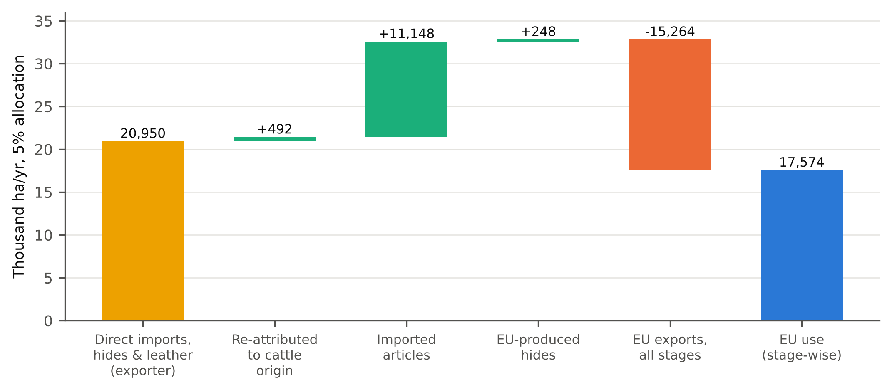

**Peter Kalafatis**

Independent researcher, x9m8.com, New York, NY, USA. Correspondence: x9m8x7@gmail.com

**Preprint, not peer reviewed.** Version 1, October 2026.

## Abstract

The Commission's assessment of deforestation linked to EU leather counts only direct imports of hides and leather, charged at partner-country intensities, and leaves out leather goods and EU exports. Laroche et al. (2024) already traced EU hide consumption, goods included, to the countries where hides were produced. I extend their physical trade model with stage-specific matrices for raw hides, tanned hides, finished leather and goods (BACI trade, FAOSTAT hide output, DeDuCE v2.1), give a 2005–2023 series, and reconcile the traced figure term by term with exporter attribution of direct imports. In 2015–2020 EU use, including leather in EU-made cars and furniture, was 1.33 million tonnes of raw-hide equivalent a year. At a 5% allocation it embodied 17,574 hectares of deforestation a year, 72% traced to Brazil. Imported goods added 11,148 hectares to the exporter-attributed 20,950, but EU exports removed 15,264, so the traced figure was 0.84 times the exporter figure (0.44–0.93 across conversion factors and balancing). Across seven allocation rules it ranged from 8,787 to 35,411 hectares. About 41% of traced hectares entered the EU from a third country, mostly as goods, led by China and Viet Nam. Levels depend on FAOSTAT's imputed Brazilian hide output: an assumed yield of 30 kg a head lowers them by 21% but leaves the ratio at 0.86. With the Commission's factors, recorded leather exports exceed FAOSTAT's hide output for Brazil and others, a joint problem of factors and imputed data.

**Keywords:** leather; cattle hides; embodied deforestation; consumption-based accounting; physical trade model; EU Deforestation Regulation; Brazil; supply chains

**Social media summary:** Traced to the farm, EU leather use embodied about 17,600 ha of deforestation a year; 41% came via third countries.

## 1. Introduction

The EU Deforestation Regulation (Regulation (EU) 2023/1115) covers both placing products on the Union market and exporting them from it. Its original Annex I listed cattle hides (HS 4101), tanned or crust hides (4104) and finished leather (4107). In 2026 a delegated act removed those lines (Commission Delegated Regulation (EU) 2026/2102). The Commission's staff working document put the deforestation embodied in EU leather imports at roughly 19,500 to 39,000 hectares a year, depending on the share of cattle deforestation charged to the hide (European Commission, 2026; Kalafatis, 2026). It counted only direct EU imports of hides and leather in 2015–2020, charged at the deforestation intensity of the partner country; its stated method adjusts that intensity for raw commodities the partner itself imports, using UN Comtrade for leather, though its annex does not show how this was applied to tanned and finished leather (European Commission, 2026, pp. 28, 31). It did not count leather goods or deduct EU exports. It noted that importers of finished leather goods, such as footwear and handbags, would not face equivalent due diligence, and that adding derived products "cannot be considered at this stage" (European Commission, 2026, p. 18).

Hides move through several countries before they reach a user. Brazilian wet-blue is finished in Italy (Mammadova et al., 2020); hides from many origins are tanned in China, India and Viet Nam and come back to Europe as shoes and bags. A companion paper on the leather exemption recomputed the Commission's figure from Eurostat data with plain exporter attribution and stated the limitation directly: leather tanned in a third country from South American hides was assigned to the tanning country (Kalafatis, 2026). Whether correcting this raises or lowers the EU's footprint is not obvious. Tracing adds Brazilian hides that reach the EU inside Asian goods, but it also removes hides that the EU imports, tans and re-exports.

Laroche et al. (2024) have already done the main part of this tracing. They extended the physical trade model of Kastner et al. (2011), which follows re-exports back to the country of production using the proportional composition of each trading partner's supply, to derived products including leather goods, using BACI trade data. In their published code all leather products, converted to raw-hide equivalent, enter one trade matrix that is traced once against FAOSTAT hide production (Kastner et al., 2024, file 01_calculations.R). Goods made in third countries are therefore assigned to the countries where the hides were produced, in proportion to each processing country's total hide-equivalent supply. Their code also reports the share of negative flows, where exports exceed supply. They reported averages for 2018–2020: EU apparent consumption of about 1,220 thousand tonnes of hides once consumer goods were included, one-third of EU origin, 13% from Brazil, 12% from China and 8% from India, and 1,200 to 31,000 hectares of deforestation a year depending on the products included, with 10% of pasture deforestation allocated to hides. Their supplement holds annual results for 2012–2022.

This paper adds four things to that work. First, it reconciles the origin-traced estimate, term by term, with exporter attribution of direct imports as used in the companion paper, which reproduces the Commission's total closely. Second, it traces each processing stage separately, so that a country's tanned leather inherits the origin mix of the raw hides it tanned and its goods inherit the origin mix of the finished leather it used; this variant gives about 10% less than pooled tracing. Third, it gives an annual series for 2005–2023 with the latest DeDuCE release. Fourth, it reports results over a grid of five conversion-factor sets and the seven allocation rules of the companion paper, and examines where the stage-by-stage mass balance fails under each factor set.

The questions are: how much cattle-driven deforestation is embodied in EU27 use of bovine leather and leather goods when hides are traced to the country where the cattle were raised; how far does that differ from exporter attribution; what share of Brazilian and Paraguayan hide-equivalents reaches EU users through third countries; and how much do EU exports of leather and goods offset imports?

## 2. Methods

### 2.1 Data

Bilateral trade came from BACI, version 202601, HS 2002 revision (Gaulier & Zignago, 2010), which reconciles exporter and importer reports from UN Comtrade and gives values and quantities in tonnes for each exporter, importer, product and year. I kept 2005–2024 flows of 35 HS six-digit subheadings, plus two used only in a sensitivity run: raw bovine and equine hides (4101), tanned or crust hides (4104), finished leather (4107), saddlery (4201), cases and bags with an outer surface of leather (4202.11, .21, .31, .91), leather apparel and accessories (4203), other leather articles (4205), footwear with leather uppers (6403, 6405.10) and textile-upper footwear with leather soles (6404.20); and, in the sensitivity run, patent leather (4114.20) and composition leather (4115.10). Outlier quantities were replaced following the supplement code of Kastner et al. (2024): where a flow's unit value was more than 20 times above or below the median for its product and year, the quantity was replaced by value divided by the median unit value. Unlike that code, which drops flows with missing quantities, I imputed missing quantities in the same way. Together these affected 7.6% of 2.19 million flows. The 27 EU member states were combined into one region and intra-EU trade was removed. BACI quantities of EU27 extra-EU imports were checked against Eurostat Comext (DS-045409; Eurostat, 2026): the median ratio of BACI to Comext tonnes over 2005–2023 was 1.12 for 4101, 1.03 for 4104 and 1.15 for 4107, so BACI puts EU imports 3% to 15% higher.

Hide production is FAOSTAT's "Raw hides and skins of cattle" plus "Raw hides and skins of buffaloes" (FAO, 2026), as in Laroche et al. (2024). Buffalo hides matter for India, for which FAOSTAT reports no cattle hide output. The EU27 aggregate was used for EU production. Every country-level production record for 2005–2024 is flagged as imputed, and the EU27 aggregate as estimated; none is official. FAOSTAT reports hides by fresh weight, which I treat, as Laroche et al. do, as equivalent to the wet-salted basis of the conversion factors.

Deforestation is DeDuCE version 2.1 (Singh & Persson, 2026; Singh et al., 2026), the five-year amortised "deforestation risk" for cattle-pasture expansion by producer country, 2005–2023, summing the "Cattle meat" and "Leather" rows. Leather's share of each country-year in this release is fixed at 5.0%, as in version 2.0 (Kalafatis, 2026). Version 2.0 (Singh et al., 2024) was used as a sensitivity. The v2.1 documentation states that leather and wood products are excluded from DeDuCE's own physical trade model because FAOSTAT has no bilateral trade data for them; the v2.1 physical trade file contains "Cattle meat" but no leather rows. Version 2.1 is licensed CC BY 4.0 on Zenodo, and its "About the data" file names the Creative Commons Attribution licence. The version 2.0 readme used in the companion paper describes the data as CC BY-NC-SA, while its Zenodo record says CC BY 4.0; this paper relies on version 2.1 and does not redistribute either.

### 2.2 Conversion factors

Every product was converted to raw-hide equivalent (RHE), tonnes of wet-salted hide. Five factor sets were used. The core set is the mean factors in the supplement (Kastner et al., 2024): 1.00 for raw hides and for wet-blue, 4.02 for crust and finished leather, and 1.03 to 4.02 for articles, by subheading. The minimum and maximum sets were also run; the three differ only in their factors for articles. The Commission set uses the staff working document's 1.00, 2.33 and 4.20 for 4101, 4104 and 4107 (European Commission, 2026). The UNIDO set is derived from the mass balance of Buljan et al. (2000), where 1,000 kg of wet-salted hide yields 350 kg of shaved wet-blue (262 kg grain, 88 kg split) and 255 kg of finished leather (195 kg grain, 60 kg split), giving 2.86 and 3.92. The Commission and UNIDO sets have no factors for articles, so articles were converted to finished-leather content with the supplement's factors (factor divided by 4.02) and then multiplied by the set's finished-leather factor. Wooden-base footwear with leather uppers (6403.30), which exists in HS 2002 but not HS 2012, took the factor of 6403.99. Laroche et al. (2024) state that they assume "at least three-quarters" of goods described only as "leather" are bovine. Articles made wholly of leather carry the finished-leather factor of 4.02 in the supplement, which suggests (my inference) that no 0.75 scaling is built in; I used the factors as published and tested a further 0.75 scaling of articles.

### 2.3 Stage-wise origin tracing

Products were grouped into four stages: raw hides, tanned and crust hides, finished leather, and articles. For each year and stage *s*, with *T*~s~ the matrix of RHE imports of each country from each partner, the re-export algorithm of Kastner et al. (2011) gives each country's supply by origin as

*R*~s~ = (*I* − *T*~s~ diag(*x*~s~)^−1^)^−1^ *P*~s~,

where *P*~s~ holds each country's own output at stage *s* by origin and *x*~s~ its total supply (output plus imports). At the first stage *P*~1~ is FAOSTAT hide production, each country being its own origin. A country's domestic use at stage *s* is its supply minus its exports, and it becomes the country's output at stage *s* + 1 with the origin mix of its stage-*s* supply. Domestic use of articles in the EU27 is called EU use here. It is not final consumption: it includes the leather used in EU-made cars and furniture and in other goods outside the codes above, whether those goods are used in the EU or exported, because HS codes for seats and vehicles do not identify leather. Leather in imported cars and furniture is not counted.

Where a country's recorded exports at a stage exceed its supply, the model cannot balance. In the core run such exports were scaled down to supply, repeating until no country's exports exceeded its supply. In a sensitivity run the missing supply was instead added to the exporting country with the origin mix of its existing supply, or as its own output if it had none; this variant adds hides that FAOSTAT does not record, by design. The size of these gaps was recorded. Because a low conversion factor can never create a gap, the check can show that factors are too high relative to reported production, but not that they are right.

To show how hides reach the EU, the EU's supply at each stage was split by entry route: the recorded exporting country, the stage at which the flow entered, and its origin. Flows are "direct" when the recorded exporter is the cattle-origin country and "via a third country" otherwise.

### 2.4 Comparators

Two comparators were computed with the same data and factors. The pooled model replicates the method of Laroche et al. (2024): all stages are summed into one RHE trade matrix, traced once against hide production, and the EU's apparent consumption (production plus imports minus exports) takes the origin mix of its total supply. The exporter model is the exporter attribution of the companion paper (Kalafatis, 2026): the EU's direct imports of hides and leather (stages 1–3), and separately of articles, are charged at the deforestation per tonne of the exporting country. It is close to, but not the same as, the Commission's method, which adjusts partner intensities for one step of raw-hide imports (§1).

### 2.5 Embodied deforestation and allocation

For origin *o* and year *t*, one tonne of RHE carries α~ot~ *D*~ot~ / *H*~ot~ hectares, where *D* is DeDuCE cattle-pasture deforestation, *H* hide production (cattle plus buffalo) and α the share of cattle deforestation allocated to the hide. The seven rules of the companion paper were applied (Kalafatis, 2026): fixed shares of 2.5% and 5% (the Commission's by-product and co-product values), 3.5% (the leather PEFCR default; De Rosa-Giglio et al., 2018), 8% (the Commission's mass value) and 10% (Laroche et al., 2024); a mass share from FAOSTAT hide and carcass weights by country and year; and an economic share from EU import prices of raw hides and of beef in each year, with a boneless yield of 0.70. Where the economic or mass share could not be computed for a country, the hide-weighted mean of the year was used. Results are mainly reported at 5%, the co-product value in the Commission's assessment, for 2015–2020, the period of that assessment.

### 2.6 Sensitivity

FAOSTAT's hide output for China is imputed and large, and under proportional sourcing it dilutes the origin mix of Chinese goods. Two runs halved and removed China's hide production in the tracing, keeping deforestation per tonne unchanged. FAOSTAT's imputed hide output for Brazil implies 16 to 27 kg of hide per animal slaughtered over 2005–2024, with step changes, against 31 to 38 kg in 2015–2020 for the United States, Argentina, Uruguay, Paraguay, Australia and mainland China in the same FAOSTAT data. As an assumption, not a sourced figure, three runs set Brazil's cattle hide output to FAOSTAT's head slaughtered times 26, 30 or 34 kg, changing both the hides traced and Brazil's deforestation per tonne. Other runs added patent and composition leather (4114.20, 4115.10) as finished leather, scaled article factors by 0.75, used the top-up balance, and used DeDuCE v2.0.

### 2.7 Validation

The pooled replication was compared with the annual output of Laroche et al. (2024), read from the supplement (Kastner et al., 2024; file output/apparent_consumption_leather_embodied_deforestation_HS12codes_2012-2022_different_processing_levels_mean.rds). Differences are expected: they used BACI HS 2012 (version 202401), DeDuCE version 1.0 and a FAOSTAT download of December 2023, dropped flows without quantities instead of imputing them, used traced first-level output rather than FAOSTAT production as the denominator of deforestation per tonne, and included patent and composition leather and leather waste (4114.20, 4115) in their core run.

### 2.8 Software, data and AI use

BACI was read from the CEPII server, the Laroche et al. supplement and DeDuCE v2.1 from Zenodo, and the FAOSTAT hide extract from its bulk download, on 22 October 2026; the FAOSTAT cattle file and the Comext extracts of the companion paper were retrieved on 21 October 2026. Analyses used Python 3.13 with pandas, NumPy, openpyxl and pyreadr; figures used matplotlib. All code and processed results are in the reproducibility package. The study was carried out with the assistance of Claude (Anthropic; model claude-opus-5-5) in October 2026, which retrieved data, read the Laroche et al. code, wrote and ran the analysis code, searched the literature and drafted the text under the author's direction. Independent AI agents checked every number against the result files and every citation against its source. The author reviewed the work and takes full responsibility for it.

## 3. Results

### 3.1 How much hide reaches EU users

In 2015–2020 EU27 use of bovine leather was 1.33 million tonnes of RHE a year under the core factors, about 14% of the 9.22 million tonnes of cattle and buffalo hides the world produced (Table 1). EU-produced hides made up 22.8% of it, India 13.5%, Brazil 11.8%, China 11.1% and the United States 8.4%. Direct imports of hides and leather were 0.82 million tonnes and of articles 1.15 million tonnes. EU use was 1.50 million tonnes a year in 2005–2009 and 1.23 million in 2021–2023 (Figure 1B). Two features push the figure up as a measure of consumption: it includes leather in EU-made vehicles and furniture that are exported, and BACI records somewhat more EU imports than Comext.

### 3.2 Embodied deforestation and the comparison with exporter attribution

At the 5% rule, EU use embodied 17,574 hectares of deforestation a year in 2015–2020 under stage-wise tracing (Table 1). Exporter attribution of direct hide and leather imports gave 20,950 hectares with the same factors, so the traced figure was 0.84 times it. The pooled method gave 19,428 hectares. Attributing all direct imports, articles included, to their exporters gave 26,087 hectares.

The difference has four parts (Figure 2). Re-attributing direct hide and leather imports from the exporter to the cattle-origin country added 492 hectares. Articles imported from outside the EU, traced to the countries where their hides were produced, added 11,148 hectares, more than half the direct-import figure. EU-produced hides added 248. Hides, leather and goods exported from the EU carried 15,264 hectares out: 5,927 in finished leather, 6,878 in articles, 2,336 in tanned hides and 122 in raw hides. Of the 1.30 million tonnes of RHE the EU exported, 158 thousand tonnes were of Brazilian or Paraguayan origin.

The ratio of traced to exporter-based deforestation ranged from 0.73 to 0.94 across 2005–2023 with no trend (Figure 1A). Both fell over the period: the traced figure from 26,481 hectares in 2005 and 30,335 in 2006 to 12,101 in 2023, and averaged 13,549 hectares in 2021–2023 against 15,649 for exporter attribution.

### 3.3 Conversion factors and the mass balance

The exporter figure depends heavily on the factor for tanned hides, which make up most of the tonnage of the EU's direct imports. With the Commission's factors it was 37,727 hectares for 2015–2020 at 5%; with the UNIDO factors 44,270; with the supplement's factors, which count wet-blue at 1.00 instead of 2.33 or 2.86, 20,950 (Table 2). The three supplement sets give the same direct-import figure because they differ only for articles. With the Commission's factors and DeDuCE v2.0, the data of the companion paper, the exporter calculation gives 43,008 hectares, against 42,216 in that paper and 39,005 in the Commission's assessment; these are close, which suggests the exporter model is a fair stand-in for the Commission's total, though the methods are not identical.

When exports above supply were scaled down, the traced figure ranged only from 17,484 to 20,204 hectares across factor sets, against 20,950 to 44,270 for the exporter figure, a range of 1.16 times against 2.1 times: scaled-down tracing cannot assign more hides to an exporter than FAOSTAT says it has. The top-up variant, which adds hides by design, raised the traced figure to as much as 30,907 hectares. The ratio of traced to exporter figures ranged from 0.44 to 0.93 across the ten combinations.

With the Commission's factors, exports of tanned hides that exceeded the exporting country's supply amounted to 11.2% of world trade in tanned hides, and for finished leather 20.4%. With UNIDO factors the shares were 21.7% and 21.7%; with the supplement's, 0.5% and 0.5% (Table 2). Raw hides showed gaps of 2.2% of world trade under every set, mainly for Canada, Iraq and Norway. The largest gaps under the Commission's factors were for Brazil, the United States and New Zealand for tanned hides, and Brazil for finished leather. This is a joint inconsistency between the factors and FAOSTAT's imputed hide output, not evidence against the factors alone. With Brazil's hide output set to 30 kg a head, the Commission-factor gaps fell to 7.3% for tanned hides and 4.3% for finished leather; much of what remains is United States and New Zealand wet-blue. Articles showed gaps of 3.8% to 7.5% of world article trade under every set, largest for Viet Nam, Cambodia and Bangladesh.

### 3.4 Origins and routes

Brazil accounted for 72.3% of the traced hectares in 2015–2020, Paraguay for 8.5%, India for 4.1% and Bolivia for 3.2% (Table 3). Under exporter attribution Brazil's share was 76.6% and Paraguay's 11.8%. India and China carried much more hide in traced EU use than in direct imports (179 and 148 thousand tonnes against 40 and 2), but little deforestation per tonne. India's share rests on dividing all its cattle-pasture deforestation by buffalo hide output only, because FAOSTAT reports no Indian cattle hides; this probably overstates it.

About 41% of the traced hectares entered the EU through a country other than the cattle's origin, 6,648 of them as articles (Figure 3A). Of the Brazilian and Paraguayan hide-equivalents in EU use, 42% came that way. The recorded exporting country was China for 31% of the indirect hectares, Viet Nam for 17%, the United Kingdom for 9%, India for 7% and Indonesia for 5% (Figure 3B). BACI records the partner reported in customs data, which is often the country of origin of the goods rather than of the last shipment, so the United Kingdom's share may include re-exports. The indirect share was 38% to 46% in every year.

### 3.5 Allocation rules and sensitivity

Across the seven allocation rules the traced total for 2015–2020 ranged from 8,787 hectares (2.5%) to 35,411 (FAOSTAT mass weights); the economic rule gave 15,699 (Table 1). The economic rule gave 41,142 hectares in 2005–2009 and 8,837 in 2021–2023, as hide prices fell relative to beef. Setting Brazil's hide output at 26, 30 or 34 kg a head lowered the 5% estimate by 13%, 21% and 27% (Table 4) and the exporter figure by similar amounts, so the ratio of the two stayed between 0.85 and 0.86; Brazil's share of traced hectares fell to between 68% and 62%. Halving China's hide output in the tracing raised the estimate by 4%, and removing it by 9%. Adding patent and composition leather lowered it by 5%, treating three-quarters of article leather as bovine by 4%, and the top-up balance raised it by 8%. DeDuCE v2.0 gave 18,723 hectares, 7% more than v2.1.

### 3.6 Validation against Laroche et al.

For 2018–2020 the pooled replication gave EU consumption of 1,381 thousand tonnes of RHE a year, against 1,220 thousand in the published output of Laroche et al. (2024), whose origin shares in that output were EU 34.5%, Brazil 12.7%, China 12.3% and India 8.5% (8% in their article). At their 10% rule the replication gave 39,302 hectares a year against their 30,979. The differences listed in §2.7 may explain the gap, but I did not test them one by one; switching to DeDuCE v2.0 widens rather than narrows the hectare gap. The replication was not tuned to match.

## 4. Discussion

### 4.1 What exporter attribution gets wrong, and in which direction

Exporter attribution of direct hide and leather imports, as in the companion paper, misses one thing and counts another. It misses the hides that reach EU users inside goods made in third countries. On the core factors these added 11,148 hectares a year in 2015–2020, more than half the direct-import figure, and about 41% of the hectares in EU use entered through a third country. These are the "derived products" the Commission's assessment set aside; on these results they are not a marginal channel. It also counts, as EU use, hides that the EU tans and re-exports as leather or goods. Within the model those exports removed more than the goods added, so on the core factors the traced figure was about one-sixth smaller than the exporter figure, and smaller under every factor set and Brazilian yield tested. The traced figure still includes leather in exported EU-made vehicles and furniture, so as a measure of consumption it is, if anything, too high.

Which figure is "right" depends on the question. The regulation applies to products placed on the EU market and to products exported from it, so for scope the gross flow matters: the hides and leather the EU imports, whether or not they leave again, plus the leather goods it imports, which are not covered. For a consumption footprint, the traced figure is the relevant one. A direct-import figure answers neither question cleanly.

The re-attribution of direct imports to cattle origin changed little (492 hectares). Most of the EU's direct imports of tanned and finished leather come straight from the countries that raised the cattle, chiefly Brazil and Paraguay, so assigning them to the exporter is nearly the same as assigning them to the origin. The large differences come from goods and from exports, not from intermediate tanning hubs.

### 4.2 Stage-wise and pooled tracing

The stage-wise model gave about 10% less deforestation than the pooled method of Laroche et al. (2024), which already attributes goods made in third countries to hide-producing countries. Pooling lets a country's goods take the origin mix of all its hide-equivalent supply, including raw hides it never tanned. The difference is modest, so the contribution here is not a correction of their totals but the reconciliation with exporter attribution, the series back to 2005, and the grid of factor sets and rules.

### 4.3 Conversion factors and FAOSTAT

The Commission's factor of 2.33 tonnes of raw hide per tonne of wet-blue, like the UNIDO-based 2.86, implies that Brazil, the United States and New Zealand export more hide than FAOSTAT reports them producing. For Brazil much of the gap disappears if its hide yield is set closer to that of other large producers, so FAOSTAT's imputed Brazilian output is at least part of the problem. For United States wet-blue, where FAOSTAT's yield looks plausible, the gap suggests that 2.33 is high for wet-blue as traded, which may be shipped at higher moisture or before shaving and splitting. The supplement's wet-blue factor of 1.00 removes the gaps, but a low factor cannot fail this test, so that is not evidence it is right; treating wet-blue as weighing the same as salted hide is close to a lower bound. Whatever the cause, the exporter-based estimate is the more sensitive to this choice: it is 1.8 times higher with the Commission's factors than with the supplement's, against 1.16 times for scaled-down tracing.

### 4.4 Limitations

Origins are assigned by proportional sourcing: each country's output takes the average origin mix of its supply. Real tanneries and factories buy from particular suppliers, and a customs-level study of one year shows specific Brazil–Italy links (Mammadova et al., 2020); the true routing of Brazilian hides through China or Viet Nam may differ from the average. China's imputed hide output also dilutes the origin mix of Chinese goods, though removing it entirely raised the estimate by only 9%. FAOSTAT hide production is imputed for every country, and Brazil's imputed yield alone moves the levels by up to about a quarter, with Brazil's share falling to 62% at 34 kg a head; India's share is probably overstated because its denominator is buffalo hides only. Leather in cars and furniture is counted where the leather is used, not where the car or sofa is bought; imported vehicles are not covered, and EU-made vehicles that are exported are counted as EU use. HS 4101, 4104 and 4107 include equine hides and the goods codes include non-bovine leather. Deforestation per tonne is a national average, which ignores differences between slaughterhouses and regions within Brazil; for version 2.0 the DeDuCE authors cautioned against relying on trends in 2021–2022 (Singh et al., 2024), and the version 2.1 documentation does not repeat the caution. The allocation share, not the tracing, is the largest source of uncertainty: a fourfold spread across rules against a spread of 1.16 across factor sets with scaled-down tracing.

## 5. Conclusion

Traced to where the cattle were raised, EU27 use of leather and leather goods embodied about 17,600 hectares of deforestation a year in 2015–2020 at a 5% allocation, and about 13,500 hectares in 2021–2023; both levels could be a fifth lower if FAOSTAT understates Brazil's hide output. That is somewhat less than exporter attribution of direct imports gives from the same data, because the EU exports much of the leather it imports. But about two-fifths of the traced deforestation reaches the EU through third countries, mostly in goods, led by China and Viet Nam, outside the scope of any rule that covers only hides and leather. Any future revision of the regulation's leather scope should count goods as well as hides and leather, and state its conversion factors, which change an exporter-based estimate by a factor of 1.8.

## Acknowledgements

The author thanks CEPII for BACI, FAO for FAOSTAT, the DeDuCE authors for open data and code, and Laroche, Kastner and colleagues for publishing their code and results. Claude (Anthropic; model claude-opus-5-5) assisted with data retrieval, analysis code, literature search and drafting in October 2026, as described in §2.8. The author reviewed all outputs and is responsible for the content.

## Author contributions

P.K. conceived the study, directed the analysis, and reviewed and approved the manuscript.

## Financial support

This research received no specific grant from any funding agency, commercial or not-for-profit sector.

## Conflicts of interest

The author owns Marcellino NY, a small business that makes and sells leather briefcases and buys finished leather. Rules on the deforestation content of leather affect the supply chains of such businesses. The author has no financial interest in hide trading, tanning, meatpacking or alternative materials.

## Research transparency and reproducibility

All inputs are public: BACI (CEPII, Etalab 2.0 licence), FAOSTAT production, DeDuCE v2.1 and v2.0 (Zenodo, CC BY 4.0; the v2.0 readme says CC BY-NC-SA), the supplement of Laroche et al. (Kastner et al., 2024; Zenodo, CC BY 4.0) and Eurostat Comext. Code and all result files are in the reproducibility package linked from the article page; raw third-party data are not redistributed, and the package README explains how to obtain them.

## References

Buljan, J., Reich, G., & Ludvik, J. (2000). *Mass balance in leather processing* (US/RAS/92/120, Regional Programme for Pollution Control in the Tanning Industry in South-East Asia). United Nations Industrial Development Organization. https://leatherpanel.org/sites/default/files/publications-attachments/mass_balance.pdf

Commission Delegated Regulation (EU) 2026/2102 of 13 July 2026 amending Regulation (EU) 2023/1115 of the European Parliament and of the Council as regards the list of relevant commodities and relevant products. *Official Journal of the European Union*, L, 2026/2102, 17 September 2026. https://eur-lex.europa.eu/eli/reg_del/2026/2102/oj/eng

De Rosa-Giglio, P., Fontanella, A., Gonzalez-Quijano, G., Ioannidis, I., Nucci, B., & Brugnoli, F. (2018). *Product environmental footprint category rules (PEFCR): Leather* (Final version, 25 April 2018). Leather Pilot Technical Secretariat. https://web.archive.org/web/20220205045047/https://ec.europa.eu/environment/eussd/smgp/pdf/PEFCR_leather.pdf

European Commission. (2026). *Commission staff working document accompanying the document Commission Delegated Regulation (EU) …/... amending Regulation (EU) 2023/1115 of the European Parliament and of the Council as regards the list of relevant commodities and relevant products* [Draft-labelled copy of SWD(2026) 194 final]. https://environment.ec.europa.eu/document/download/9b5c8907-8651-440f-be8f-bb2d3d549763_en?filename=Commission%20Staff%20Working%20Document%20on%20Delegated%20Regulation%20on%20EUDR%20list%20of%20relevant%20commodities%20and%20products.pdf

Eurostat. (2026). *EU trade since 1988 by HS2-4-6 and CN8* (DS-045409) [Data set]. Retrieved October 21, 2026, from https://ec.europa.eu/eurostat/api/comext/dissemination/statistics/1.0/data/DS-045409

FAO. (2026). *FAOSTAT: Crops and livestock products* (QCL) [Data set]. Food and Agriculture Organization of the United Nations. Retrieved October 21 and 22, 2026, from https://bulks-faostat.fao.org/production/Production_Crops_Livestock_E_All_Data_(Normalized).zip

Gaulier, G., & Zignago, S. (2010). *BACI: International trade database at the product-level. The 1994–2007 version* (CEPII Working Paper No. 2010-23). CEPII. Data version 202601 retrieved October 22, 2026, from https://www.cepii.fr/DATA_DOWNLOAD/baci/doc/baci_webpage.html

Kalafatis, P. (2026). *Lower economic value, same forest: The EU's leather exemption from deforestation rules* [Preprint]. x9m8.com. https://x9m8.com/eu-deforestation-regulation-leather-exemption/

Kastner, T., Kastner, M., & Nonhebel, S. (2011). Tracing distant environmental impacts of agricultural products from a consumer perspective. *Ecological Economics*, *70*(6), 1032–1040. https://doi.org/10.1016/j.ecolecon.2011.01.012

Kastner, T., Laroche, P. C. S. J., Gómez-Suárez, M., Persson, U. M., Pendrill, F., Schwarzmüller, F., & Schulp, C. J. E. (2024). *Supplement code and data for "Accounting for trade in derived products when estimating European Union's role in driving deforestation"* (Version 1.0) [Data set and code]. Zenodo. https://doi.org/10.5281/zenodo.11085413

Laroche, P. C. S. J., Gómez-Suárez, M., Persson, U. M., Pendrill, F., Schwarzmueller, F., Schulp, C. J. E., & Kastner, T. (2024). Accounting for trade in derived products when estimating European Union's role in driving deforestation. *Ecological Economics*, *224*, Article 108288. https://doi.org/10.1016/j.ecolecon.2024.108288

Mammadova, A., Masiero, M., & Pettenella, D. (2020). Embedded deforestation: The case study of the Brazilian–Italian bovine leather trade. *Forests*, *11*(4), Article 472. https://doi.org/10.3390/f11040472

Regulation (EU) 2023/1115 of the European Parliament and of the Council of 31 May 2023 on the making available on the Union market and the export from the Union of certain commodities and products associated with deforestation and forest degradation and repealing Regulation (EU) No 995/2010. *Official Journal of the European Union*, L 150, 206–247. https://eur-lex.europa.eu/eli/reg/2023/1115/oj/eng

Singh, C., & Persson, U. M. (2026). Global patterns of commodity-driven deforestation and associated carbon emissions. *Nature Food*, *7*(2), 138–151. https://doi.org/10.1038/s43016-026-01305-4

Singh, C., Persson, U. M., Croft, S., Kastner, T., & West, C. D. (2024). *Commodity-driven deforestation, associated carbon emissions and trade 2001–2022* (Version 2.0) [Data set]. Zenodo. https://doi.org/10.5281/zenodo.10633818

Singh, C., Persson, U. M., Croft, S., Kastner, T., & West, C. D. (2026). *Commodity-driven deforestation, associated carbon emissions and trade 2001–2023* (Version 2.1) [Data set]. Zenodo. https://doi.org/10.5281/zenodo.18953516

## Tables

**Table 1.** Deforestation embodied in EU27 leather, mean of 2015–2020 (hectares per year), by accounting method and allocation rule. Mean conversion factors of the Laroche et al. supplement (Kastner et al., 2024); exports above supply scaled down. Direct imports are attributed to the exporting country, as in the companion paper; EU use includes leather in EU-made cars and furniture. RHE, raw-hide equivalent; Econ., economic rule at prices of the year; FAO mass, mass share from FAOSTAT hide and carcass weights.

| Method | RHE (kt) | 2.5% | 3.5% | 5% | 8% | 10% | Econ. | FAO mass |
|------------------|----:|----:|----:|----:|----:|----:|----:|----:|
| Stage-wise tracing | 1,330 | 8,787 | 12,302 | 17,574 | 28,119 | 35,149 | 15,699 | 35,411 |
| Pooled tracing | 1,425 | 9,714 | 13,600 | 19,428 | 31,085 | 38,857 | 17,441 | 39,057 |
| Direct imports, hides and leather | 816 | 10,475 | 14,665 | 20,950 | 33,521 | 41,901 | 18,651 | 41,532 |
| Direct imports, articles | 1,148 | 2,568 | 3,596 | 5,136 | 8,218 | 10,273 | 5,718 | 13,765 |
| Direct imports, all | 1,964 | 13,043 | 18,261 | 26,087 | 41,739 | 52,174 | 24,369 | 55,297 |

**Table 2.** Sensitivity to conversion factors and to the treatment of exports that exceed supply, mean of 2015–2020, 5% allocation (hectares per year). The last three columns give the world total of such excess exports at each stage as a share of world exports at that stage, before correction. The three Laroche sets differ only in their factors for articles, so the direct-import figure for hides and leather is the same in all three.

| Factor set | Direct imports, hides and leather | Stage-wise, exports scaled down | Stage-wise, supply topped up | Ratio, stage-wise to direct | Excess, tanned | Excess, finished | Excess, articles |
|--------|-----:|-----:|-----:|-----:|----:|----:|----:|
| Commission SWD | 37,727 | 20,204 | 26,335 | 0.54–0.70 | 11.2% | 20.4% | 4.4% |
| UNIDO mass balance | 44,270 | 19,505 | 30,907 | 0.44–0.70 | 21.7% | 21.7% | 3.8% |
| Laroche mean | 20,950 | 17,574 | 18,944 | 0.84–0.90 | 0.5% | 0.5% | 5.9% |
| Laroche min | 20,950 | 17,484 | 18,346 | 0.83–0.88 | 0.5% | 0.5% | 4.1% |
| Laroche max | 20,950 | 17,666 | 19,546 | 0.84–0.93 | 0.5% | 0.5% | 7.5% |

**Table 3.** Cattle-origin countries in EU27 leather, mean of 2015–2020: raw-hide equivalent (thousand tonnes) and embodied deforestation at 5% (hectares per year), by accounting method.

| Origin | Stage-wise, kt | Stage-wise, ha | Pooled, kt | Pooled, ha | Direct imports (hides and leather), kt | Direct imports (hides and leather), ha |
|---|---:|---:|---:|---:|---:|---:|
| Brazil | 157.3 | 12,702 | 178.8 | 14,417 | 197.9 | 16,051 |
| Paraguay | 18.7 | 1,492 | 20.9 | 1,676 | 31.0 | 2,471 |
| Bolivia | 4.3 | 555 | 4.6 | 607 | 7.2 | 930 |
| India | 179.1 | 721 | 162.4 | 654 | 39.7 | 158 |
| China | 147.7 | 235 | 155.0 | 247 | 1.8 | 3 |
| Argentina | 47.4 | 16 | 51.4 | 18 | 38.2 | 13 |
| EU27 | 302.8 | 99 | 449.6 | 147 | 0.0 | 0 |

**Table 4.** Sensitivity of the stage-wise estimate, mean of 2015–2020, 5% allocation. FAOSTAT implies a Brazilian hide yield of 16–27 kg per head; the Brazil rows replace it with an assumed yield, which changes both the hides traced and Brazil's deforestation per tonne.

| Scenario | Hectares per year | Change from core |
|------------------|------:|------:|
| Core (supplement mean factors, exports scaled down, DeDuCE v2.1) | 17,574 | — |
| China's hide output halved in the tracing | 18,338 | +4% |
| China's hide output excluded from the tracing | 19,071 | +9% |
| Patent and composition leather (4114.20, 4115.10) added as finished leather | 16,744 | −5% |
| Three-quarters of article leather bovine | 16,934 | −4% |
| Supply topped up instead of exports scaled down | 18,944 | +8% |
| DeDuCE v2.0 instead of v2.1 | 18,723 | +7% |
| Brazil hide output = head slaughtered × 26 kg (assumption) | 15,295 | −13% |
| Brazil hide output = head slaughtered × 30 kg (assumption) | 13,926 | −21% |
| Brazil hide output = head slaughtered × 34 kg (assumption) | 12,872 | −27% |

## Figures

![**Figure 1.** (A) Deforestation embodied in EU27 leather use at the 5% allocation, 2005–2023, by accounting method, with the supplement's mean conversion factors (Kastner et al., 2024). Direct imports are attributed to the exporting country, as in the companion paper. The shaded band is the range of the stage-wise estimate across five conversion-factor sets and two ways of balancing exports that exceed supply. (B) Raw-hide equivalent of EU direct imports of hides and leather, of articles, and of EU use under stage-wise tracing.](../figures/fig1_series.png)

