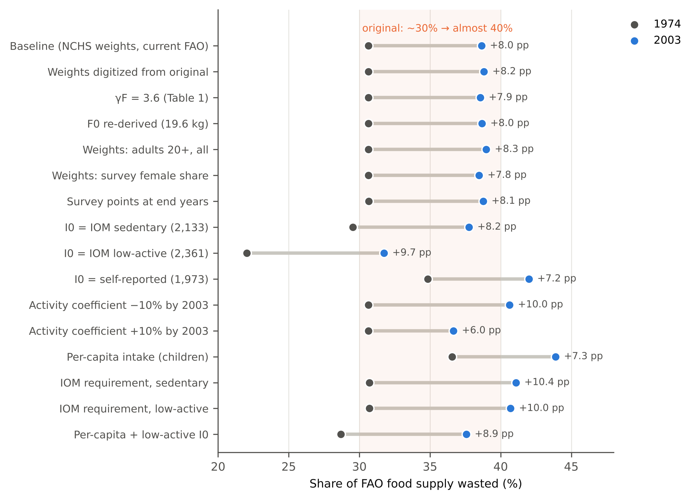

**Peter Kalafatis**

Independent researcher, x9m8.com, New York, NY, USA. Correspondence: x9m8x7@gmail.com

**Preprint, not peer reviewed.** Version 1, October 2026.

## Abstract

Hall et al. (2009) estimated US food waste as the difference between the per-capita food supply in FAO food balance sheets and the food intake implied, through an energy-balance model, by the rise in mean adult body weight. They reported that waste grew by about 50% from 1974 to 2003, to more than 1,400 kcal per person per day, and from about 30% to almost 40% of the supply. No code or data accompanied the paper. I re-implemented the model from its printed equations and re-ran it with public inputs: NCHS mean body weights (published tables for 1971–1994, NHANES microdata thereafter) and the current FAOSTAT food balance sheets. The calculation reproduces: the model coefficients came out at 9,103 kcal/kg and 22.1 kcal/kg/d (published 9,100 and 22). Waste rose from 929 to 1,459 kcal per person per day (57%), and its share of supply from 30.7% to 38.6%. The rise survived every input and parameter check, but the level did not: the 1974 share ranged from 22% to 37% depending on assumed baseline intake and whether children were counted. Extending the series to 2023, the wasted share peaked at 39.0% in 2002 and 2005, fell to about 35% in 2014–2017 (35.2% in 2017) and returned to 38.6% in 2023. The change from 2003 to 2023 was +0.0 percentage points (95% parameter-uncertainty interval −1.2 to +1.0; −0.2 with 2022 as end year). The original's arithmetic holds, but the waste it reports is a residual, and the 1974–2003 climb did not continue.

**Keywords:** food waste; food supply; energy balance; obesity; NHANES; FAOSTAT food balance sheets; reproducibility; sustainability

**Social media summary:** US food waste, re-run: the 1974–2003 rise reproduces from public data, but the climb did not continue after 2003.

## 1. Introduction

How much food does a country waste? Direct measurement is hard. Studies weigh plate waste, sort garbage or apply loss factors along the supply chain, and each method misses something. Hall et al. (2009) took a different route. They estimated the food the US population actually ate from the change in its average body weight, using a mathematical model of energy balance, and subtracted that intake from the per-capita food supply recorded in the Food and Agriculture Organization (FAO) food balance sheets. What remained was waste.

The paper's conclusions are stated plainly in its abstract: "US per capita food waste has progressively increased by ∼50% since 1974 reaching more than 1400 kcal per person per day or 150 trillion kcal per year." In the results, food waste "progressively increased from about 30% of the available food supply in 1974 to almost 40% in recent years", and the waste implied by the US Department of Agriculture's loss-adjusted food availability (FAO supply minus that availability, as the original constructs it), while "within 5% of our calculation in 1974, it was ∼25% too low in 2003". The discussion linked the trend to obesity, describing a "push effect" of increased food availability and marketing, and converted it into environmental terms: more than a quarter of US freshwater use and about 300 million barrels of oil a year. OpenAlex listed 753 works citing the paper on 29 October 2026.

Three features make the study worth re-running. First, it rests on a small set of inputs, all of them public, and a model whose equations and parameters are printed in full, yet no code or input file accompanied it. I found no published reproduction or update of the US calculation (searches of OpenAlex citing works, the FLoRA Replication Atlas, Institute for Replication discussion papers and the web, 28–29 October 2026). Second, two of those inputs have been revised since 2009: FAO has re-issued its food balance sheets under a new methodology from 2010 onward, keeping the old series to 2013 as a separate dataset, and NHANES has released eight further cycles of data, through August 2021–August 2023. Third, related residual (energy-gap) approaches, based on energy requirements rather than this body-weight model, have been applied to the world and to many countries including the US (Hiç et al., 2016; van den Bos Verma et al., 2020), so the behaviour of such residuals matters beyond this paper. Related work estimated that the increase in US food energy supply was "more than sufficient" to explain weight gain in the US population, children and adults, since the 1970s (Swinburn et al., 2009), and, in work by two of the same authors, that the average increase in intake needed to sustain the higher adult weights was about 0.9 MJ (about 215 kcal) per day (Hall et al., 2011).

This paper does three things. It re-implements the model and reproduces the published numbers from public data, checking each intermediate quantity the original reports. It tests how much the result depends on inputs and assumptions, including several the original authors themselves identified as limitations. And it extends the series from 2003 to 2023. I did not contact the original authors.

## 2. Methods

### 2.1 The original calculation

Hall et al. (2009) write the energy balance of each adult as d(ρBW)/dt = I − E, where I is metabolizable energy intake and E expenditure, and E includes resting metabolism proportional to fat-free mass (γFFM = 22 kcal/kg/d) and fat mass (γF), physical activity proportional to body weight (δ), an adaptive term (β) and the costs of tissue deposition (ηF, ηFFM). Averaging over the population, assuming energy balance at the first NHANES (1971–1974) and that the covariances of activity with weight and of β with intake are constant, and partitioning weight change between fat and fat-free mass with the Forbes relation (parameter C = 10.4 kg, initial mean fat mass F0 = 19.1 kg from the Jackson et al. (2002) BMI equations), they obtain their equation 13 for the change in mean intake ΔI underlying the observed mean weight change. With nominal parameters and constant physical activity this reduces to their equation 14 (the published article prints this equation with a second label "(13)" but refers to it in the text as equation 14; the waste equation is printed as (14)):

ΔI ≈ 9,100 kcal/kg × dBW/dt + 22 kcal/kg/d × (BW − BW0).

Intake is I0 + ΔI, with I0 = 2,100 kcal/d in 1974, which they calculated from the Institute of Medicine (IOM, 2005) energy-requirement equations for a sedentary population with the demographics of the first adult NHANES sample. Waste is the FAO per-capita food supply minus I. Confidence intervals come from 10^5 Monte Carlo draws of the parameters from normal distributions (their Table 1). In my Monte Carlo, draws with C ≤ 0 or β ≥ 0.95 (not addressed in the original) were redrawn, and I report medians and 2.5th–97.5th percentiles. The text uses γF = 3.2 kcal/kg/d, while Table 1 lists 3.6 ± 2; I used 3.2 for the nominal run, which reproduces the printed coefficients, and Table 1 for the Monte Carlo.

I read the equations from the article's images and the text from the full-text XML of the open-access article (Europe PMC, PMC2775916). I also digitized the original Figure 1 (mean adult body weight, modelled intake, and waste), locating axis ticks and marker centres from pixel intensities, to compare intermediate values (data/raw/other/hall2009_fig1_digitized.csv; expected precision about ±0.15 kg and ±15 kcal).

### 2.2 Data

*Body weight.* Hall et al. (2009) plot mean adult body weight for six NHANES surveys from 1971–1974 to 2003–2004 but do not give the values or the age range. I built a public series: for NHANES I (1971–1974), II (1976–1980) and III (1988–1994), mean weight of adults aged 20–74, pregnant women excluded, from NCHS Advance Data report 347 (Ogden et al., 2004, Table 7); for each continuous NHANES cycle from 1999–2000 to 2021–2023, the same quantity computed from the public DEMO and BMX files with examination weights (Centers for Disease Control and Prevention, National Center for Health Statistics, n.d.). Pooled 1999–2002 microdata gave 86.84 kg for men and 74.61 kg for women, against 86.8 and 74.7 kg in the published report. Men and women were combined with the original's female share of 0.525. Survey points were placed where the original placed them (NHANES I at 1974, II at 1978.5, III at 1991, continuous cycles at mid-cycle) and interpolated linearly.

*Food supply.* Per-capita food supply (kcal/capita/day, item "Grand Total") and population for the United States from FAOSTAT bulk files: the old-methodology food balance sheets, 1961–2013 (FBSH, file dated 10 March 2023), and the new-methodology series from 2010 (FBS, file dated 28 October 2025) (Food and Agriculture Organization of the United Nations [FAO], n.d.-a, n.d.-b). Over the four overlapping years the new series is higher by 63–81 kcal (mean 72.8).

*Comparison series.* USDA Economic Research Service loss-adjusted food availability, calories per capita per day, 1970–2010 (data last updated 1 June 2019; U.S. Department of Agriculture, Economic Research Service [USDA ERS], n.d.); EPA municipal solid waste generation of food, 1960–2019, with a change of methodology from 2018 (U.S. Environmental Protection Agency [EPA], 2026); EIA petroleum product supplied (U.S. Energy Information Administration [EIA], n.d.); and self-reported energy intake, from the NHANES day-one 24-hour recalls (reliable recalls, adults 20–74, dietary weights) and, for 1971–1974, the age-adjusted values reported by Wright et al. (2004).

### 2.3 Reproduction

The model was coded from equations 1–14 of the original (code/common.py). I ran it for each calendar year from 1974 to 2003 with two weight inputs (the digitized original values and the NCHS series) and the current FBSH supply, and computed every quantity the original reports: the two coefficients of equation 14, F0, I0, the size of the two terms in 2003, intake and waste in 1974 and 2003, the waste share, total waste, and the oil, freshwater and USDA comparisons using the original's conversion assumptions (3 kcal of fossil energy per kcal of food, agriculture 70% of freshwater use, 1.9 kcal/g for solid food waste) and, for barrels, the EIA crude-oil heat content of 5.8 million Btu per barrel, which the original does not state. F0 was re-derived from the NHANES I means with the Jackson equations; because those require means of BMI × weight and BMI² × weight, which the published tables do not give, I scaled the products of means by the ratios observed in NHANES 1999–2000 for the same age range. I0 was re-derived with the IOM equations from NHANES I mean weight and height; mean age is not published for NHANES I, so I used the 1999–2000 mean age and varied it by ±3 years. Because the first segment of the weight series has a slope, the model's 1974 intake is 2,102 rather than exactly 2,100 kcal/d; the difference is immaterial.

### 2.4 Robustness

Table 2 lists the variants: weights digitized from the original figure; γF = 3.6; F0 re-derived; adults 20 and over including pregnant women; survey-weighted female share; survey points at end years; three alternative baselines (IOM sedentary and low-active requirements from NHANES I means, and self-reported intake); physical activity falling or rising by 10% by 2003, which the original assumed constant; a per-capita correction, since the food supply is per person of all ages while the model describes adults (adult intake multiplied by the ratio of the mean IOM sedentary requirement for all ages to that for adults 20–74 in NHANES 1999–2000, 0.915); and a steady-state alternative to the energy-balance model in which intake changes with the IOM requirement at the observed mean weights and heights. I also varied each parameter by one standard deviation.

### 2.5 Update

The update extends the body-weight series to NHANES 2021–2023 and the supply to 2023. The FAO break was handled in two ways: splicing the new series onto the old by subtracting the 2010–2013 mean difference, and switching to the new series in 2010 without adjustment. For 2023 the weight series is extrapolated half a year beyond its last point. The per-capita correction was recomputed for each cycle (0.915 to 0.929). Monte Carlo intervals for the change between 2003 and 2023 use the same parameter draws as the reproduction (seed 20091124). They express parameter uncertainty only; sampling error in the mean weights, the splice offset and the extrapolation are examined separately as sensitivities (results/update.json).

### 2.6 Software, data and AI use

Analyses used Python 3.13 with pandas and NumPy; figures used matplotlib. NHANES files were parsed and aggregated in a web browser with a script included in the package (code/00_nhanes_aggregate.js), which reads the public SAS transport files and returns weighted means only; FAOSTAT bulk files were filtered to the United States in the same way. Because of restrictions in the computing environment, these aggregates were transferred as text and checked against checksums computed in the browser. The study was carried out with the assistance of Claude (Anthropic; model claude-opus-5-5) in October 2026, which retrieved data, wrote and ran the analysis code, read the original article, searched the literature and drafted the text under the author's direction. The author reviewed the work and takes full responsibility for it.

## 3. Results

### 3.1 The calculation reproduces

The two coefficients of equation 14 came out at 9,103 kcal/kg and 22.1 kcal/kg/d with the nominal parameters, against the printed 9,100 and 22 (Table 1). With γF = 3.6, as in the original Table 1, the second coefficient is 22.5. F0 re-derived from the NHANES I means was 19.6 kg (19.2 kg without the dispersion adjustment), against 19.1 kg, and α = C/F0 was 0.53 against 0.54. The IOM sedentary requirement for the NHANES I adult means was 2,133 kcal/d (2,109–2,158 for a mean age three years higher or lower), against the original's 2,100.

The body weights read from the original figure were 0.2 to 1.5 kg below the NCHS values for the same surveys (Figure 1A): 71.2 against 71.9 kg for NHANES I and 80.3 against 81.4 kg for 2003–2004. The original does not state the age range or exclusions behind its values, and I could not recover them; the difference in levels hardly matters, because the model uses changes. Between 1974 and 2003 mean weight rose by 8.9 kg on the digitized values and 9.4 kg on the NCHS series, somewhat less than the "∼10 kg" in the original text, and the average rate was 8.4 × 10⁻⁴ and 8.9 × 10⁻⁴ kg/d against the stated 9.5 × 10⁻⁴.

With either input, the model reproduced the published intake curve to within 16 kcal at every year read from the figure, and the waste curve to within 30 kcal except in 2000 and 2001, where the original curve is 54–99 kcal higher (Figure 1B, C). The supply plotted in the original Figure 1B is about 3,800 kcal around 2000, against 3,755 kcal for 2000 in the current FAO release. This may reflect a revision of the FAO data since 2009, although the original's figure caption labels this series as USDA unadjusted availability while its text calls it FAO supply. Intake rose from 2,102 kcal/d in 1974 to 2,318 in 2003 (2,311 with the digitized weights); the second term of equation 14 contributed 208 kcal/d (published "∼220") and the first 9.9 (published "<10"; 13.7 with the digitized weights, whose last segment is steeper).

Waste was 929 kcal per person per day in 1974 and 1,459 in 2003, an increase of 57% (Table 1). The share of the supply wasted rose from 30.7% to 38.6%. With the digitized weights the corresponding figures were 929, 1,466, 58%, 30.6% and 38.8%. Total waste in 2003 was 156 trillion kcal, the embodied oil 320 million barrels or 4.4% of 2003 US consumption, and 70% of the wasted share is 27% of freshwater use. Each of these matches the original's rounded statements. The 95% Monte Carlo intervals, over the original parameter distributions, were 733 to 1,123 kcal for 1974 and 1,214 to 1,687 kcal for 2003; the waste share rose in 99.95% of draws (median +8.0 percentage points, interval +3.8 to +11.4).

Two comparisons do not reproduce as stated, possibly because the comparison data have been revised since 2009; I did not compare data vintages. With the current USDA loss-adjusted availability series, the USDA-implied waste (FAO supply minus loss-adjusted availability) was 8% above the model's in 1974 and 17% below it in 2003, against "within 5%" and "∼25% too low" in the original. The direction of the divergence is the same. EPA's current series, interpolated between its 2000 and 2005 values, puts municipal solid food waste at about 99 kg per person in 2003, which at 1.9 kcal/g is 35% of the model's wasted energy, against "∼30%"; the original used an earlier EPA source (the 2007 *Facts and Figures* report, its Table 9).

### 3.2 What the result depends on

The rise between 1974 and 2003 was robust to every variant tried (Table 2, Figure 2). The increase in the wasted share ranged from +6.0 to +10.4 percentage points and the increase in waste per person from 49% to 79%. No input choice about body weight (source, age range, exclusions, female share, timing) moved the 2003 share by more than 0.4 points.

The level of waste was much less certain. It depends almost one-for-one on the baseline intake. Taking the IOM requirement for a low-active rather than sedentary population (2,361 kcal/d) lowered the 1974 share to 22.0% and the 2003 share to 31.7%. Taking self-reported intake in NHANES I (1,973 kcal/d, pooled from Wright et al., 2004) raised them to 34.8% and 42.0%, though self-reports are known to understate intake (Archer et al., 2013). Counting children, who need less food than adults but are included in the per-capita supply, raised the shares to 36.6% and 43.9%, as the original authors anticipated. Physical activity mattered for the trend, again in the direction the original anticipated when it called its estimates lower bounds: a 10% fall in the activity coefficient by 2003 raised the 2003 share to 40.6%, a 10% rise lowered it to 36.7%. Replacing the energy-balance model with the change in IOM requirements, which attributes about 125–140 kcal/d of extra intake to the heavier population instead of about 215, raised the 2003 share to 40.7–41.1%. Among the model parameters, a one-SD change in I0 moved the 2003 share by about 2.65 points and in the activity coefficient δ by 1.3 points; β and C moved it by 0.5–0.9 points and the deposition costs not at all (results/robustness.json).

### 3.3 After 2003

Mean adult weight kept rising after 2003, more slowly, from 81.3 kg (interpolated, 2003) to 84.8 kg in 2017–2018 and 84.5 kg in 2021–2023 (Figure 3A). Modelled intake rose from 2,318 kcal/d in 2003 to 2,382 in 2019 and was 2,377 in 2023. The FAO supply did not rise steadily. In the old-methodology series it peaked at 3,828 kcal in 2005 and fell to 3,649 by 2011, mostly through sugar and sweeteners (−67 kcal) and animal products (−72 kcal); in the new series it rose again from 3,731 kcal in 2010 to 3,947 in 2023.

As a result the 1974–2003 climb in the wasted share did not continue (Table 3, Figure 3B). On the spliced supply the share was 38.6% in 2003, 39.0% in 2005, 36.1% in 2010, 35.7% in 2013, about 35% in 2014–2017 (a low of 35.2% in 2017), 36.4% in 2019 and 38.6% in 2023, a rise of 3.5 points from 2017 as the FAO supply grew. The least-squares trend from 2003 to 2023 was −0.06 percentage points per year (naive standard error 0.05, which ignores autocorrelation), against +0.26 from 1974 to 2003; I did not test whether it differs from zero. The change between the two end years was +0.0 points (95% parameter-uncertainty interval −1.2 to +1.0), and the share in 2023 was higher than in 2003 in 50% of Monte Carlo draws. This interval omits other sources of uncertainty, and the end-to-end change depends on the end year: with 2022 instead of 2023 it is −0.19 points; using the 2010-only or 2013-only splice offset gives −0.12 or +0.16; raising or lowering the 2021–2023 mean weight by 0.35 kg moves it by about 0.26–0.27 points in the opposite direction; and ending at the last survey point without extrapolation gives −0.01. Waste per person changed by +38 kcal/d (95% parameter-uncertainty interval −12 to +80). Waste per person changed by +38 kcal/d (−12 to +80). Without splicing, the methodology break in 2010 adds about 73 kcal to the supply; the share then ends at 39.8% in 2023, 1.1 points (0.0 to 2.1) above 2003, and the trend after 2003 is +0.01 points per year. With the per-capita correction the shares were 36.6% (1974), 43.6% (2003) and 43.0% (2023).

Self-reported intake moved differently from modelled intake. In NHANES 24-hour recalls it was 97% of the modelled intake in 1999–2004 and 86% in 2021–2023, falling from 2,255 kcal/d (2003–2004) to 2,050 (2021–2023) while body weight rose (Table 3). Whatever the reason, a growing share of intake is not captured by recall, and a waste estimate built from recalls would rise for that reason alone.

## 4. Discussion

### 4.1 What reproduces and what does not

Hall et al. (2009) reproduces well. The model's printed equations are complete, the coefficients they imply come out as printed, and with public NCHS body weights and the current FAO food balance sheets the 1974–2003 numbers match the published ones to within the rounding the paper uses: about 900 rising to more than 1,400 kcal per person per day, about 30% rising to almost 40% of supply, about 150 trillion kcal, about 300 million barrels of oil. Two comparisons with outside data (the USDA availability series and EPA municipal food waste) no longer match their published values, possibly because both series have been revised, but the direction of the USDA comparison holds. The original's own statement that γF was 3.2 kcal/kg/d in the text and 3.6 in its Table 1, and its "∼10 kg" weight gain (8.9 to 9.4 kg here), are small inconsistencies with no material effect.

The reproduction separates two claims that the original presents together. The first is that waste rose between 1974 and 2003 by roughly 50% per person. That claim survives every check here, because it rests on the difference between a rise in supply of about 750 kcal and a modelled rise in intake of about 215 kcal, and no reasonable input moves the second figure enough to close the gap. The original authors argued this point themselves: their conclusion, they wrote, holds "unless the uncertainties of the US food supply data are systematically biased to progressively overestimate food supply at later dates". The second claim is the level, "more than 1400 kcal" or "almost 40%". That number is as uncertain as the assumed baseline intake, and in this calculation the defensible range for the 2003 share runs from about 32% to 44%. The original's own Monte Carlo intervals (shown as dashed curves in its Figure 1) partly anticipated this, though they cover parameter uncertainty only and the text reports the central values.

### 4.2 The trend did not continue

Extended to 2023, the "progressive increase" does not continue. The wasted share was essentially the same in 2023 as in 2003, after a dip from the late 2000s to the late 2010s (a low of 35.2% in 2017) that follows a dip in the FAO supply, and a rise since. This is not evidence of a decline: the trend after 2003 is close to zero and its sign depends on the end year and on the splice. Over 2003–2023 the modelled intake rose by about 60 kcal and the spliced supply by about 100 kcal. This finding is conditional on how the FAO methodology break is handled; without splicing, a small rise of about one point remains, essentially all of it the break itself. Either way, the steady climb of about a quarter of a percentage point a year between 1974 and 2003 did not continue.

That pattern fits the original's interpretation only in part. If waste is the gap between an expanding supply and what people can eat, it should track the supply, and between 2005 and 2011 it did: supply fell and so did the wasted share. It also means the waste estimate inherits the FAO supply's year-to-year noise and revisions, which the original discussed as uncertainty in the level of supply rather than in its year-to-year movement.

### 4.3 What the residual measures

The quantity estimated is not food thrown away. It is food energy in the national supply that is not accounted for by the modelled intake of adults, and it absorbs measurement error in the supply, food eaten by children, energy in foods not fully metabolized, and any error in the model's assumption of unchanged physical activity. Bellemare et al. (2017) argue that widely cited food-waste measures are inconsistent with each other and overstate the problem; the residual approach here shows why levels differ so much between methods while trends can still be informative. The environmental conversions in the original (freshwater, oil) scale with the level and inherit its uncertainty, and they rest on further assumptions (3 kcal of fossil energy per kcal of food, 70% of freshwater for agriculture) that this reproduction did not examine.

For readers who run restaurants or food businesses, the reproduced finding is narrower than the headline often attached to it: the US food supply grew much faster than modelled consumption between the mid-1970s and the early 2000s, and has not pulled further ahead since. The paper does not apportion waste among farms, retailers, restaurants and households, and neither does this reproduction.

### 4.4 Limitations

The NCHS body-weight series differs from the original's by 0.2 to 1.5 kg in level; I could not recover the original's exact sample definition, and the reproduction of its curves rests on digitized values. F0 and I0 for 1971–1974 were re-derived from published means with approximations (dispersion ratios and mean age from 1999–2000). The per-capita correction holds the 1999–2000 age structure for earlier years, when children were a larger share of the population, so it probably understates the correction for 1974. The update splices two FAO methodologies with a constant offset estimated from four years. Survey sampling error in mean weights (standard errors of 0.2 to 0.5 kg in the published tables) was not propagated. It is small next to the parameter uncertainty in the level of waste, but not for the 2003–2023 change, where parameter uncertainty largely cancels: a 0.35 kg error in the 2021–2023 mean weight moves that change by about a quarter of a point, comparable to the splice-offset and end-year sensitivities. The intervals for that change should therefore be read as lower bounds on the total uncertainty. I did not re-implement the original's model validation against feeding studies, and I used the closed-form model as published rather than the later dynamic model by the same group (Hall et al., 2011). The self-reported intake comparison uses one recall day and simple weighting.

## 5. Conclusion

Hall et al. (2009) reproduces from public data: the model's coefficients, its intermediate quantities and its headline numbers come out as published. The rise in the share of the US food supply that is not accounted for by adult intake, from about 31% to about 39% between 1974 and 2003, is robust to every input and assumption tested. The level is not: it depends on the assumed baseline intake and on whether children are counted, and plausible choices move the 2003 share from about 32% to 44%. With data to 2023 the 1974–2003 climb has not continued; the share in 2023 was about where it was in 2003. The paper's method remains a useful check on supply-chain estimates of waste, but its "progressive increase" describes 1974 to 2003, not the decades since.

## Acknowledgements

The author thanks the National Center for Health Statistics, FAO, the USDA Economic Research Service, the US Environmental Protection Agency and the US Energy Information Administration for public data, and Hall, Guo, Dore and Chow for a paper that prints its model in full. Claude (Anthropic; model claude-opus-5-5) assisted with data retrieval, analysis code, literature search and drafting in October 2026, as described in §2.6. The author reviewed all outputs and is responsible for the content.

## Author contributions

P.K. conceived the study, directed the analysis, and reviewed and approved the manuscript.

## Financial support

This research received no specific grant from any funding agency, commercial or not-for-profit sector.

## Conflicts of interest

The author operates a restaurant, The Heritage Diner, in Mount Sinai, New York. Restaurants are part of the food supply chain in which waste arises. The author declares no other financial interest in the food, restaurant or waste-management industries.

## Research transparency and reproducibility

All data are public: FAOSTAT food balance sheets (old and new methodology, bulk files); NHANES public-use files 1999–2023 and NCHS Advance Data report 347; USDA ERS loss-adjusted food availability; EPA municipal solid waste data; EIA petroleum data; and the original article (Creative Commons public-domain dedication, CC0). Code, the browser aggregation script, aggregated inputs, result files and source URLs are in the reproducibility package linked from the article page. Raw third-party microdata are not redistributed. The analysis was not preregistered.

## References

Archer, E., Hand, G. A., & Blair, S. N. (2013). Validity of U.S. nutritional surveillance: National Health and Nutrition Examination Survey caloric energy intake data, 1971–2010. *PLoS ONE*, *8*(10), Article e76632. https://doi.org/10.1371/journal.pone.0076632

Bellemare, M. F., Çakir, M., Peterson, H. H., Novak, L., & Rudi, J. (2017). On the measurement of food waste. *American Journal of Agricultural Economics*, *99*(5), 1148–1158. https://doi.org/10.1093/ajae/aax034

Centers for Disease Control and Prevention, National Center for Health Statistics. (n.d.). *National Health and Nutrition Examination Survey data, 1999–2000 to August 2021–August 2023* [Data set]. Retrieved October 28, 2026, from https://wwwn.cdc.gov/nchs/nhanes/default.aspx

Food and Agriculture Organization of the United Nations. (n.d.-a). *Food balances (-2013, old methodology and population)* [Data set]. FAOSTAT. Retrieved October 28, 2026, from https://www.fao.org/faostat/en/#data/FBSH

Food and Agriculture Organization of the United Nations. (n.d.-b). *Food balances (2010-)* [Data set]. FAOSTAT. Retrieved October 28, 2026, from https://www.fao.org/faostat/en/#data/FBS

Hall, K. D., Guo, J., Dore, M., & Chow, C. C. (2009). The progressive increase of food waste in America and its environmental impact. *PLoS ONE*, *4*(11), Article e7940. https://doi.org/10.1371/journal.pone.0007940

Hall, K. D., Sacks, G., Chandramohan, D., Chow, C. C., Wang, Y. C., Gortmaker, S. L., & Swinburn, B. A. (2011). Quantification of the effect of energy imbalance on bodyweight. *The Lancet*, *378*(9793), 826–837. https://doi.org/10.1016/S0140-6736(11)60812-X

Hiç, C., Pradhan, P., Rybski, D., & Kropp, J. P. (2016). Food surplus and its climate burdens. *Environmental Science & Technology*, *50*(8), 4269–4277. https://doi.org/10.1021/acs.est.5b05088

Institute of Medicine. (2005). *Dietary reference intakes for energy, carbohydrate, fiber, fat, fatty acids, cholesterol, protein, and amino acids*. National Academies Press. https://doi.org/10.17226/10490

Jackson, A. S., Stanforth, P. R., Gagnon, J., Rankinen, T., Leon, A. S., Rao, D. C., Skinner, J. S., Bouchard, C., & Wilmore, J. H. (2002). The effect of sex, age and race on estimating percentage body fat from body mass index: The Heritage Family Study. *International Journal of Obesity and Related Metabolic Disorders*, *26*(6), 789–796. https://doi.org/10.1038/sj.ijo.0802006

Ogden, C. L., Fryar, C. D., Carroll, M. D., & Flegal, K. M. (2004). *Mean body weight, height, and body mass index, United States 1960–2002* (Advance Data from Vital and Health Statistics, No. 347). National Center for Health Statistics. https://www.cdc.gov/nchs/data/ad/ad347.pdf

Swinburn, B., Sacks, G., & Ravussin, E. (2009). Increased food energy supply is more than sufficient to explain the US epidemic of obesity. *The American Journal of Clinical Nutrition*, *90*(6), 1453–1456. https://doi.org/10.3945/ajcn.2009.28595

U.S. Department of Agriculture, Economic Research Service. (n.d.). *Food availability (per capita) data system: Loss-adjusted food availability, calories* [Data set; data last updated June 1, 2019]. Retrieved October 28, 2026, from https://www.ers.usda.gov/data-products/food-availability-per-capita-data-system

U.S. Energy Information Administration. (n.d.). *U.S. product supplied of crude oil and petroleum products (thousand barrels per day)* [Data set]. Retrieved October 28, 2026, from https://www.eia.gov/dnav/pet/hist/LeafHandler.ashx?n=PET&s=MTTUPUS2&f=A

U.S. Environmental Protection Agency. (2026, January 23). *Food: Material-specific data*. Retrieved October 28, 2026, from https://www.epa.gov/facts-and-figures-about-materials-waste-and-recycling/food-material-specific-data

van den Bos Verma, M., de Vreede, L., Achterbosch, T., & Rutten, M. M. (2020). Consumers discard a lot more food than widely believed: Estimates of global food waste using an energy gap approach and affluence elasticity of food waste. *PLoS ONE*, *15*(2), Article e0228369. https://doi.org/10.1371/journal.pone.0228369

Wright, J. D., Kennedy-Stephenson, J., Wang, C. Y., McDowell, M. A., & Johnson, C. L. (2004). Trends in intake of energy and macronutrients—United States, 1971–2000. *Morbidity and Mortality Weekly Report*, *53*(4), 80–82. https://www.cdc.gov/mmwr/preview/mmwrhtml/mm5304a3.htm

## Tables

**Table 1.** Published statements and reproduced values. "Digitized weights" uses mean adult body weights read from the original Figure 1A; "NCHS weights" uses published NCHS means for NHANES I–III (Ogden et al., 2004) and NHANES microdata from 1999–2000 (adults 20–74, pregnant women excluded, women weighted 0.525). Both use the current FAOSTAT old-methodology food balance sheets (FBSH) and the original nominal parameters. Intervals: 2.5th–97.5th percentiles of 100,000 Monte Carlo draws over the original Table 1 parameter distributions (NCHS weights; draws with C ≤ 0 or β ≥ 0.95 redrawn); they reflect parameter uncertainty only. Original values are from the text of Hall et al. (2009) or, where marked, digitized from its Figure 1.

| Quantity | Original | Reproduced, digitized weights | Reproduced, NCHS weights | 95% interval |
|:--|:--|--:|--:|--:|
| Coefficient on dBW/dt (kcal/kg) | 9,100 | 9,103 | same | 6,695 to 13,358 |
| Coefficient on BW − BW0 (kcal/kg/d) | 22 | 22.1 | same | 9.4 to 38.1 |
| Initial mean fat mass F0 (kg) | 19.1 | — | 19.6 (approximated from NHANES I means) | — |
| Baseline intake I0, 1974 (kcal/d) | 2,100 (IOM equations, sedentary) | — | 2,133 (IOM, sedentary; 2,109–2,158 for mean age ±3 y) | — |
| Change in mean adult weight, 1974–2003 (kg) | ~10 | 8.9 | 9.4 | — |
| Rate of weight change (kg/d) | ~9.5 × 10⁻⁴ | 8.4 × 10⁻⁴ (mean) | 8.9 × 10⁻⁴ (mean) | — |
| First term of eq. 14 in 2003 (kcal/d) | <10 | 13.7 | 9.9 | — |
| Second term of eq. 14 in 2003 (kcal/d) | ~220 | 197 | 208 | — |
| Model intake 2003 (kcal/d) | ~2,300 (Fig. 1B, digitized 2,302) | 2,311 | 2,318 | 2,090 to 2,563 |
| Food waste 1974 (kcal/person/d) | ~900 (Fig. 1C, digitized 911) | 929 | 929 | 733 to 1,123 |
| Food waste 2003 (kcal/person/d) | ~1,400; more than 1,400 in the abstract (Fig. 1C, digitized 1,455) | 1,466 | 1,459 | 1,214 to 1,687 |
| Increase in waste per person, 1974–2003 | ~50% | 58% | 57% | 39 to 78% |
| Share of supply wasted, 1974 → 2003 | about 30% → almost 40% | 30.6% → 38.8% | 30.7% → 38.6% | 24.2 to 37.1% → 32.1 to 44.7% |
| Total waste, 2003 (trillion kcal/yr) | ~150 | 157 | 156 | — |
| Oil embodied (million barrels/yr; 3 kcal fossil per kcal food) | ~300 | 322 | 320 | — |
| Share of US oil consumption, 2003 | ~4% | 4.4% | 4.4% | — |
| Share of freshwater use (70% × wasted share) | more than one quarter | 27% | 27% | — |
| USDA-implied waste (FAO supply − USDA loss-adjusted availability) vs model, 1974 | within 5% | +8% | +8% | — |
| USDA-implied waste vs model, 2003 | ~25% too low | −17% | −17% | — |
| Municipal solid food waste as share of wasted energy, 2003 (1.9 kcal/g; EPA 2003 value interpolated) | ~30% (EPA 2007 source) | — | 35% | — |

**Table 2.** Robustness of the 1974–2003 result. Each row changes one input or assumption relative to the baseline (NCHS weights, current FAOSTAT FBSH, nominal parameters), except the last, which combines two. Intake is the modelled mean intake; waste is FAO supply minus intake.

| Variant | Intake 2003 (kcal/d) | Waste 1974 (kcal/d) | Waste 2003 (kcal/d) | Increase in waste | Wasted share 1974 | Wasted share 2003 | Change (pp) |
|:--|--:|--:|--:|--:|--:|--:|--:|
| Baseline: NCHS body weights, current FAO (FBSH), nominal parameters | 2,318 | 929 | 1,459 | 57% | 30.7% | 38.6% | +8.0 |
| Body weights digitized from the original Figure 1A | 2,311 | 929 | 1,466 | 58% | 30.6% | 38.8% | +8.2 |
| γF = 3.6 (Table 1) instead of 3.2 (text) | 2,321 | 929 | 1,456 | 57% | 30.7% | 38.6% | +7.9 |
| F0 = 19.6 kg (re-derived from NHANES I) instead of 19.1 | 2,316 | 929 | 1,461 | 57% | 30.6% | 38.7% | +8.0 |
| Body weights: adults 20+ incl. pregnant (NHANES III onward) | 2,305 | 929 | 1,472 | 58% | 30.7% | 39.0% | +8.3 |
| Body weights: survey-weighted female share (1999 onward) | 2,324 | 929 | 1,453 | 56% | 30.7% | 38.5% | +7.8 |
| Survey points at end years (NHANES II 1980, III 1994, cycles +0.5 y) | 2,313 | 930 | 1,464 | 57% | 30.7% | 38.8% | +8.1 |
| I0 = 2,133 kcal/d (IOM sedentary, NHANES I means) | 2,351 | 896 | 1,426 | 59% | 29.5% | 37.8% | +8.2 |
| I0 = 2,361 kcal/d (IOM low-active, NHANES I means) | 2,578 | 668 | 1,199 | 79% | 22.0% | 31.7% | +9.7 |
| I0 = 1,973 kcal/d (self-reported, NHANES I, Wright et al., 2004) | 2,191 | 1,056 | 1,586 | 50% | 34.8% | 42.0% | +7.2 |
| Physical activity coefficient falls 10% by 2003 | 2,243 | 929 | 1,534 | 65% | 30.7% | 40.6% | +10.0 |
| Physical activity coefficient rises 10% by 2003 | 2,392 | 929 | 1,385 | 49% | 30.7% | 36.7% | +6.0 |
| Per-capita intake = adult intake × 0.915 (IOM requirement, all ages / adults, NHANES 1999–2000) | 2,120 | 1,109 | 1,657 | 50% | 36.6% | 43.9% | +7.3 |
| Steady-state requirement (IOM, sedentary) instead of the energy-balance model | 2,225 | 931 | 1,552 | 67% | 30.7% | 41.1% | +10.4 |
| Steady-state requirement (IOM, low-active) instead of the energy-balance model | 2,240 | 931 | 1,537 | 65% | 30.7% | 40.7% | +10.0 |
| Combined: per-capita adjustment and IOM low-active I0 | 2,358 | 870 | 1,419 | 63% | 28.7% | 37.6% | +8.9 |

**Table 3.** Update to 2023. Model intake from NCHS adult body weights through NHANES 2021–2023 (body weight after mid-2022 extrapolated half a year). FAO supply: "spliced" uses the old-methodology series to 2013 and the new-methodology series from 2014, lowered by the 2010–2013 mean difference between the two (72.8 kcal); "unspliced" switches to the new series in 2010. Slopes are least-squares trends in the wasted share. Intervals: Monte Carlo over the original parameter distributions; parameter uncertainty only (they omit sampling error in mean weights, the splice offset and the half-year extrapolation; see §3.3).

| Year or statistic | Intake (kcal/d) | Supply, spliced | Waste, spliced | Wasted share, spliced | Supply, unspliced | Wasted share, unspliced |
|:--|--:|--:|--:|--:|--:|--:|
| 1974 | 2,102 | 3,031 | 929 | 30.7% | 3,031 | 30.7% |
| 2003 | 2,318 | 3,777 | 1,459 | 38.6% | 3,777 | 38.6% |
| 2005 | 2,337 | 3,828 | 1,491 | 39.0% | 3,828 | 39.0% |
| 2010 | 2,332 | 3,650 | 1,318 | 36.1% | 3,731 | 37.5% |
| 2013 | 2,367 | 3,682 | 1,315 | 35.7% | 3,745 | 36.8% |
| 2019 | 2,382 | 3,747 | 1,364 | 36.4% | 3,820 | 37.6% |
| 2023 | 2,377 | 3,875 | 1,497 | 38.6% | 3,947 | 39.8% |
| Trend in wasted share, 1974–2003 (pp/yr) | | | | +0.26 | | +0.26 |
| Trend in wasted share, 2003–2023 (pp/yr) | | | | −0.06 | | +0.01 |
| Lowest share after 2003 (spliced) | | | | 35.2% (2017) | | |
| Change in wasted share 2003→2022, pp (end-year sensitivity) | | | | −0.19 | | |
| Change in wasted share 2003→2023, pp (95% parameter-uncertainty interval) | | | | +0.0 (−1.2 to +1.0) | | +1.1 (+0.0 to +2.1) |
| Change in waste 2003→2023, kcal/d (95% parameter-uncertainty interval) | | | +38 (−12 to +80) | | | |

**Table 3 (continued).** Self-reported energy intake (first-day 24-hour recall, adults 20–74, reliable recalls, women weighted 0.525) against the modelled intake at the same dates.

| NHANES cycle | Men (kcal/d) | Women (kcal/d) | Pooled | Model intake | Reported / model |
|:--|--:|--:|--:|--:|--:|
| 1999-2000 | 2,604 | 1,859 | 2,213 | 2,292 | 0.97 |
| 2001-2002 | 2,644 | 1,874 | 2,239 | 2,303 | 0.97 |
| 2003-2004 | 2,667 | 1,882 | 2,255 | 2,322 | 0.97 |
| 2005-2006 | 2,686 | 1,816 | 2,229 | 2,333 | 0.96 |
| 2007-2008 | 2,560 | 1,794 | 2,158 | 2,330 | 0.93 |
| 2009-2010 | 2,559 | 1,803 | 2,162 | 2,335 | 0.93 |
| 2011-2012 | 2,608 | 1,859 | 2,215 | 2,341 | 0.95 |
| 2013-2014 | 2,512 | 1,840 | 2,159 | 2,366 | 0.91 |
| 2015-2016 | 2,476 | 1,816 | 2,130 | 2,376 | 0.90 |
| 2017-2018 | 2,513 | 1,866 | 2,174 | 2,388 | 0.91 |
| 2021-2023 | 2,355 | 1,775 | 2,050 | 2,378 | 0.86 |

## Figures

![**Figure 1.** Reproduction, 1974–2003. (A) Mean adult body weight: values digitized from the original Figure 1A (triangles) and the public NCHS series used here (circles; Ogden et al., 2004, for NHANES I–III; NHANES microdata, adults 20–74, pregnant women excluded, thereafter). (B) FAO per-capita food supply (current old-methodology release), reproduced model intake with 95% Monte Carlo band (parameter uncertainty), USDA loss-adjusted availability (current release), and the original intake curve (digitized). (C) Food waste, supply minus intake: reproduced with NCHS and digitized weights, 95% Monte Carlo band, and the original curve (digitized).](../figures/fig1_reproduction.png)

![**Figure 3.** Update to 2023. (A) FAO per-capita food supply (old methodology to 2013, new methodology from 2010), modelled intake from NCHS body weights, and self-reported intake from NHANES 24-hour recalls (adults 20–74). (B) Share of supply wasted: spliced FAO series with 95% Monte Carlo band (parameter uncertainty only); new methodology from 2010 without splicing; with the per-capita (children) correction; and the share implied by USDA loss-adjusted availability (to 2010). The dotted line marks 2003, the end of the original series.](../figures/fig3_update.png)
