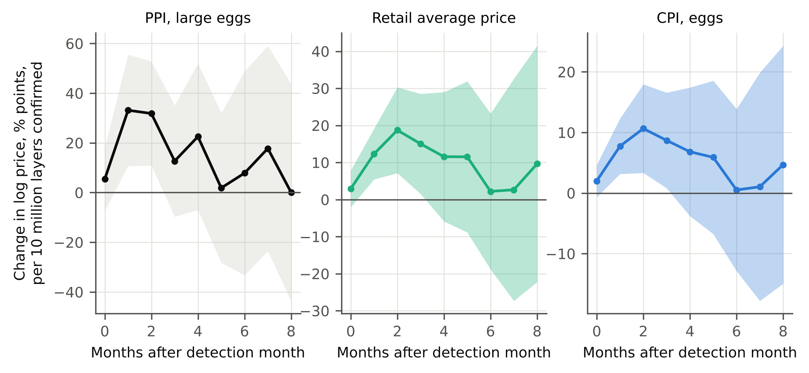

**Peter Kalafatis** (ORCID: https://orcid.org/0009-0000-1637-7142)

Independent researcher, x9m8.com, New York, NY, USA. Correspondence: x9m8x7@gmail.com

**Preprint, not peer reviewed.** Version 1, October 2026.

## Abstract

Highly pathogenic avian influenza (HPAI) has repeatedly removed laying hens from US egg supply since 2022, and retail egg prices rose sharply in 2022–23 and again in 2024–25. Whether that shock reached restaurant menus is less clear than whether it reached grocery shelves. I linked USDA APHIS confirmations of HPAI in commercial table-egg layer flocks (152.4 million birds in 136 flocks, February 2022 to September 2026) to Bureau of Labor Statistics (BLS) egg prices at producer and retail level, and then tested whether egg price changes show up in the CPI for full-service and limited-service restaurant meals, using distributed-lag models with controls for food-at-home inflation, restaurant wage growth, seasonality and the series' own history. Local projections show retail egg prices rising by about 21% (95% CI 7 to 35) two months after 10 million layers are confirmed, with producer prices responding more strongly and earlier and the effect fading within about five months. Restaurant prices showed no detectable pass-through: a 10% rise in the egg CPI was associated with a cumulative change of −0.008 percentage points (95% CI −0.12 to +0.11) in full-service menu prices and −0.003 (−0.08 to +0.08) in limited-service prices, and the estimates stayed near zero across 13 specifications. The data rule out menu-price effects above roughly 0.6% even for a 70% annual egg price increase. National CPI cannot show what happens on egg-heavy menus, under contract pricing, or at the level of an individual restaurant, and the estimates are associations, not causal effects.

**Keywords:** avian influenza; egg prices; price pass-through; restaurant prices; consumer price index; local projections

**Social media summary:** Bird flu lifted egg prices; national restaurant menu prices barely noticed.

## 1. Introduction

Since February 2022, highly pathogenic avian influenza has led to the depopulation of tens of millions of commercial laying hens in the United States. Retail egg prices moved accordingly. In the BLS series for Grade A large eggs, the national average price per dozen reached $4.82 in January 2023 and $6.23 in March 2025, the highest values in the 2005–2026 data used here, before falling to $2.27 by September 2026. The episodes drew wide attention as a driver of grocery inflation.

Two separate questions are involved. The first is upstream: how do losses of layers translate into wholesale and retail egg prices, and with what lag? Biological constraints matter here, because a flock cannot be replaced in a week. The second is downstream: when egg prices rise, do restaurants raise menu prices, and does it differ between full-service restaurants, where eggs appear on breakfast and brunch menus and in many dishes, and limited-service restaurants, where the exposure may be different? I expected eggs to be a small part of both the food at home basket and restaurant input costs, so that the effect on aggregate menu-price indexes could be small, but I did not measure those shares and did not want to assume the answer.

Prior work covers the upstream side. I am aware of studies of the effect of HPAI on US egg prices that emphasise biological lags and vertical market dynamics (Mitchell et al., 2024), of HPAI and retail price premiums in the US poultry market (Zamani et al., 2024), and of price transmission after avian influenza in the Taiwanese egg market (Chen et al., 2026) and the Turkish poultry market (Mutlu Çamoğlu et al., 2014). The general literature on how commodity and input cost changes pass through to retail food prices is older (Leibtag, 2009). I have read only the titles and bibliographic records of these papers, not their full text, so I do not characterise their methods or findings beyond their titles. I am not aware of work that places egg price shocks from HPAI next to restaurant menu-price indexes in a single, transparent time-series design using public data, which is the narrower contribution of this paper. That statement rests on a limited literature search and should be read as hedged.

This paper asks three questions of public data. (1) How are monthly layer-flock losses confirmed by APHIS related to producer and retail egg prices, with what lags and magnitudes? (2) Are egg price changes associated with changes in restaurant menu-price inflation, separately for full-service and limited-service meals, after accounting for overall food-at-home inflation and restaurant wage inflation? (3) What can national CPI data say and not say about this? I make no causal claim. The restaurant analysis is an association between published price indexes, and the layer analysis relates a count of confirmed detections to prices.

## 2. Methods

### 2.1 Data

All data are public and were retrieved on 2–3 November 2026 (UTC) from the sources below; Table 1 lists the series.

*Prices and wages.* Monthly series came from the BLS bulk time-series files at https://download.bls.gov/pub/time.series/ (directories cu, ap, wp and ce). I checked series identifiers and titles against the BLS catalogue files (cu.series, wp.series, ce.series) for the egg, restaurant-meal, New York, PPI and earnings series; the national food-at-home, food-away-from-home and all-items CPI series were identified from the bulk data files by identifier, and the average-price series title was checked against a FRED listing. The CPI series are for all urban consumers (CPI-U), not seasonally adjusted. The outcomes are CPI food away from home (CUUR0000SEFV), full service meals and snacks (CUUR0000SEFV01), limited service meals and snacks (CUUR0000SEFV02), and food away from home in the New York-Newark-Jersey City area (CUURS12ASEFV). Egg prices are the CPI for eggs (CUUR0000SEFH), the BLS average price of Grade A large eggs per dozen (APU0000708111), and the producer price index (PPI) for eggs, large (WPU01710703) and for chicken eggs (WPU0171). The PPI is a producer-level price and stands in for the wholesale price. The New York area CPI has no egg index, and BLS publishes limited-service meals only without seasonal adjustment, so I used non-seasonally-adjusted data throughout and added calendar-month dummies. Controls were the CPI for food at home (national or New York) and average hourly earnings of production and nonsupervisory employees in food services and drinking places (CES7072200008, seasonally adjusted), which ends in August 2026. BLS published no CPI or average-price data for October 2025, so that month is missing in every series and the monthly changes for October and November 2025 are treated as missing. The analysis sample runs January 2005 to September 2026.

*Layer losses.* I used the USDA APHIS dashboard "HPAI Confirmed Detections in Commercial and Backyard Flocks" (https://www.aphis.usda.gov/livestock-poultry-disease/avian/avian-influenza/hpai-detections/commercial-backyard-flocks, which embeds a Tableau view hosted at publicdashboards.dl.usda.gov). The dashboard exposes a table of 2,297 confirmed detections with date, state, county, production type and birds affected, from 8 February 2022 to 30 October 2026. There is no bulk file; I read the table through the dashboard's own embedding interface in a browser tab. The shock variable is the number of birds affected in detections whose production type is "Commercial Table Egg Layer", summed by calendar month of confirmation and expressed in millions. Months with no such detection are zero. For birds in a commercial flock, "birds affected" is the flock size at confirmation, so it measures layers depopulated, not eggs lost, and it is not scaled by the national flock. For scale, the same APHIS page states, as context above the dashboard and without its own citation beyond "data from USDA National Agricultural Statistics Service," that there are more than 378.5 million egg-laying chickens in the United States (page text read 3 November 2026; see Research transparency and reproducibility below on why this is cited rather than redistributed). Pullet and breeder flocks are excluded from the shock. The dashboard starts at the first detection of the current outbreak, so I set layer losses to zero in the months before February 2022 only to construct lags; I did not analyse the 2014–15 outbreak because it is not in this dashboard.

*USDA wholesale series.* I looked for USDA AMS or ERS public files of wholesale egg prices and layer inventories. I did not find a bulk file I could retrieve reliably, so the PPI is the only producer-level price in the analysis, and I do not use flock inventory.

*Provenance.* Because the browser tool could not save files to disk, each dataset was assembled in the browser from the source, serialised to a compact text file, transcribed into the package, and checked by SHA-256 against the hash computed in the browser. These hashes, retrieval times and series counts are in `data/SOURCES.md` in the reproducibility package. Nothing was uploaded to any server.

### 2.2 Layer losses and egg prices (local projections)

For each price series *y* (log), I estimated for horizons *h* = 0,…,8 by ordinary least squares

*y*~*t*+*h*~ − *y*~*t*−1~ = α~*h*~ + β~*h*~ *L*~*t*~ + γ~1*h*~ *L*~*t*−1~ + γ~2*h*~ *L*~*t*−2~ + δ~*h*~ (*y*~*t*−1~ − *y*~*t*−2~) + ε~*t*+*h*~,

where *L*~*t*~ is millions of commercial table-egg layers confirmed in month *t*. The coefficient β~*h*~ is the cumulative log change in price from the month before detection to *h* months afterwards per million layers. I report 100(exp(10β~*h*~) − 1), the percentage change for 10 million layers, with 95% confidence intervals from Newey–West (1987) HAC standard errors with *h* + 3 lags. Local projections avoid imposing a dynamic model on the response (Jordà, 2005; Montiel Olea & Plagborg-Møller, 2021). The sample is February 2022 to September 2026 (at most 56 months), so power is limited. Sensitivity analyses drop the lagged-price control or use four shock lags. I also report cross-correlations between monthly layer losses and subsequent price changes, and a regression of the log price level on the trailing six-month sum of layer losses.

### 2.3 Egg prices and restaurant menu prices (distributed lags)

For each restaurant outcome *y*, with monthly log changes written Δ, the baseline model for January 2005 to August 2026 is

Δ*y*~*t*~ = *a* + Σ~*k*=0..6~ *b*~*k*~ Δegg~*t*−*k*~ + Σ~*k*=0..3~ *g*~*k*~ Δfah~*t*−*k*~ + Σ~*k*=0..3~ *w*~*k*~ Δwage~*t*−*k*~ + Σ~*k*=1..3~ *r*~*k*~ Δ*y*~*t*−*k*~ + month dummies + *e*~*t*~,

with Δegg the log change in the egg CPI, Δfah the log change in the food-at-home CPI (the New York series for the New York outcome), and Δwage the log change in restaurant production-worker hourly earnings. The quantity of interest is the cumulative pass-through, the sum of *b*~0~ to *b*~6~, a long-run elasticity of the menu-price index with respect to the egg price over the lags included. Its standard error uses the HAC covariance matrix (12 lags). I also report a joint Wald test of all seven egg coefficients and, as a falsification check, the sum of three egg *lead* coefficients (future egg price changes should not predict current menu-price changes). Sensitivity analyses vary the number of lags (3 and 12), drop the food-at-home or wage control, use average hourly earnings of all private employees as the wage control, exclude March 2020 to December 2021, start in 2015 or 2019, use the average egg price or the producer price in place of the egg CPI, and drop the month dummies or the own lags. A parsimonious version (three egg lags, one lag of each control, two own lags, no month dummies) is estimated on the HPAI period alone (February 2022 onward).

As a reduced-form check that does not rely on the egg price at all, I estimated local projections of restaurant price changes on monthly layer losses for *h* = 0,…,12 in the HPAI period, controlling for two lags of the shock, two lags of the dependent variable and one lag of wage growth.

To translate the confidence intervals into plain terms, I combined the cumulative pass-through interval with the log change in the egg CPI over the 12 months to each peak (January 2023 and March 2025).

### 2.4 Interpretation limits

Egg prices are not exogenous to restaurant demand, the CPI egg index is a retail price paid by households and not the price restaurants pay, and monthly egg CPI changes include sampling noise that biases pass-through estimates toward zero. I therefore describe results as associations. The estimates are reported with confidence intervals so that the reader can see what size of effect the data exclude, rather than only whether zero is rejected.

### 2.5 Software, data and AI use

Analyses used Python 3.13 with pandas 3.0.5, NumPy 2.5.3, SciPy 1.18.1 and statsmodels 0.15.0; figures used matplotlib 3.11.2. The study was carried out with the assistance of Claude (Anthropic; model claude-sonnet-5) in October–November 2026, which retrieved data, wrote and ran the analysis code, verified references and drafted the text under the author's direction. The author reviewed the work and takes full responsibility for it.

## 3. Results

### 3.1 Layer losses and egg prices

APHIS confirmed HPAI in 136 commercial table-egg layer flocks, 152.4 million birds, between February 2022 and September 2026, with detections in 30 of the 56 months (Table 2, Figure 1). Losses came in waves: 27.6 million in March and April 2022, 13.6 million from November 2023 to January 2024, and 43.7 million from December 2024 to February 2025, with the single largest month January 2025 (18.8 million). The retail average price reached $4.82 per dozen in January 2023 and $6.23 in March 2025 and was $2.27 in September 2026. The BLS egg CPI and the average price moved together, and the producer price index was more volatile (Figure 1B).

Monthly layer losses and subsequent price changes were positively related at short lags. The correlation between layers confirmed in month *t* and the log change in the retail average price in month *t* + 1 was 0.46, the largest of the lags examined from −3 to +6 (0.34 in month *t*, 0.20 in *t* + 2), and it turned negative at longer lags (−0.31 at five months). Regressing the log price level on the trailing six-month sum of layers confirmed gave slopes corresponding to 16.2% higher retail average prices (R² = 0.49) and 9.9% higher egg CPI (R² = 0.53) per 10 million layers, and 27.4% for the producer price (R² = 0.30).

The local projections show the timing (Table 3, Figure 2). After 10 million layers were confirmed in a month, the producer price for large eggs was 39.3% higher one month later (95% CI 11.3 to 74.2) and 37.5% higher after two months (11.4 to 69.6), with the effect no longer distinguishable from zero from the third month (13.5%, −9.3 to 42.0). The retail average price rose more slowly and by less: 13.1% at one month (5.6 to 21.1), 20.6% at two months (7.4 to 35.4), 16.2% at three months (1.5 to 33.0), and the interval included zero from four months (12.3%, −5.7 to 33.6). The egg CPI followed the same shape with smaller magnitudes: 8.1% at one month, 11.2% at two months (3.4 to 19.7), 9.1% at three months. By six months all three responses were close to zero (producer 8.1%, retail 2.2%, CPI 0.5%) with wide intervals. The pattern, producer prices first and largest, retail one month behind and about half the size, is what one would expect if wholesale shocks are partly absorbed in the retail margin and not fully passed on. I cannot separate absorption from differences between the indexes' definitions and coverage. Dropping the lagged-price control raised the retail estimates slightly (15.0% at one month, 22.3% at two) and using four shock lags lowered them (11.7%, 18.0%), so the qualitative result is robust to those choices.

### 3.2 Pass-through to restaurant menu prices

Over 2005–2026 the monthly log change in the egg CPI had a standard deviation of 4.8%, compared with 0.19% for full-service meals and 0.20% for limited-service meals. Eggs are volatile and restaurant menu-price indexes are smooth. The 12-month egg CPI change peaked at +70.1% in January 2023 and +60.4% in March 2025. In January 2023, 12-month inflation was 8.1% for full-service meals and 6.7% for limited-service meals, and was falling for limited-service meals (8.0% a year earlier); in March 2025 it was 4.1% and 3.4% (Figure 3A). Restaurant wages (production workers) rose 7.5% in the 12 months to January 2023 and 4.2% to March 2025. Between December 2021 and September 2026 the egg CPI rose 19.6%, food at home 20.3%, food away from home 25.7%, and restaurant hourly earnings 25.9% (to August 2026).

In the distributed-lag models, the cumulative pass-through was close to zero for every outcome (Table 4, Figure 3B). A 10% rise in the egg CPI was associated with a cumulative change of −0.008 percentage points (95% CI −0.122 to +0.105) in full-service menu prices and −0.003 (−0.082 to +0.077) in limited-service menu prices; for all food away from home the estimate was +0.009 (−0.067 to +0.086), and for the New York-area food-away-from-home index +0.049 (−0.159 to +0.256). The joint test that all seven egg lags are zero did not reject for any outcome (*p* = 0.13 to 0.46), and future egg price changes did not predict current menu-price changes (lead *p* = 0.24 to 0.68). Restricting the model to the HPAI period gave estimates of +0.042 (−0.031 to +0.115) for full-service and +0.019 (−0.036 to +0.074) for limited-service meals.

The estimates were stable across the 13 specifications (Table 5, Figure 3C). Point estimates for the two restaurant types ranged from −0.042 to +0.094 percentage points per 10% rise in the egg price; the widest intervals were with 12 egg lags, with no own-lag control and in the post-2019 sample, and the narrowest with the producer price as the egg measure (full-service +0.011, −0.022 to +0.044). The largest point estimates (+0.080 full-service, +0.094 limited-service) came from dropping the food-at-home control, whose inclusion absorbs common movements in food prices; even there the lower limits were −0.007 and −0.001. No specification produced an interval excluding zero.

Using these intervals, the egg price rise over the 12 months to January 2023 (log change 0.531) corresponds to a change in full-service menu prices of −0.04% (95% CI −0.65 to +0.56) and in limited-service menu prices of −0.01% (−0.44 to +0.41). For the 12 months to March 2025 (log change 0.473) the corresponding figures are −0.04% (−0.58 to +0.50) and −0.01% (−0.39 to +0.36).

The reduced-form local projections of menu prices on layer losses did not give a consistent picture (Table 4, last column). Twelve months after 10 million layers were confirmed, full-service prices were 0.68 percentage points higher (*p* = 0.04), limited-service prices 0.67 lower (*p* = 0.06) and all food away from home 0.26 higher (*p* = 0.40); the food-at-home index was 0.97 higher (*p* = 0.04). Opposite signs for the two restaurant types, and magnitudes much larger than the egg channel could deliver given the distributed-lag results, suggest these reflect other movements in prices during a short, volatile sample, not egg pass-through. With 45 to 56 observations and 13 horizons I treat these as unreliable.

## 4. Discussion

### 4.1 Findings

Confirmed layer losses were followed by higher egg prices, first at the producer level and then, by about a month and at around half the proportional size, at retail. The retail effect had largely dissipated within four to five months. The restaurant results are different in kind: across outcomes, specifications and samples the data show no detectable cumulative association between egg price changes and menu-price inflation, and the confidence intervals are tight enough to exclude large effects. A 10% rise in the egg CPI is associated with at most about 0.1 percentage points on full-service menu prices and about 0.08 on limited-service prices, at the 95% level. Even for the two largest annual increases in the egg CPI in the sample (about 60–70%), the upper bound is a change of about 0.5% in full-service and 0.4% in limited-service menu-price indexes.

### 4.2 Interpretation

These are statements about what national price indexes show. Several readings are consistent with them, and my data cannot distinguish between them. Restaurants may absorb egg cost changes because eggs are a small share of total input costs, which are dominated by labour, rent and other food; I did not measure that share and the data here cannot confirm it. They may buy eggs under contracts with formula or lagged pricing, so the retail egg index overstates what they paid; I did not observe contract terms. They may change menu composition, portion sizes or add surcharges that the CPI treats differently from a list-price increase. They may raise prices at a few egg-intensive establishments, a change that would be diluted in a national index. The method is also biased toward finding no effect to the extent that the retail egg index measures restaurant egg costs with error. The two limited- and full-service indexes are unlikely to be equally sensitive, but the data show no clear difference between them.

The most defensible conclusion is limited: national restaurant CPI did not move in a way that the egg price movements of 2022–2026 would predict, at the size of effect these data can detect. It does not imply that no restaurant, and no egg-intensive menu, raised prices in response to eggs, and it does not speak to the experience of an individual operator.

### 4.3 Limitations

First, the HPAI series is short. The layer analysis uses at most 56 monthly observations from three main waves, with HAC standard errors that can be too small in samples this size, and the confidence intervals are probably somewhat optimistic. I did not correct for the number of horizons and specifications examined. The layer shock is flock size at confirmation, not eggs lost, and does not account for repopulation, imports, stocks, cage-free mix, or demand changes, and confirmed layers cluster in particular seasons (Figure 1A), so the shock is not independent of time of year. The 2014–15 outbreak, which also moved egg prices, is outside the APHIS dashboard I used and is not analysed.

Second, I could not obtain USDA AMS or ERS wholesale prices or layer inventories as bulk public files. The PPI is a producer price index from the BLS and is not the same as the USDA wholesale quotations that market participants watch, so the lag and magnitude estimates are for the PPI and retail series only.

Third, the restaurant analysis uses national and one regional CPI index. CPI food away from home reflects the prices of a sample of menu items, not all dishes, and the full-service and limited-service indexes cover broad categories. The New York estimates are noisy (the interval spans about ±0.2 percentage points per 10%), and there is no egg index for New York. October 2025 is missing, which removes a few observations around the second price wave's decline. Wage data end one month before the CPI.

Fourth, the association is not causal. Egg prices and restaurant prices both respond to general inflation and demand, and the pandemic-era surge in restaurant prices overlaps the first egg price wave. The controls (food-at-home and wage inflation, own lags, month dummies) and the sensitivity analyses reduce but do not remove this concern. Measurement error in monthly egg CPI changes biases toward zero, so the near-zero estimates are partly a statement about what can be recovered from noisy indexes.

Fifth, the reduced-form projections for restaurants gave opposite-signed, imprecise results, which I report but do not interpret as pass-through.

### 4.4 What is new

I am not aware of a published analysis that estimates, with public data, both the lag structure from HPAI layer losses to egg prices and the association of egg prices with full-service and limited-service restaurant price indexes. The upstream results are broadly in the spirit of existing work on lags between flock losses and prices (Mitchell et al., 2024), although I have not compared magnitudes with their estimates. The downstream result, a precisely estimated absence of national menu-price pass-through, is the part I believe to be new; it needs to be confirmed with establishment-level data.

### 4.5 Disclosure of interest

The author operates a restaurant that buys eggs. I did not use any of the restaurant's data. The study was not preregistered, and all specifications that were run are reported. A finding of no national pass-through is not informative about the restaurant's own costs or prices.

## 5. Conclusion

In US monthly data, HPAI layer losses were followed by higher producer and retail egg prices that peaked within one to two months and faded within about five. Over the same period, and over 2005–2026, egg price changes showed no detectable association with national full-service or limited-service menu-price inflation, with confidence intervals that exclude effects larger than about 0.1 percentage points per 10% rise in the egg price. National CPI cannot show whether particular egg-intensive restaurants raised prices, which is the question that matters most to an operator. Establishment-level menu data would be needed for that.

## Acknowledgements

The author thanks the Bureau of Labor Statistics and the USDA Animal and Plant Health Inspection Service for making the data public. Claude (Anthropic; model claude-sonnet-5) assisted with data retrieval, analysis code, reference checking and drafting in October–November 2026, as described in §2.5. The author reviewed all outputs and is responsible for the content.

## Author contributions

P.K. conceived the study, directed the analysis, and reviewed and approved the manuscript.

## Financial support

This research received no specific grant from any funding agency, commercial or not-for-profit sector.

## Conflicts of interest

The author operates a restaurant, The Heritage Diner in Mount Sinai, New York, which buys eggs, and therefore has a personal interest in egg and menu-price questions. The author also owns Marcellino NY, a leather goods business, which is unrelated to this topic. No other competing interests are declared.

## Research transparency and reproducibility

All data are public: BLS time-series files and the USDA APHIS HPAI detections dashboard (https://www.aphis.usda.gov/livestock-poultry-disease/avian/avian-influenza/hpai-detections/commercial-backyard-flocks, read 3 November 2026). The code and the compact BLS extracts used (with source URLs, retrieval times and SHA-256 hashes) are in the reproducibility package linked from the article page. The HPAI layer-loss figures used in the analysis are drawn from that public APHIS dashboard and are reported here only as a derived monthly aggregate (millions of commercial table-egg layer birds and flock count confirmed per month); the underlying detection-level extract is not redistributed in this package, because the APHIS dashboard states its data are for restricted government purposes. A reader can obtain the same public figures directly from the cited dashboard URL and reproduce the monthly aggregate as described in the package's `data/SOURCES.md`. The study was not preregistered. Raw BLS bulk files are likewise not redistributed; the small BLS extracts used are included with the code.

## References

Chen, N., Pendell, D. L., & Chang, C.-L. (2026). Price transmission and long-term effects of avian influenza on Taiwan's egg market. *Preventive Veterinary Medicine, 247*, 106753. https://doi.org/10.1016/j.prevetmed.2025.106753

Jordà, Ò. (2005). Estimation and inference of impulse responses by local projections. *American Economic Review, 95*(1), 161–182. https://doi.org/10.1257/0002828053828518

Leibtag, E. (2009). How much and how quick? Pass through of commodity and input cost changes to retail food prices. *American Journal of Agricultural Economics, 91*(5), 1462–1467. https://doi.org/10.1111/j.1467-8276.2009.01365.x

Mitchell, J. L., Thompson, J. M., & Malone, T. (2024). Biological lags and market dynamics in vertically coordinated food supply chains: HPAI impacts on U.S. egg prices. *Food Policy, 126*, 102655. https://doi.org/10.1016/j.foodpol.2024.102655

Montiel Olea, J. L., & Plagborg-Møller, M. (2021). Local projection inference is simpler and more robust than you think. *Econometrica, 89*(4), 1789–1823. https://doi.org/10.3982/ECTA18756

Mutlu Çamoğlu, S., Serra, T., & Gil, J. M. (2014). Vertical price transmission in the Turkish poultry market: The avian influenza crisis. *Applied Economics, 47*(11), 1106–1117. https://doi.org/10.1080/00036846.2014.990623

Newey, W. K., & West, K. D. (1987). A simple, positive semi-definite, heteroskedasticity and autocorrelation consistent covariance matrix. *Econometrica, 55*(3), 703–708. https://doi.org/10.2307/1913610

U.S. Bureau of Labor Statistics. (2026). *Consumer Price Index, Average Price Data, Producer Price Index and Current Employment Statistics time-series files* [Data set]. https://download.bls.gov/pub/time.series/

U.S. Department of Agriculture, Animal and Plant Health Inspection Service. (2026). *Confirmations of highly pathogenic avian influenza in commercial and backyard flocks* [Data dashboard]. https://www.aphis.usda.gov/livestock-poultry-disease/avian/avian-influenza/hpai-detections/commercial-backyard-flocks

Zamani, O., Bittmann, T., & Ortega, D. L. (2024). The effect of avian influenza outbreaks on retail price premiums in the United States poultry market. *Poultry Science, 103*(10), 104102. https://doi.org/10.1016/j.psj.2024.104102

## Tables

**Table 1.** Data series used. All are public. Monthly, January 2005 to September 2026 unless noted; October 2025 is missing from every BLS CPI and average-price series.

| Series | BLS or APHIS identifier | Use |
|:--|:--|:--|
| CPI-U, eggs, US city average, not seasonally adjusted | CUUR0000SEFH | Retail egg price index |
| Average price, eggs, Grade A, large, per dozen, US city average | APU0000708111 | Retail egg price (dollars) |
| PPI, farm products: eggs, large; and chicken eggs | WPU01710703; WPU0171 | Producer-level (wholesale) egg price index |
| CPI-U, food at home | CUUR0000SAF11 | Control |
| CPI-U, food away from home | CUUR0000SEFV | Outcome |
| CPI-U, full service meals and snacks | CUUR0000SEFV01 | Outcome (from December 1997) |
| CPI-U, limited service meals and snacks | CUUR0000SEFV02 | Outcome (from December 1997) |
| CPI-U, food away from home and food at home, New York-Newark-Jersey City | CUURS12ASEFV; CUURS12ASAF11 | Regional outcome and control |
| Average hourly earnings, production and nonsupervisory employees, food services and drinking places, seasonally adjusted | CES7072200008 | Wage control (through August 2026) |
| Average hourly earnings, all employees, total private (sensitivity) | CES0500000003 | Alternative wage control (from March 2006) |
| Confirmed HPAI detections in commercial and backyard flocks, USDA APHIS dashboard | HPAI 2022 Confirmed Detections (2,297 records, 8 February 2022 to 30 October 2026) | Birds affected in commercial table-egg layer flocks |

**Table 2.** Commercial table-egg layers confirmed with HPAI (APHIS), February 2022 to September 2026, and the retail egg price around each wave.

| Period | Layers confirmed (millions) | Retail average price, Grade A large, per dozen |
|:--|--:|:--|
| 2022 (from 8 February) | 43.3 | $1.93 in January 2022; peak $4.82 in 2023-01 |
| 2023 | 12.9 | |
| 2024 | 38.4 | |
| 2025 | 41.8 | peak $6.23 in 2025-03; $3.49 in September 2025 |
| 2026, January to September | 16.1 | $2.27 in September 2026 |
| *March to April 2022* | 27.6 | |
| *November 2023 to January 2024* | 13.6 | |
| *December 2024 to February 2025* | 43.7 | |
| **Total, February 2022 to September 2026** | **152.4** (136 flocks; detections in 30 of 56 months; largest month 2025-01, 18.8) | |

**Table 3.** Local projections: percent change in egg prices after 10 million commercial table-egg layers are confirmed with HPAI in a month (change from the month before detection to *h* months after, 95% confidence interval from HAC standard errors). February 2022 to September 2026; *n* = 45 to 56.

| Months after | PPI, large eggs | Retail average price | CPI, eggs |
|:--|--:|--:|--:|
| 0 | 5.6 (-7.0 to 19.8) | 3.0 (-2.0 to 8.2) | 2.0 (-0.7 to 4.8) |
| 1 | 39.3 (11.3 to 74.2) | 13.1 (5.6 to 21.1) | 8.1 (3.2 to 13.1) |
| 2 | 37.5 (11.4 to 69.6) | 20.6 (7.4 to 35.4) | 11.2 (3.4 to 19.7) |
| 3 | 13.5 (-9.3 to 42.0) | 16.2 (1.5 to 33.0) | 9.1 (0.8 to 18.0) |
| 4 | 25.3 (-6.7 to 68.2) | 12.3 (-5.7 to 33.6) | 7.1 (-3.7 to 19.0) |
| 5 | 1.9 (-24.6 to 37.7) | 12.2 (-8.5 to 37.6) | 6.1 (-6.5 to 20.4) |
| 6 | 8.1 (-28.2 to 63.0) | 2.2 (-17.1 to 26.1) | 0.5 (-12.1 to 14.9) |

**Table 4.** Pass-through of egg price changes to restaurant menu prices. Column 2: distributed-lag model (egg CPI lags 0 to 6, with food-at-home, wage, own-lag and month controls), January 2005 to August 2026, *n* = 245; cumulative response in percentage points of the menu-price level per 10% rise in the egg CPI (95% CI). Column 3: p-value of a joint test that all seven egg-lag coefficients are zero. Column 4: p-value of a test that the sum of three *lead* egg coefficients is zero (falsification). Column 5: the same model, simplified, on the HPAI period only (February 2022 on, *n* = 50). Column 6: reduced-form local projection, change in menu price 12 months after 10 million layers are confirmed (percentage points).

| Outcome | Cumulative response, % points per 10% egg rise (95% CI) | Joint test, egg lags (*p*) | Egg leads (*p*) | HPAI period only | Menu price 12 months after 10M layers |
|:--|--:|--:|--:|--:|--:|
| Food away from home (US) | +0.009 (-0.067 to +0.086) | 0.13 | 0.49 | +0.013 (-0.043 to +0.069) | +0.26 (p = 0.40) |
| Full-service meals (US) | -0.008 (-0.122 to +0.105) | 0.46 | 0.68 | +0.042 (-0.031 to +0.115) | +0.68 (p = 0.04) |
| Limited-service meals (US) | -0.003 (-0.082 to +0.077) | 0.27 | 0.24 | +0.019 (-0.036 to +0.074) | -0.67 (p = 0.06) |
| Food away from home (NY-Newark-JC) | +0.049 (-0.159 to +0.256) | 0.30 | 0.29 | +0.070 (-0.070 to +0.211) | -0.25 (p = 0.54) |
| *Comparison: food at home (US)* | | | | | +0.97 (p = 0.04) |

**Table 5.** Sensitivity of the cumulative pass-through (percentage points per 10% rise in the egg price; 95% CI), US full-service and limited-service meals.

| Specification | *n* | Full-service meals | Limited-service meals |
|:--|--:|--:|--:|
| baseline (K=6) | 245 | -0.008 (-0.122 to +0.105) | -0.003 (-0.082 to +0.077) |
| K=3 | 251 | +0.039 (-0.026 to +0.104) | +0.015 (-0.046 to +0.076) |
| K=12 | 236 | +0.026 (-0.114 to +0.167) | +0.067 (-0.053 to +0.188) |
| no FAH control | 245 | +0.080 (-0.007 to +0.167) | +0.094 (-0.001 to +0.190) |
| no wage control | 246 | -0.003 (-0.116 to +0.111) | -0.003 (-0.084 to +0.078) |
| wage = all private AHE (from 2006-03) | 235 | +0.023 (-0.078 to +0.124) | -0.007 (-0.082 to +0.068) |
| excl. 2020-03 to 2021-12 | 223 | +0.028 (-0.076 to +0.133) | -0.002 (-0.082 to +0.078) |
| from 2015-01 | 132 | -0.010 (-0.126 to +0.107) | +0.012 (-0.091 to +0.116) |
| from 2019-01 | 84 | +0.039 (-0.101 to +0.179) | +0.045 (-0.078 to +0.168) |
| egg = avg price, Grade A large | 245 | +0.000 (-0.064 to +0.064) | +0.016 (-0.038 to +0.071) |
| egg = PPI large eggs | 248 | +0.011 (-0.022 to +0.044) | +0.008 (-0.015 to +0.031) |
| no month dummies | 245 | +0.004 (-0.093 to +0.100) | -0.015 (-0.077 to +0.047) |
| no own lags | 245 | +0.003 (-0.133 to +0.138) | -0.042 (-0.172 to +0.089) |

## Figures

