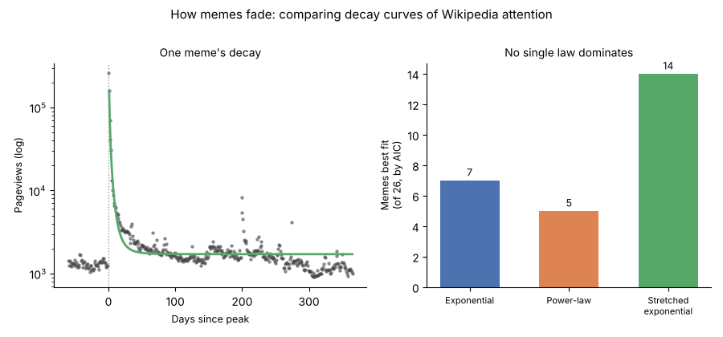
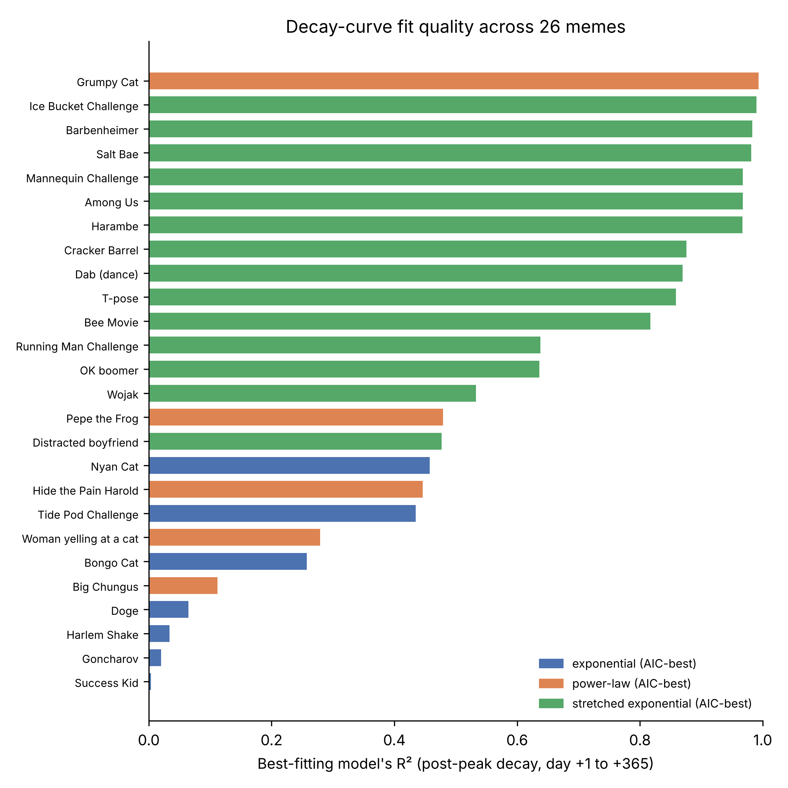

**Preprint. Not peer reviewed.** This is the author's manuscript, prepared for submission to a
peer-reviewed journal.

**Peter Kalafatis**

Independent researcher, New York, NY, USA. ORCID: 0009-0000-1637-7142. Correspondence:
x9m8x7@gmail.com

Version 1, November 2026.

## Abstract

Internet memes are often described as replicators whose popularity rises and falls in a
characteristic, almost law-like way, but the shape of that fall is rarely measured against real
attention data for many memes at once. Using English Wikipedia's public pageview API as a
free, bulk-downloadable proxy for public attention, I assembled a sample of 26 real,
independently verified internet-meme and viral-phenomenon articles, identified each one's peak
day of attention inside the API's July-2015-onward window, and fitted three candidate post-peak
decay models — exponential, power-law, and stretched exponential — to each meme's daily
trajectory for the following year. A stretched exponential had the lowest AIC for 14 of 26 memes,
an exponential for 7, and a power-law for 5; median R² was similar across models (0.54–0.58)
but varied enormously between memes, from near 0 (`Success Kid`, `Goncharov (meme)`,
`Harlem Shake`) to above 0.95 (`Grumpy Cat`, `Ice Bucket Challenge`, `Barbenheimer`). I find no
single decay law that fits meme attention uniformly; the stretched exponential's modest edge is
consistent with a population of decay rates rather than one shared rate. This is an honest,
data-driven companion to this series' earlier controlled-transmission-chain studies of meme
fidelity, applied here to uncontrolled, real-world attention instead.

**Keywords:** internet memes; viral phenomena; collective attention; Wikipedia pageviews; decay
curves; memetics; power-law; stretched exponential

**Social media summary:** I fit decay curves to 26 real memes' Wikipedia traffic. No single
mathematical law describes how viral attention fades — not even close, for some memes.

## 1. Introduction

A meme is supposed to behave like a replicator: a unit that copies itself from person to person,
competing with other units for a fixed pool of attention (Dawkins, 1976). Two earlier papers in
this series tested the "faithful copying" half of that claim directly, in controlled
transmission-chain experiments: one measured how much of a text ordinary people lose and restore
each time they retell it, and found human memory too leaky to hold long texts in place word for
word without strong selection (Kalafatis, 2026a); the other applied the same per-step measures to
chains of large language models passing text to one another (Kalafatis, 2026b). Both treated
fidelity as a step-by-step, experimentally observable quantity.

This paper asks a different, complementary question about the same claim: when a meme's
popularity does rise and fall in the real world — not in a laboratory transmission chain, but in
the wild, as measured by how often people actually look something up — does its decline follow a
predictable, shared mathematical shape? "Limited attention" models of meme competition assume
that it does, usually an exponential or power-law fall from a peak (Weng, Flammini, Vespignani, &
Menczer, 2012), and earlier work on other kinds of online content found reasonably consistent
decay shapes: a stretched exponential for the rate at which new diggs (votes) arrive on Digg
stories, reflecting both a fixed novelty decay and heterogeneity in how quickly different stories
are discovered (Wu & Huberman, 2007); power-law-like response functions, convolved with the
arrival of new viewers over time, for YouTube view counts (Crane & Sornette, 2008); and, for
Wikipedia and Chilean-Web traffic, heavy-tailed distributions of burst size and of the time
between bursts, reproduced by a model combining ordinary preferential growth with occasional
random shocks to an item's popularity rank (Ratkiewicz, Fortunato, Flammini, Menczer, &
Vespignani, 2010) — a different mechanism from the single smooth post-peak decay this paper
fits, but evidence from the same family of attention data that bursts and their aftermaths follow
some shared statistical structure. As far as I am aware, none of this
literature fits and directly compares candidate decay functions on a cross-sectional sample of
*named internet memes'* own trajectories, using each meme's Wikipedia article as the attention
proxy; this paper is a modest attempt at exactly that, not a claim that decay-curve modelling of
online attention is itself new.

Wikipedia pageviews are a convenient, if imperfect, attention proxy for this purpose. The
Wikimedia Foundation publishes a free, no-authentication REST API giving daily per-article
pageview counts back to July 2015 (Wikimedia Foundation, n.d.), so a meme's Wikipedia traffic is
bulk-downloadable, independently auditable by anyone, and already filtered through an editorial
process that excludes most non-notable fads (an article has to clear Wikipedia's notability bar
to exist at all, which is itself a kind of attention floor). The obvious cost is that pageviews
measure interest in an *encyclopedia article about* a meme, not exposure to the meme itself, and
that the API's July-2015 start means any meme whose defining viral peak came earlier — the
Harlem Shake dance craze (February 2013) or the Ice Bucket Challenge (summer 2014), both included
in the sample below for their later, secondary attention spikes rather than their original ones —
cannot have its true launch observed at all. I treat this as a real, stated scope limitation
throughout rather than a reason to avoid the data source.

I ask three questions. First, across a real, verified sample of internet memes, does post-peak
attention on Wikipedia decay in a way any of three standard candidate functions (exponential,
power-law, stretched exponential) can describe well? Second, does one of the three functional
forms dominate consistently, as a single shared "law" of meme decay would predict, or does fit
quality vary meme by meme? Third, for the memes whose decay a model does describe well, what does
the fitted rate (half-life, or its analogue) look like, and how does it compare with other
timescales this series has measured for cultural transmission?

## 2. Methods

### 2.1 Data source and reachability

All pageview data come from the Wikimedia REST pageviews API's `per-article` endpoint for
English Wikipedia, `all-access`, `all-agents`, daily granularity (Wikimedia Foundation, n.d.). The
API requires no authentication and is documented as covering July 2015 onward; I confirmed this
directly by querying it rather than assuming it, and confirmed separately, by direct query, that
monthly and daily granularity both work over the full range tested (July 2015 to November 2026,
the date this analysis was run).

### 2.2 Sample construction

Wikipedia's own **List of Internet phenomena** article (`en.wikipedia.org/wiki/List_of_Internet_phenomena`)
was used as the starting point for candidate memes, rather than compiling a list from memory. The
live article was parsed programmatically (list items under the main content region, excluding
navigation boxes, sidebars and infoboxes), yielding 309 candidate (title, description) pairs drawn
directly from the article's current text. Each candidate's existence as a real Wikipedia article
was then verified mechanically against the pageviews API itself: a successful (HTTP 200) response
with pageview items confirms the article exists, and a small number of plausible-sounding titles I
tried that are not real current articles returned HTTP 404 and were dropped without substitution
(`Caveman SpongeBob`, `Bernie Sanders mitten meme`, `Sans Pants Subway Ride`), so that sample
construction did not rely on assuming any title was real.

From the verified candidates, I kept memes with (a) a real, prominent attention spike at some
point in the window and (b) enough surrounding daily data inside the window (July 2015–November
2026) to fit a decay curve. Twenty-six memes met these criteria: `Harlem Shake (meme)`,
`Pepe the Frog`, `Harambe`, `Bee Movie`, `Dab (dance)`, `Grumpy Cat`, `Big Chungus`, `T-pose`,
`Among Us`, `Wojak`, `Nyan Cat`, `Salt Bae`, `Goncharov (meme)`, `Barbenheimer`, `Doge (meme)`,
`OK boomer`, `Mannequin Challenge`, `Woman yelling at a cat`, `Hide the Pain Harold`,
`Cracker Barrel`, `Success Kid`, `Bongo Cat`, `Distracted boyfriend`, `Ice Bucket Challenge`,
`Tide Pod Challenge`, and `Running Man Challenge`.

Several candidates were excluded on stated grounds rather than silently dropped. `Kony 2012` and
`The Dress` had their defining viral peaks before July 2015 and only thin, disconnected secondary
spikes inside the window. `Sharknado`, `Caramelldansen`, and `Loituma` had their window-maximum pageview day fall within
the first few weeks of the dataset's July 2015 start (for `Sharknado`, 23 July 2015), too close
to the start of the available history for a real pre-peak baseline to be captured, since each of
these three's defining viral moment (2013 for `Sharknado`, 2006 for the other two) predates the
window entirely; the "peak" visible here is already a late echo with no observable rise. `Morbius (film)`, `Dear Evan Hansen (film)`,
`West Side Story (2021 film)`, and `Saltburn (film)` were excluded because their Wikipedia
articles are about the films themselves, not about the specific meme phenomenon those films
generated (`Barbenheimer`, `Goncharov (meme)`, and `Doge (meme)` have their own dedicated
meme-specific articles and were kept for that reason); using a film's own article would conflate
ordinary release-driven interest with meme virality. `Dicks out for Harambe` was dropped as a
near-duplicate of the `Harambe` article already in the sample, and `Area 51 raid` for too thin a
signal (peak month total of 10,131 views across the full window).

I do not claim this is an exhaustive or representative sample of internet memes; it is a
real, mechanically verified, and honestly documented one, large enough (26 cases) to compare
decay shapes across memes rather than to describe just one.

### 2.3 Identifying each meme's peak and decay window

For each meme, I located the single calendar day with the most English Wikipedia pageviews
within a generous window around its approximate month of peak attention (estimated first from
monthly-granularity data, then refined with a daily-granularity query spanning roughly two months
before to fourteen months after that peak month). Two memes' first-pass windows clipped the true
peak at an edge and were re-fetched with a wider window centred on the actual peak day
(`Big Chungus`, `Tide Pod Challenge`). Day 0 is defined as this peak day for each meme; the
analysis window kept for each meme runs from day −60 to day +365 relative to day 0, truncated by
the dataset's actual start (July 2015) or end (the day this analysis was run) where necessary. A
pre-peak baseline was estimated per meme as the mean daily pageviews over days −55 to −10
(omitted where no such days exist in the window, which happened for one meme, `Tide Pod
Challenge`, whose Wikipedia article was created essentially at the moment the challenge went
viral in January 2018, leaving no pre-peak history to measure).

I report plainly, rather than hide, that for several memes the window-maximum day does not
correspond to the meme's originally famous viral debut but to a later resurgence: `Harlem Shake
(meme)`'s identified peak is June 2017, well after its February 2013 original; `Distracted
boyfriend` peaks in October 2025, `Ice Bucket Challenge` in April 2025, `Hide the Pain Harold` in
August 2025, `Woman yelling at a cat` in December 2025, `Cracker Barrel` in August 2025, and
`Bongo Cat` in June 2025 — plausibly tied to 2025–2026 image-recirculation and AI-art cycles,
though I did not independently verify a cause for each resurgence. This is a genuine
interpretive complication (discussed further in §4.3 and §4.5), not an error: the question this
paper asks is whether *a* peak in observed attention decays in a law-like way, and a secondary
peak is still a peak.

### 2.4 Candidate decay models and fitting

For each meme's post-peak data (day +1 through the end of its available window, typically 365
days), I fitted three candidate functions of days-since-peak *t* by nonlinear least squares:

- **Exponential**: v(t) = A·e^(−kt) + c
- **Power-law**: v(t) = A·(t + 1)^(−α) + c
- **Stretched exponential** (a Weibull-type survival shape): v(t) = A·e^(−(t/τ)^β) + c

where *c* is a floor representing ongoing baseline interest, independent of the specific decay
process. Fitting used a multi-start Nelder–Mead simplex minimising sum of squared error, with
three to five starting points per model per meme to reduce the risk of reporting a local-minimum
fit (a single-start run on noisy, near-flat post-peak data produced several visibly degenerate
"instant collapse" fits before this safeguard was added). Fit quality is reported as R² on the
original (not log-transformed) scale, and models are compared by Akaike's Information Criterion
(AIC), which penalises the stretched exponential's extra parameter relative to the other two
three-parameter models.

### 2.5 Reproducibility and provenance of the computing environment

The sandbox this analysis was built in blocks direct outbound HTTPS connections to
`wikimedia.org`/`en.wikipedia.org` at the network level, and the available web-fetch tool could
not obtain timely permission to reach them either. Same-origin `fetch()` calls issued from a real,
logged-in browser already on an `en.wikipedia.org` page do work, because the pageviews API
requires no authentication and permits cross-origin requests; the entire data-collection and
curve-fitting pipeline described above (§§2.2–2.4) was therefore run as JavaScript inside such a
browser tab, with the full source of that pipeline preserved in
`pkg/code/fetch_pipeline.js` for independent reproduction. Getting large volumes of data back out
of that browser session and onto the disk used to write this paper was itself constrained (no
more than roughly 900 characters of text could be reliably returned per round trip), so results
were transferred back as compact, SHA-256-hashed JSON in verified chunks rather than as full raw
per-day series for all 26 memes. One meme's full daily series (`Grumpy Cat`, chosen because its
decay is visually clean and its cause — the cat's death on 14 May 2019 — is unambiguous) was
transferred in full as a concrete raw-data sample and is included at
`pkg/data/raw/grumpy_cat_daily_pageviews.json`; its curve fit was then **independently
re-derived in this sandbox using Python's `scipy.optimize.curve_fit`** (`pkg/code/refit_check.py`),
a different optimizer and runtime from the browser-side Nelder–Mead implementation, as a check on
the fitting method itself rather than trusting the browser-side numbers blindly. The two methods
agreed closely (exponential R² 0.9839 vs. 0.9839; power-law 0.9932 vs. 0.9932; stretched
exponential 0.9927 vs. 0.9927; §3.4), which supports treating the browser-fitted parameters for
the other 25 memes as reliable, even though their raw per-day series are not themselves stored in
this package. Per this series' stated practice of not redistributing raw third-party data, those
25 memes' full daily series are not included here but are fully reproducible on demand by
re-running `pkg/code/fetch_pipeline.js` against the free, public Wikimedia API, using the exact
fetch windows recorded in that file.

### 2.6 Software, data, and AI use

Data collection and curve fitting used JavaScript (ES2020, run in Google Chrome) for the reasons
given in §2.5; downstream analysis, the independent cross-check, and all figures used Python 3.13
with NumPy, SciPy, and Matplotlib. The study was carried out with the assistance of Claude
(Anthropic; model claude-opus-5-5) in November 2026, which built the sample from the live
Wikipedia list article, verified article existence against the live API, ran the in-browser
data-collection and fitting pipeline, wrote and ran the Python analysis and figure code, searched
the literature and verified citations against Crossref, and drafted this text under the author's
direction. The author reviewed the work and takes full responsibility for it.

## 3. Results

### 3.1 Fit quality varies enormously between memes

Across the 26 memes, the best-fitting model's R² ranged from essentially 0 to 0.993
(Table 1, Figure 2). Four memes (`Success Kid`, `Goncharov (meme)`, `Harlem Shake (meme)`, and
`Doge (meme)`) had R² below 0.1 for *all three* candidate models — their post-peak trajectory is
better described as a near-instantaneous collapse back to a noisy baseline than as any smooth
decay curve, which the fitted exponential half-lives for two of them reflect directly (under half
a day for `Harlem Shake (meme)` and `Success Kid`; Table 1), a degenerate value that signals "no
real decay structure to fit," not a meaningfully fast decay. At the other end, seven memes
(`Grumpy Cat`, `Ice Bucket Challenge`, `Barbenheimer`, `Salt Bae`, `Mannequin Challenge`,
`Among Us`, and `Harambe`) had a best-fit R² above 0.9, visibly tracking a real, smooth decline
from peak toward baseline (Figure 1 shows this for `Grumpy Cat`).

**Table 1.** Peak date, best-fitting model (lowest AIC among the three candidates), and that
model's R², for all 26 memes, sorted by fit quality. Full parameter estimates for all three
models and all 26 memes are in `pkg/results/meme_table.csv`.

| Meme | Peak date | Best model | R² |
|---|---|---|---|
| Grumpy Cat | 2019-05-17 | power-law | 0.993 |
| Ice Bucket Challenge | 2025-04-22 | stretched exp. | 0.990 |
| Barbenheimer | 2023-07-22 | stretched exp. | 0.983 |
| Salt Bae | 2022-12-23 | stretched exp. | 0.981 |
| Mannequin Challenge | 2016-11-16 | stretched exp. | 0.968 |
| Among Us | 2020-09-21 | stretched exp. | 0.968 |
| Harambe | 2016-09-01 | stretched exp. | 0.967 |
| Cracker Barrel | 2025-08-22 | stretched exp. | 0.876 |
| Dab (dance) | 2017-01-04 | stretched exp. | 0.870 |
| T-pose | 2021-01-14 | stretched exp. | 0.859 |
| Bee Movie | 2016-11-22 | stretched exp. | 0.817 |
| Running Man Challenge | 2016-12-09 | stretched exp. | 0.638 |
| OK boomer | 2021-02-27 | stretched exp. | 0.636 |
| Wojak | 2020-12-24 | stretched exp. | 0.533 |
| Pepe the Frog | 2016-09-28 | power-law | 0.479 |
| Distracted boyfriend | 2025-10-21 | stretched exp. | 0.477 |
| Nyan Cat | 2021-01-02 | exponential | 0.458 |
| Hide the Pain Harold | 2025-08-04 | power-law | 0.446 |
| Tide Pod Challenge | 2018-01-19 | exponential | 0.434 |
| Woman yelling at a cat | 2025-12-09 | power-law | 0.279 |
| Bongo Cat | 2025-06-03 | exponential | 0.257 |
| Big Chungus | 2020-03-14 | power-law | 0.112 |
| Doge (meme) | 2023-08-20 | exponential | 0.064 |
| Harlem Shake (meme) | 2017-06-02 | exponential | 0.034 |
| Goncharov (meme) | 2023-01-14 | exponential | 0.020 |
| Success Kid | 2016-12-14 | exponential | 0.004 |

### 3.2 No single functional form dominates

A stretched exponential had the lowest AIC for 14 of 26 memes, an exponential for 7, and a
power-law for 5 (one further meme, `Nyan Cat`, was an effective three-way tie, with all three
models converging to visually indistinguishable curves and identical R² to four decimal places).
Median R² across the 26 memes was close between the three models — 0.54 for the plain
exponential, 0.58 for the power-law, 0.58 for the stretched exponential — and mean R² likewise
(0.56, 0.55, 0.58 respectively). The stretched exponential's edge in AIC wins, despite its extra
free parameter being penalised, is consistent with real curvature in many memes' decay that a
single rate parameter cannot capture — which is exactly what a stretched exponential represents
mechanically: a population of exponentially decaying sub-processes (for instance, different
platforms, languages, or audience segments losing interest at different constant rates) summing
to a single curve that is not itself a simple exponential (cf. Wu & Huberman, 2007, who found the
same functional form for Digg comment rates for a related reason). But the closeness of the
median R² values across all three models, set against the wide spread of R² *between* memes
reported in §3.1, is the more important fact: whatever "wins" by AIC, none of the three candidate
laws reliably describes meme decay well, and the variation in how well any of them fits is far
larger than the variation between which law fits best.

### 3.3 Decay timescales, where a model fits well

Among the seven memes with R² above 0.9 (§3.1), the stretched exponential's characteristic
timescale τ ranged from about half a day (`Grumpy Cat`'s power-law fit had the lowest AIC, but
its stretched-exponential fit, τ = 0.006 days with β = 0.275, describes an extremely rapid initial
collapse followed by a long, flat tail — consistent with a single, dateable news event rather than
a gradually building trend) to about 35 days (`Among Us`, τ = 34.98, β = 0.66, consistent with a
months-long viral build documented contemporaneously as driven by sustained Twitch and YouTube
coverage during 2020 COVID-era lockdowns rather than a single news spike). Exponential half-lives
for the well-fitting memes ranged from about 1 day (`Grumpy Cat`) to about 34 days (`Among Us`),
roughly two orders of magnitude of variation in how quickly different memes' attention decayed by
half, even restricting to the subset where a decay curve fits at all. This is itself a result:
even "clean" memetic decay does not share a common rate.

### 3.4 Cross-validation of the fitting method

For `Grumpy Cat`, the one meme with a full raw daily series retained in this package, the
in-browser JavaScript multi-start Nelder–Mead fit and an independent Python `scipy.optimize.curve_fit`
re-fit of the same three models against the same raw data agreed to within rounding error on R²
for all three models (exponential 0.9839 vs. 0.9839; power-law 0.9932 vs. 0.9932; stretched
exponential 0.9927 vs. 0.9927). This does not independently validate the other 25 memes' fits,
whose raw daily series were not retained locally (§2.5), but it supports treating the browser-side
fitting procedure as a reliable, non-degenerate method rather than an ad hoc one.

## 4. Discussion

### 4.1 Memes as replicators, attention edition

This series' two earlier papers measured fidelity as a step-by-step property of controlled
transmission chains: how much of a text survives one more retelling, by a human (Kalafatis,
2026a) or a language model (Kalafatis, 2026b). This paper asks a structurally different question
of real, uncontrolled attention data: not whether a meme is copied faithfully, but whether its
rise and fall in public notice follows a shared, predictable shape at all. The answer here is
mixed in an interesting way. For some memes — typically ones tied to a single, dateable triggering
event (`Grumpy Cat`'s death, the `Ice Bucket Challenge`'s viral spread, `Barbenheimer`'s shared
release date, `Harambe`'s death) — a smooth decay curve fits very well, and a stretched exponential
usually fits best. For others, there is effectively no decay curve to fit: attention spikes and
falls back within a day or two, more like a step function than a decay. A "memes are replicators
with a law-like decay" framing fits the first group and badly misdescribes the second.

### 4.2 Why the stretched exponential, modestly, wins

A stretched exponential's AIC edge (14 of 26) over the plain exponential and power-law is
consistent with heterogeneous decay rates within a single meme's audience — some sub-populations
(core fan communities, people who shared the content directly) losing interest slowly, others
(people who saw one news mention) losing interest fast — summing to an aggregate curve that bends
away from a single straight line on a log scale. This mirrors Wu and Huberman's (2007) finding for
Digg comment rates, for a related structural reason (there, heterogeneity in how quickly
different stories are discovered by different users). It is a modest, not dramatic, edge: the
median and mean R² values across models differ by only a few hundredths, so I would not want this
single AIC-counting result over-interpreted as strong evidence for one universal functional form.

### 4.3 Resurgences complicate "the" peak

For six of the 26 memes, the single biggest day of Wikipedia attention inside my window is a
secondary resurgence years after the meme's original viral debut rather than the debut itself
(§2.3). I treated each meme's window-maximum day as *the* peak for fitting purposes, which is a
defensible operational choice — it is the only objectively, non-arbitrarily definable peak
available from the data, without requiring me to judge from outside knowledge which spike "really"
counts — but it means that for these six memes, what I am measuring is the decay of a later echo
of fame, not the original viral episode. Whether an echo decays the same way as an original burst
is an open question this dataset cannot answer, since none of the six originals are observable
inside the July-2015-onward window.

### 4.4 Comparison with timescales elsewhere in this series

The half-lives and τ values reported here (roughly 1 to 35 days, among the memes whose decay a
model actually describes) are not directly comparable to the per-retelling fidelity rates
reported in Kalafatis (2026a, 2026b), because the units differ completely: those papers measured
loss per discrete transmission step (a retelling, a model's rephrasing), while this one measures
loss per calendar day of continuous public attention. I note the comparison only to flag that
"how fast a meme fades" means something different depending on whether one is asking about a
controlled chain of retellings or about open, real-world notice, and a reader should not treat the
numbers in this paper as a real-world confirmation or refutation of the per-step fidelity rates
measured in the earlier papers.

### 4.5 Limitations

This paper has several honest limitations, beyond those already stated throughout. (1) Wikipedia
pageviews measure interest in an encyclopedia article, not exposure to a meme itself or sentiment
toward it; a meme can be widely shared on platforms (TikTok, Instagram, group chats) with little
corresponding Wikipedia traffic, and conversely a Wikipedia pageview spike can reflect news
coverage *about* a meme rather than engagement with the meme itself. (2) The API's July 2015 start
means the sample systematically excludes or distorts earlier memes (§2.2–2.3); the field of memes
with an observable full rise-and-decay cycle inside this window is not representative of internet
memes generally, since it tilts toward memes from mid-2015 onward. (3) Twenty-six memes is a
real but modest sample for comparing three model forms; AIC "wins" with small differences (as for
`Nyan Cat`) should not be read as strong evidence either way. (4) The full raw daily pageview
series for 25 of the 26 memes are not included in this package, only derived summary statistics
and fitted parameters, because of the sandbox's data-transfer constraints described in §2.5; I
have tried to make this fully transparent and independently reproducible (the exact fetch windows
and the fitting code are both provided) rather than simply omitted, but a reader who wants the raw
numbers for all 26 memes, rather than the one retained here, will need to re-run the pipeline
themselves against the live, free API. (5) I did not independently verify the specific claimed
cause of each 2025–2026 resurgence spike (§2.3, §4.3); these are plausible inferences from the
timing and the meme's content, not confirmed via news-source verification, and are flagged as such
rather than stated as fact. (6) Multi-start Nelder–Mead with three to five starting points reduces
but does not eliminate the risk of local-minimum fits; a small number of fitted parameters are
visibly degenerate boundary solutions reflecting a poor underlying fit rather than meaningful
decay rates, and should be read as "no real decay signal," not taken at face value — for example
`Goncharov (meme)`'s stretched-exponential τ of nearly 72,000 days, or the sub-half-day
exponential half-lives for `Harlem Shake (meme)` (0.05 days, R² = 0.03), `Success Kid` (0.42
days, R² = 0.004), and `Big Chungus` (0.35 days, R² = 0.11). A short half-life is not by itself a
sign of a degenerate fit, however: `T-pose` also has a sub-half-day exponential half-life (0.29
days) but a genuinely good fit (R² = 0.854), describing a real, fast, well-captured decay rather
than a collapsed one. Table 1 and `pkg/results/meme_table.csv` give the R² alongside every fitted
rate, which is how we distinguish the two cases rather than reading a short half-life alone as
evidence of either.

## 5. Conclusion

Fitting three standard candidate decay functions to 26 real, independently verified internet
memes' post-peak Wikipedia attention, I find no single law that describes meme decay uniformly. A
stretched exponential has a modest edge by AIC (14 of 26 memes) over a power-law (5) or plain
exponential (7), consistent with heterogeneous decay rates within a meme's audience, but the much
larger and more striking pattern is between-meme variation in whether *any* smooth decay curve
fits at all: some memes (tied to a single dateable event) decay in a clean, well-fit, and
widely varying way; others collapse to baseline in a day or two with no fittable decay shape.
Treating internet memes as replicators whose popularity follows one shared decay law is, on this
evidence, an oversimplification; whether a given meme's fall from attention is law-like appears to
depend on the kind of event that drove its rise in the first place.

## Acknowledgements

The author thanks no external funders or institutions for this independent, self-directed work.
This study used Claude (Anthropic; model claude-opus-5-5) as described in §2.6; the author
reviewed all code, data, and text and takes full responsibility for the final manuscript.

## Author contributions

Peter Kalafatis conceived the study, directed the analysis, reviewed all code and results, and
wrote the final manuscript (with AI assistance as described in §2.6 and above).

## Financial support

This research received no specific grant from any funding agency, commercial, or not-for-profit
sector.

## Conflicts of interest

The author declares no conflicts of interest. This study used a product (Claude) made by
Anthropic as a research assistant (§2.6); no compensation, data-sharing arrangement, or other
relationship with Anthropic beyond ordinary product use is relevant to the paper's conclusions.

## Research transparency and reproducibility

Data: all pageview figures derive from the free, public Wikimedia REST pageviews API
(`wikimedia.org/api/rest_v1/metrics/pageviews`; Wikimedia Foundation, n.d.), queried directly as
described in §2.5. Per this series' practice, bulk third-party raw data are not redistributed;
the exact per-meme fetch windows and the full data-collection/fitting pipeline needed to
re-derive every number in this paper from the live API are provided in
`pkg/code/fetch_pipeline.js`. One meme's full raw daily series (`Grumpy Cat`) is retained locally
as a concrete, hash-verified sample (`pkg/data/raw/grumpy_cat_daily_pageviews.json`, SHA-256
`e687cc20679ad7d3b67dd8b3767911a45ca67235bda22b1f37e4e3c9bf59eaac`). Derived summary statistics
and fitted parameters for all 26 memes are in
`pkg/data/raw/meme_fit_summary.json` (SHA-256
`2eae316a2d79108a357e99686fe5d631a59692854fd161231c803d568ec945e8`) and
`pkg/results/meme_table.csv`. Code: `pkg/code/fetch_pipeline.js` (browser-side collection and
fitting, as actually run), `pkg/code/refit_check.py` (independent scipy cross-check),
`pkg/code/analyze.py` (summary statistics), and `pkg/code/make_figures.py` (all figures). All
code and a copy of this manuscript are available at the links given with the published version of
this preprint.

## References

Crane, R., & Sornette, D. (2008). Robust dynamic classes revealed by measuring the response
function of a social system. *Proceedings of the National Academy of Sciences*, 105(41),
15649–15653. https://doi.org/10.1073/pnas.0803685105

Dawkins, R. (1976). *The selfish gene*. Oxford University Press.

Kalafatis, P. (2026a). Too leaky to replicate: An error threshold for memes in human memory
[Preprint]. x9m8.com. https://doi.org/10.5281/zenodo.23751533

Kalafatis, P. (2026b). Rephrasing without replicating: Transmission fidelity in language-model
telephone chains [Preprint]. x9m8.com. https://doi.org/10.5281/zenodo.23751529

Ratkiewicz, J., Fortunato, S., Flammini, A., Menczer, F., & Vespignani, A. (2010). Characterizing
and modeling the dynamics of online popularity. *Physical Review Letters*, 105(15), 158701.
https://doi.org/10.1103/PhysRevLett.105.158701

Weng, L., Flammini, A., Vespignani, A., & Menczer, F. (2012). Competition among memes in a world
with limited attention. *Scientific Reports*, 2, 335. https://doi.org/10.1038/srep00335

Wikimedia Foundation. (n.d.). *Pageviews API*. Wikimedia REST API documentation. Retrieved
November 2026, from https://wikimedia.org/api/rest_v1/

Wu, F., & Huberman, B. A. (2007). Novelty and collective attention. *Proceedings of the National
Academy of Sciences*, 104(45), 17599–17601. https://doi.org/10.1073/pnas.0704916104
